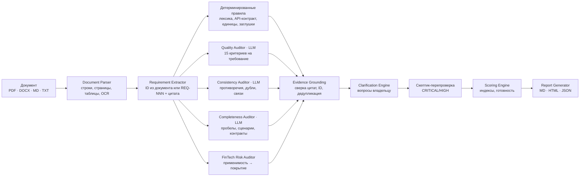

# LÜMEN Requirements Intelligence

**AI-Powered Requirements Quality & Compliance Platform** · BCC-HUB × MNU FinTech Hackathon 2026

LÜMEN — ИИ-агент, который проводит **статическую проверку документа требований до разработки**: читает документ
(PDF, DOCX, MD, TXT, HTML, RTF, фото и сканы через OCR), выделяет отдельные требования, проверяет каждое и весь набор по критериям
**ISO/IEC/IEEE 29148:2018 (п. 5.2.5, 5.2.6)** и **IEEE Std 830-1998 (п. 4.3)**, добавляет экспертный FinTech-аудит,
формирует **вопросы владельцу требований** и выпускает отчёт на русском языке, в котором каждое замечание
привязано к строке документа и подкреплено дословной цитатой.

| Компонент | Что это | Запуск |
| :--- | :--- | :--- |
| **LÜMEN Core** (CLI) | агент: документ → отчёт, одной командой | `python -m lumen -i docs/requirements.md -o reports/audit_report.md` |
| **LÜMEN Intelligence** | веб-панель: загрузка, живой прогресс, линза документа, граф, вопросы | `uvicorn lumen.api.app:app` → http://localhost:8000 |
| **REST API** | загрузка, SSE-прогресс, результаты, отчёты, статусы вопросов | http://localhost:8000/docs |
| **Telegram-бот** | файл, фото или текст → вердикт, ИИ-чат по отчёту, отчёт в PDF/Word/Excel/HTML/MD/JSON | внутри API или `python -m lumen.bot` |

---

## Бизнес-проблема

Ошибка в требованиях, найденная после старта разработки, стоит банку переписанного кода, перетестирования и сдвига
релиза. Первичное ревью ТЗ делается вручную, зависит от опыта аналитика и редко документируется. LÜMEN делает его
**за минуты, воспроизводимо и с доказательствами**: показывает, что исправить до разработки, и какие вопросы задать
владельцу продукта, чтобы их не пришлось угадывать разработчику.

Что видно в каждом прогоне (реальные метрики самого агента, без выдуманных процентов экономии): число требований,
замечаний по уровням критичности, противоречий, непроверяемых и неполных формулировок, открытых вопросов, покрытие
критериев, время прогона, число обращений к модели и токенов, доля замечаний «требует проверки».

## Как устроен агент



Принципы архитектуры:

* **Правила там, где можно решить правилом; LLM — только для смысла.** Расплывчатые слова, «и/или», смешение
  тиынов и тенге, GET для изменяющей операции, ответ 200 с телом ERROR, расхождение типов параметров, коды статусов
  без описания, пустые поля, заглушки, незаполненный чек-лист — находят детерминированные правила, бесплатно и
  воспроизводимо. Модель ищет то, что требует понимания: противоречия между разделами, пропущенные сценарии,
  применимость FinTech-рисков.
* **Один оркестратор, восемь модулей, параллельные LLM-шаги.** Никакой искусственной «команды агентов»: проверка
  требований (пакетами), согласованность, полнота и FinTech идут параллельно, затем вопросы и перепроверка.
* **Строгие контракты.** Все обмены — Pydantic-схемы; LLM отвечает в JSON по схеме (у Claude — принудительный
  tool call). Невалидный ответ → повтор с текстом ошибки; сбой API → экспоненциальный backoff; если шаг не удался,
  прогон продолжается на правилах, а отчёт честно об этом сообщает.

### База знаний терминов

`lumen/knowledge/glossary.py` — справочник банковских, платёжных и аналитических терминов с известными ловушками:
авторизация и клиринг, refund/reversal/chargeback, держатель основной и дополнительной карты, месяц учёта,
идемпотентность и повторная доставка, валюта операции, PAN и ПДн, HTTP-семантика и др. Агент передаёт модели
определения терминов, найденных в документе, а для неоднозначных терминов, которые документ не определяет, сам
создаёт замечание и вопрос владельцу требований с вариантами ответа. Это управляемая база знаний, а не дообучение:
её можно расширять без затрат. В системный промпт добавлены примеры калибровки критичности.

### Защита от галлюцинаций

1. Каждая цитата модели ищется в документе (точное и нечёткое совпадение ≥ 82 %) и **заменяется дословным
   фрагментом**; строка и страница вычисляются по файлу, а не берутся из ответа модели.
2. Цитата не найдена → замечание получает статус **«требует проверки»**, в отчёте показывается реальный текст требования.
3. Несуществующие ID требований отбрасываются; ID из документа (например, Ф-2) переводятся в ID отчёта.
4. CRITICAL/HIGH-замечания модели проходят **независимую перепроверку** (роль скептичного ревьюера): она может
   отклонить дефект или снизить критичность.
5. Отсутствие информации в документе — это пробел документа, а не утверждение, что функции нет в продукте.
6. Без LLM агент не выдаёт «READY»: готовность ставится `INSUFFICIENT DATA`.

### Критерии

Отдельное требование: однозначность, полнота, проверяемость, непротиворечивость, необходимость, атомарность,
реализуемость, прослеживаемость, корректность, отсутствие лишних проектных решений (ISO 29148 / IEEE 830) +
экспертные: входные и выходные данные, ошибки и исключения, критерии приёмки, граничные условия.

Набор: полнота, согласованность, реализуемость, понятность, валидируемость (ISO 29148 п. 5.2.6), ранжирование,
модифицируемость, прослеживаемость (IEEE 830 п. 4.3), терминология, интеграционные контракты. FinTech-аспекты
(идемпотентность, повторная доставка, денежные единицы, возвраты, конкурентные операции, доступ, ПДн и др.)
сначала оцениваются на применимость; неприменимые отмечаются N/A и дефектом не считаются.

### Шкала и готовность

`CRITICAL` блокирует реализацию или создаёт серьёзный риск · `HIGH` исправить до разработки · `MEDIUM` риск разной
интерпретации · `LOW` улучшение · `INFO` наблюдение. Индекс качества — прозрачная формула штрафов (приложение А
отчёта), **не официальная оценка по ISO**. Готовность: `READY`, `READY WITH CONDITIONS`, `NOT READY`, `INSUFFICIENT DATA`.

---

## Установка

Нужны Python 3.10+ (и Node 20+ — только для сборки веб-панели).

```bash
git clone https://github.com/Sabinochkaaa/LUMEN.git
cd LUMEN
python -m venv .venv && source .venv/bin/activate     # Windows: .venv\Scripts\activate
pip install -r requirements.txt
cp .env.example .env                                  # Windows: copy .env.example .env
```

## Ключ LLM

Достаточно **одного** ключа в `.env`; при `LLM_PROVIDER=auto` агент сам выберет провайдера.

| Провайдер | Как получить ключ | Переменные |
| :--- | :--- | :--- |
| **Claude (рекомендуется)** | https://console.anthropic.com → Settings → API Keys → Create Key | `ANTHROPIC_API_KEY=…` (модель по умолчанию `claude-opus-5-5`) |
| **Gemini (бесплатно)** | https://aistudio.google.com/apikey → Create API key | `GEMINI_API_KEY=…` (модель `gemini-flash-latest`) |
| OpenRouter (бесплатно) | https://openrouter.ai/keys | `OPENROUTER_API_KEY=…` (модели `:free`) |
| Groq (бесплатно) | https://console.groq.com/keys | `GROQ_API_KEY=…` |
| OpenAI-совместимый | OpenAI / DeepSeek / локальные | `OPENAI_API_KEY=…`, `OPENAI_BASE_URL=…`, `LLM_MODEL=…` |
| Claude Code CLI | установленный и авторизованный `claude` | `--provider claude-cli` |

**Резервные модели.** Если у модели закончилась квота или её нет на тарифе, LÜMEN сам переходит на резервные
модели того же провайдера (`LLM_FALLBACK_MODELS`), а затем — на других провайдеров, чьи ключи заданы
(`LLM_PROVIDER_CHAIN=1`). Переключение отмечается в паспорте отчёта.

Модель меняется без правки кода: `LLM_PROVIDER` и `LLM_MODEL` в `.env` или флаги `--provider` / `--model`.
Ключ не попадает в код, Git, frontend, отчёты и логи (маскируется во всех сообщениях об ошибках). Если ключ не
задан, агент сообщает об этом и работает в режиме «только правила».

Архитектура и ключевые решения с их ценой — [`docs/ARCHITECTURE.md`](docs/ARCHITECTURE.md).

## Команда агентов

| Агент | Что делает |
| --- | --- |
| Аналитик | делит ТЗ на требования и проверяет каждое по 15 критериям ISO/IEC/IEEE 29148 и IEEE 830 |
| Скептик | сверяет цитаты с файлом и перепроверяет критичные замечания |
| FinTech-эксперт | 20 банковских аспектов: валюты, повторы, возвраты, статусы, часовой пояс, ПДн |
| Переводчик | RU ⇄ KK ⇄ EN с сохранением структуры, перевод поверх фото |
| Поддержка | отвечает 24/7 на сайте (кнопка с роботом) и в Telegram по базе знаний и по отчёту пользователя; не знает — передаёт команде (`LUMEN_SUPPORT_CHAT_ID`), работает и без ключа модели по FAQ |

## Насколько агент точен: LÜMEN Bench

В чистое, аккуратно написанное ТЗ (`examples/bench/clean_spec.md`) по одному закладываются известные дефекты: нечёткие
слова, «и/или», тиыны вместе с тенге, граница суток по городу, НФТ без нагрузки, GET для изменения данных, неописанный
HTTP-код, раздел-заглушка, нет версии и согласующих, неопределённый банковский термин и другие. Бенчмарк считает,
сколько из них агент нашёл, и сколько замечаний он выдал на чистом документе (ложные срабатывания).

```bash
python -m lumen.bench                          # только правила: 15 из 15, 0 ложных — проверяется в CI
python -m lumen.bench --provider claude-cli    # + 2 смысловых дефекта, которые видит только модель
```

Результат последнего прогона — `reports/bench_rules.md`.

## Запуск одной командой

```bash
python -m lumen --input docs/requirements.md --output reports/audit_report.md
# или то же самое через корневой файл:
python main.py --input docs/requirements.md --output reports/audit_report.md
```

* вход — путь к документу (PDF, DOCX, MD, TXT, HTML, RTF, PNG/JPG), выход — путь к отчёту; директория создаётся автоматически;
* рядом с `audit_report.md` ложатся `audit_report.html` (интерактивный) и `audit_report.json` (машиночитаемый);
  нужны PDF, Word или Excel — добавьте `--formats md,html,json,pdf,docx,xlsx`;
* в терминале — прогресс 15 этапов и итог; код выхода `0` — успех, `1` — ошибка чтения/анализа, `2` — неверные аргументы.

```bash
python -m lumen docs/requirements.pdf reports/report.md --provider gemini     # другой формат и модель
python -m lumen --demo -o reports/demo.md                                     # демо без ключа
pip install -e . && lumen -i docs/requirements.md -o reports/audit_report.md  # как команда lumen
```

## Веб-панель и API

```bash
cd web && npm install && npm run build && cd ..   # один раз: собрать dashboard
uvicorn lumen.api.app:app --port 8000             # http://localhost:8000, API — /docs
```

Режим разработки: `uvicorn lumen.api.app:app --reload` и `cd web && npm run dev` (http://localhost:5173, прокси на API).

Главная страница — лендинг продукта с анимированной «линзой». Интерфейс на **трёх языках** (русский, қазақша,
English) и в **трёх темах** (светлая, тёмная, «Аврора»), выбор сохраняется в браузере.

Разделы LÜMEN Intelligence: **Обзор** (история и динамика индекса) · **Новый аудит** (drag-and-drop, выбор модели,
живой прогресс 15 этапов, линза сканирует документ) · **Требования** (карточки и матрица 15 критериев) · **Дефекты**
(фильтры, документ с отметками на строках) · **Граф связей** (противоречия, дубли, зависимости, требования без связей)
· **Вопросы владельцу** (статусы «открыт / уточнён / отклонён», ответ попадает в отчёт и пересчитывает показатели)
· **FinTech-риски** · **Сравнение версий** (что исправлено, что осталось, что появилось нового) · **Перевод
документов** (RU ⇄ KK ⇄ EN с сохранением структуры, результат в Markdown и Word) · **Отчёты** (PDF, Word, Excel, HTML,
MD, JSON) · **Настройки** · кнопка «Поделиться» ссылкой на аудит.

Основные эндпоинты: `POST /api/audits` (multipart `file`, `provider`, `model`) · `GET /api/audits/{id}/events`
(SSE) · `GET /api/audits/{id}` · `GET /api/audits/{id}/report.{md|html|json|pdf|docx|xlsx}` · `GET /api/compare?base=&new=`
· `POST /api/translate` (multipart `file`, `target` = ru|kk|en) · `POST /api/translate/docx` · `PATCH /api/audits/{id}/questions/{qid}`
· `POST /api/demo` · `GET /api/health`.

## Telegram-бот

**Отдельный сервер не нужен:** бот работает внутри того же сервиса, что и API (`LUMEN_BOT_IN_API=1`, по умолчанию).
Создайте бота у [@BotFather](https://t.me/BotFather) и впишите `TELEGRAM_BOT_TOKEN`. Локально — `python -m lumen.bot`
(не запускайте две копии с одним токеном одновременно: Telegram отдаёт обновления только одной).

Что умеет:
* принимает документ в любом поддерживаемом формате — PDF, Word, Markdown, TXT, HTML, RTF, **фото или скан** (OCR) —
  или текст требований, вставленный прямо в сообщение;
* показывает прогресс, вердикт готовности и главные дефекты; кнопки «Вопросы» и «Все критичные»;
* присылает отчёт в формате на выбор — **PDF, Word, Excel, HTML, Markdown, JSON** (кнопки, `/format` или просто
  «скинь в Excel»); формат по умолчанию — PDF;
* **перевод документа**: файл с подписью «переведи на английский» (или любой из 10 языков: казахский, русский, узбекский, кыргызский, турецкий, китайский, немецкий, французский, испанский) или та же фраза после
  анализа — бот пришлёт перевод в Word и Markdown;
* **ИИ-чат по отчёту**: «почему NOT READY?», «что не так с Ф-3?», «перепиши REQ-010», «пришли таблицей». Ответы
  строятся только по результатам аудита со ссылками на ID замечаний; без ключа модели чат отключается, отчёты работают.

## Деплой: Railway + Supabase

1. **Supabase** (необязательно, для постоянной истории): SQL Editor → выполнить `supabase/migrations/001_audits.sql`,
   затем `002_security.sql`;
   взять `Project URL` и `service_role` ключ (Settings → API). При недоступности Supabase LÜMEN продолжит работу на
   локальном хранилище.
2. **Railway**: New Project → Deploy from GitHub → этот репозиторий. Сборка по `Dockerfile` (`railway.json`,
   healthcheck `/api/health`). Variables: `ANTHROPIC_API_KEY` (или `GEMINI_API_KEY`), `SUPABASE_URL`,
   `SUPABASE_SECRET_KEY` (секретный ключ `sb_secret_…`; старое имя `SUPABASE_SERVICE_KEY` тоже работает), `TELEGRAM_BOT_TOKEN`, `LUMEN_PUBLIC_URL`, `LUMEN_ADMIN_PASSWORD` (вход администратора),
   `LUMEN_ENCRYPTION_KEY` (шифрование).
   Коммит агента берётся из `RAILWAY_GIT_COMMIT_SHA` и попадает в паспорт прогона.

## Безопасность

HTTPS + HSTS, шифрование сохранённых отчётов **AES-256-GCM**, вход администратора (HttpOnly-сессия, защита от подбора и CSRF), лимиты запросов, проверка файлов по
содержимому (исполняемые файлы, макросы, zip-бомбы), строгий CSP, приватные прогоны из бота, защита от prompt
injection, контейнер без root. Подробно и список переменных — [SECURITY.md](SECURITY.md). Схема проекта простыми
словами — [docs/GUIDE.md](docs/GUIDE.md).

## Тесты

```bash
pip install -r requirements-dev.txt
pytest -q
```

54 автотеста работают **без платного ключа** (правила + Mock LLM): PDF, DOCX, пустой и повреждённый файл,
документ без идентификаторов, неоднозначность, противоречия, дубли, неполнота, отсутствие критериев приёмки,
проблемы API-контракта, недостаточно данных, ошибка LLM API, невалидный ответ модели (повтор и безопасный отказ),
выдуманные цитаты и ID, генерация отчёта, маскирование секретов, шифрование, zip-бомбы и подмена файлов, лимиты, приватность прогонов бота, контракты провайдеров Claude/Gemini/OpenAI на заглушках HTTP, REST API, токен доступа, Telegram-бот.
CI (GitHub Actions) прогоняет тесты, офлайн-прогон документа организаторов и сборку dashboard.

## Демо-режим

`python -m lumen --demo` или `/demo` в боте (на сайте демо-кнопки нет — это рабочий продукт). Используются собственный
документ `examples/demo_requirements.md` (перевод по номеру телефона с намеренными дефектами) и **смоделированные**
ответы модели. Демо-прогоны помечены в отчёте, панели и истории и никогда не выдаются за проверку документа организаторов.

## Структура проекта

```
lumen/
  cli.py                 запуск одной командой
  config.py              конфигурация из .env, выбор провайдера, версия агента (git commit)
  models.py              контракты данных (Pydantic)
  parsing/               Document Parser: PDF (страницы, таблицы, OCR), DOCX, MD, TXT → строки + структура
  engine/
    extractor.py         Requirement Extractor: ID из документа или REQ-NNN, цитаты, типы
    rules.py             детерминированный Quality/Consistency Auditor + линтер API-контракта
    evidence.py          индекс доказательств: сверка цитат, строки и страницы
    fintech.py           LÜMEN Risk Engine
    criteria.py          каталог критериев ISO 29148 / IEEE 830
    scoring.py           Scoring Engine и готовность
    pipeline.py          оркестратор 15 этапов, параллельные LLM-шаги, перепроверка
  llm/                   слой LLM: Claude, Gemini, OpenAI-совместимый, Claude CLI, Mock; схемы и промпты
  report/render.py       Report Generator: Markdown и HTML
  service.py             фоновые прогоны с прогрессом (API и бот)
  api/app.py             FastAPI + раздача dashboard
  storage/store.py       история: локальные файлы или Supabase (с откатом на локальное)
  bot/telegram.py        Telegram-бот
  demo.py                демо-режим
web/                     LÜMEN Intelligence (React, TypeScript, Vite, Tailwind, Recharts, React Flow, Framer Motion)
tests/                   pytest
docs/requirements.md     проверяемый документ организаторов (вход, не встроен в код)
examples/                демо-документ
supabase/migrations/     схема таблицы истории
Dockerfile, railway.json деплой
```

## Ограничения

* Качество смыслового анализа зависит от модели; финальный отчёт рекомендуется получать на Claude Opus 5.5 или
  аналогичной сильной модели. Слабые модели дают больше замечаний «требует проверки».
* Без ключа LLM агент находит только то, что ловят правила, и не ставит READY (готовность `INSUFFICIENT DATA`).
* OCR сканированных PDF работает, если установлены `pytesseract`, `pillow` и системный tesseract с языком `rus`;
  иначе страница пропускается с предупреждением в отчёте.
* Экспорт в PDF — через печать HTML-отчёта из браузера (стили печати включены).
* Индекс качества — методика LÜMEN, а не сертификация по ISO.
* Хранилище Railway эфемерно: для постоянной истории подключите Supabase.
