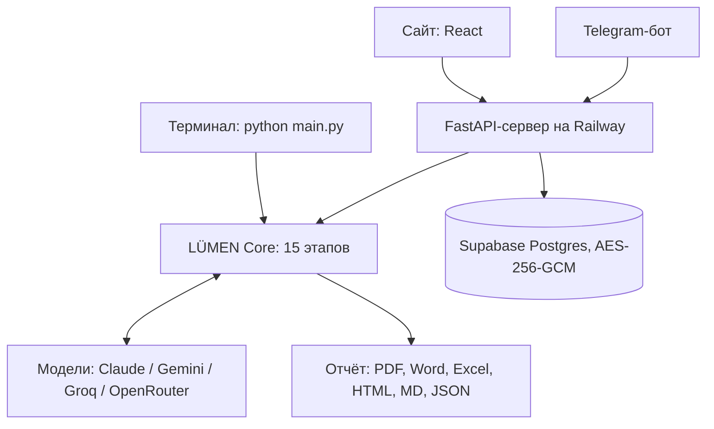

# Архитектура LÜMEN

Одно ядро (`lumen/engine`) обслуживает три канала: терминал, сайт и Telegram-бот. Поэтому один и тот же документ
даёт один и тот же отчёт везде, а новый канал добавляется без изменения логики проверки.

## Конвейер проверки

| № | Этап | Кто делает | Что получается |
| ---: | --- | --- | --- |
| 1–3 | Загрузка, проверка формата, извлечение текста | `parsing/loader.py` | строки с номерами и страницами; PDF, DOCX, MD, TXT, HTML, RTF, фото через OCR |
| 4–6 | Сегментация, выделение и классификация требований | `engine/extractor.py` | требования с ID, типом и точным местом в файле |
| 7 | Проверка каждого требования | правила + LLM | 15 критериев ISO/IEC/IEEE 29148 п. 5.2.5 и IEEE 830 п. 4.3 |
| 8–9 | Противоречия, дубли, полнота набора | правила + LLM | замечания уровня документа, граф связей |
| 10 | FinTech-аудит | `engine/fintech.py` + LLM | применимость и покрытие 20 банковских аспектов |
| 11 | Вопросы владельцу | правила + LLM | вопросы с вариантами ответа |
| 12 | Перепроверка | `pipeline._Grounder` + скептик | цитаты сверены с файлом, критичные замечания перепроверены |
| 13 | Статистика и готовность | `engine/scoring.py` | индекс 0–100 и вердикт |
| 14–15 | Отчёт и сохранение | `report/*`, `storage/store.py` | 6 форматов, история |

## Агент поддержки

`lumen/support.py` + `POST /api/support`: отвечает только по базе знаний (26 вопросов-ответов) и по данным открытой
проверки, сообщение пользователя передаётся модели как данные в тегах. Модель недоступна — ответ из FAQ по совпадению
основ слов. Понятный вопрос о продукте отвечается мгновенно из базы знаний, без модели; модели даётся не больше
12 секунд, после чего ответ берётся из базы — чат не зависает, когда бесплатная модель перегружена. Ответа нет — `escalate`: обращение сохраняется и пересылается команде в Telegram. Лимит 60 сообщений в час
на IP, 5 обращений в час.

## Ключевые решения

| Решение | Почему | Цена решения |
| --- | --- | --- |
| **Правила + LLM, а не только LLM** | Регулярные дефекты (единицы, «и/или», GET для изменения данных, пустые поля) правила находят всегда одинаково, бесплатно и офлайн. Модель нужна там, где нужен смысл: противоречия, полнота | Правила нужно поддерживать; их точность проверяет LÜMEN Bench в CI |
| **Цитата модели сверяется с файлом, строку считает код** | Главная угроза доверию — выдуманные цитаты. Совпадение ищется точно и нечётко (≥ 82 %); нет совпадения — статус «требует проверки», вердикт от него не зависит | Часть верных, но перефразированных замечаний уходит в «требует проверки» |
| **Скептик для CRITICAL и HIGH** | Вторая модель с ролью придирчивого ревьюера может понизить или отклонить замечание — меньше ложных тревог в главном | +1 запрос к модели |
| **Без успешного LLM-анализа никогда не «Готов»** | Правила не видят смысловых противоречий; честнее сказать «мало данных», чем выдать ложное «готов» | Без ключа вердикт всегда INSUFFICIENT DATA |
| **Цепочка провайдеров и резервные модели** | Бесплатные квоты заканчиваются посреди демо. Агент переходит на резервную модель или другого провайдера и отмечает это в паспорте отчёта | Качество зависит от того, какая модель ответила — это видно в паспорте |
| **Строгая JSON-схема ответа модели** | Pydantic-схема, у Claude — принудительный вызов инструмента. Невалидный ответ — повтор с текстом ошибки | Немного больше токенов |
| **Одно ядро для всех каналов** | Нет расхождений между сайтом, ботом и CLI; кэш по SHA-256 файла и temperature 0 дают тот же результат | Сервер и бот живут в одном процессе (проще деплой, но один экземпляр) |
| **Хранилище с откатом на диск** | Supabase недоступен — продукт продолжает работать на локальном хранилище, причина видна в `/api/health` | Локальная история пропадает при перезапуске контейнера |
| **Шифрование на уровне приложения** | ТЗ банка конфиденциально: AES-256-GCM до записи в базу, ключ только в переменных сервера | Без ключа старые зашифрованные отчёты не прочитать |

## Качество

* **LÜMEN Bench** (`python -m lumen.bench`): 15 заложенных дефектов, правила находят все 15, на чистом документе — 0
  ложных замечаний. Ещё 2 смысловых дефекта проверяются в режиме с моделью. Результат — `reports/bench_rules.md`.
* **67 автотестов** (`pytest -q`): конвейер, форматы, API, безопасность, бот, перевод, бенчмарк как порог качества.
* **CI** на Python 3.10 и 3.12, сборка фронтенда, офлайн-прогон на ТЗ организаторов.

## Безопасность

Подробно — `SECURITY.md`. Кратко: проверка файлов по содержимому, лимиты по IP с защитой от подмены
`X-Forwarded-For`, вход администратора через HttpOnly-cookie с отдельным ключом подписи, правка ответов только автором
проверки, CSP и HSTS, шифрование хранимых отчётов, документ — данные, а не инструкции для модели (защита от
prompt injection).

## Как масштабировать

| Нагрузка | Что меняется |
| --- | --- |
| Хакатон, пилот на одной команде | как сейчас: один контейнер, Supabase |
| Десятки одновременных проверок | очередь задач и лимиты в Redis, несколько воркеров; ядро не меняется |
| Внутри контура банка | Docker-образ в инфраструктуре банка, модель с договором о неиспользовании данных или локальная, SSO |
