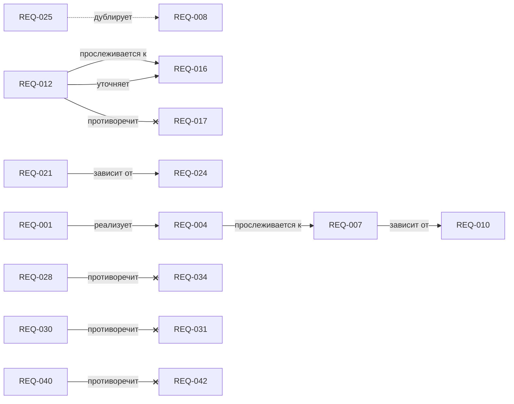

# Отчёт о проверке требований: «Уведомление о расходах по карте»

> **Итог:** ❌ NOT READY — начинать разработку и тестирование нельзя. Обнаружено 2 критических дефекта и 18 дефектов высокой критичности — разработку и тестирование начинать рано.  
> Выделено требований: **42**, подтверждённых замечаний: **66** (🔴 2 · 🟠 18 · 🟡 38 · 🔵 8), «требует проверки»: 3, вопросов владельцу: 18. Индекс качества LÜMEN: **57.0/100**.

## Коротко: что исправить в первую очередь

| # | Проблема | Где | Как исправить |
| :---: | :--- | :--- | :--- |
| 1 | 🔴 **Смешение единиц измерения (тиыны и тенге)** — Сумма покупки хранится в тиынах, а порог — в тенге. Прямое сравнение приведёт к логической ошибке (разница в 100 раз). | строка 49; REQ-011 | Хранить идентификатор карты, месяц, идентификатор операции, сумму покупки и порог в тиынах, а также признак отправки. |
| 2 | 🔴 **Противоречие метода HTTP и изменения состояния системы** — В требованиях к интеграции указано сохранение настроек через REST API (REQ-012), однако метод объявлен с типом GET (REQ-017). | строка 52; REQ-012, REQ-017 | REST type \| POST |
| 3 | 🟠 **Термин «Проведённая операция» не определён в документе** — Неоднозначно: авторизация (банк одобрил и заблокировал сумму) ≠ клиринг/проводка (операция пришла от платёжной системы и списана, обычно через 1–3 дня). | строка 38; REQ-006, REQ-009 | Добавить определение «Проведённая операция» в раздел терминов и использовать его единообразно. |
| 4 | 🟠 **Раздел «Тестирование требований» не заполнен** — Вместо содержимого раздела — заглушка «заполняются тестировщиками». | строка 57 | Заполнить раздел «Тестирование требований» до передачи в разработку. |
| 5 | 🟠 **Изменяющая операция объявлена через GET** — Метод сохраняет состояние, но объявлен как GET (безопасный и идемпотентный по RFC 9110). | строка 104; REQ-017 | REST type: PUT; Request URL: /alerts/limit; тело: {"cardId", "amount", "enabled"}. |

**Спросите у владельца требований:**

* ❓ Подтвердите единицу хранения и сравнения сумм в REQ-011: тиын или тенге? _(REQ-011)_
* ❓ Допустимо ли заменить GET на PUT/POST для операции сохранения в REQ-017? _(REQ-017)_
* ❓ По какому ключу распознаётся повтор одного события (ID операции, ID события, хеш)? Как долго хранятся обработанные ключи? _(REQ-012)_
* ❓ Планируется ли изменить HTTP-метод для сохранения настроек с GET на PUT или POST согласно RFC 9110? _(REQ-012, REQ-017)_
* ❓ Как мобильное приложение должно читать текущие настройки порога и статуса уведомлений? _(REQ-012, REQ-016)_

_Без замечаний 12 из 42 требований. Цитаты сверены с исходным текстом, строки и страницы вычислены по файлу. Ниже — полная доказательная часть._

**Содержание:** [1. Паспорт прогона](#1-паспорт-прогона) · [2. Методика](#2-методика-проверки) · [3. Нарезка требований](#3-как-агент-нарезал-требования) · [4. Проверка каждого требования](#4-проверка-каждого-требования) · [5. Проверка набора](#5-проверка-всего-набора-требований) · [6. Вопросы владельцу](#6-вопросы-к-владельцу-требований) · [7. Сводка](#7-сводка) · [8. Итог](#8-итог-можно-ли-начинать-разработку-и-тестирование) · [Приложения](#приложения)

## 1. Паспорт прогона

| Параметр | Значение |
| :--- | :--- |
| Название документа | «Уведомление о расходах по карте» |
| Файл | `requirements.md` (MARKDOWN) |
| SHA-256 файла | `e7dae55e5453a250d93e335f5ff9c7f775f4457ccddd333f4a67e47b20d74381` |
| Дата и время анализа | 27.11.2026 01:00:43 (UTC+05:00) |
| Длительность | 45.9 с |
| Модель LLM | `gemini-flash-lite-latest` — Google Gemini API |
| Режим анализа | LLM + детерминированные правила |
| Версия агента | LÜMEN 1.0.0, коммит `1c3619b90b3e` |
| Обращений к модели | 12 (ошибок/повторов: 5); токены: вход 104 005 · выход 25 434 |
| Стандарты | ISO/IEC/IEEE 29148:2018 (п. 5.2.5, 5.2.6); IEEE Std 830-1998 (п. 4.3) |
| Идентификатор прогона | `c02696f1d10c4da19309` |

**Предупреждения прогона:**

* ⚠️ 1 шаг(ов) LLM не прошли с первого раза (лимиты бесплатного тарифа) и были успешно выполнены повторно — результат полный.
* ⚠️ Основная модель gemini/gemini-flash-latest была недоступна; анализ выполнен резервной моделью gemini/gemini-flash-lite-latest.

## 2. Методика проверки

Проверка статическая — ревью текста требований до разработки (программа не запускается). Конвейер LÜMEN Core:

1. ✅ **Загрузка документа** — 13 507 байт
2. ✅ **Проверка формата и целостности** — Формат: MARKDOWN, SHA-256 e7dae55e5453…
3. ✅ **Извлечение текста, структуры, страниц и таблиц** — 199 строк, — стр., 7 таблиц
4. ✅ **Сегментация документа** — 128 блоков, 34 разделов
5. ✅ **Выделение и идентификация требований** — 42 требований, с исходным ID: 11
6. ✅ **Классификация требований** — API-контракт: 27, Функциональное: 4, Архитектура/процесс: 3, Критерий приёмки: 3, Бизнес-цель: 1, UI/UX: 1, Нефункциональное: 1, Данные: 1, Интеграция: 1
7. ✅ **Индивидуальная проверка требований** — Правила: 32 замечаний; LLM: пакетов 6/6
8. ✅ **Межтребовательная проверка (противоречия, дубли)** — LLM: 5 замечаний, 3 связей
9. ✅ **Анализ полноты документа** — LLM: 3 замечаний, 3 связей
10. ✅ **FinTech-аудит (LÜMEN Risk Engine)** — Применимо: 19, пробелов: 5
11. ✅ **Уточняющие вопросы (Clarification Engine)** — 18 вопросов к владельцу требований
12. ✅ **Перепроверка результатов и защита от галлюцинаций** — Цитаты сверены с документом; «требует проверки»: 3; отклонено перепроверкой: 0; отброшено несуществующих ID: 5
13. ✅ **Подсчёт статистики и готовности** — Индекс качества 57.0, готовность: NOT READY
14. ✅ **Генерация отчёта** — Markdown, HTML и JSON доступны для скачивания
15. ✅ **Сохранение отчёта** — Хранилище: supabase

**Защита от галлюцинаций.** Детерминированные правила (лексика, структура, API-контракт, единицы, заглушки) работают без модели. Ответы LLM принимаются только по строгой JSON-схеме (при невалидном ответе — повтор с описанием ошибки). Каждая цитата модели ищется в документе (точное и нечёткое совпадение ≥ 82%) и заменяется дословным фрагментом; при отсутствии совпадения замечание получает статус «требует проверки». Несуществующие ID требований отбрасываются. CRITICAL/HIGH-замечания модели проходят независимую перепроверку (роль скептичного ревьюера), которая может снизить критичность или отклонить дефект.

**Критерии отдельного требования** (✅ выполнено · ❌ дефект · N/A неприменимо · «·» не оценено):

| Сокр. | Критерий | Основание |
| :--- | :--- | :--- |
| Одн | Однозначность | ISO 29148 §5.2.5 Unambiguous; IEEE 830 §4.3.2 |
| Пол | Полнота | ISO 29148 §5.2.5 Complete; IEEE 830 §4.3.3 |
| Пров | Проверяемость | ISO 29148 §5.2.5 Verifiable; IEEE 830 §4.3.6 |
| Согл | Непротиворечивость | ISO 29148 §5.2.6 Consistent; IEEE 830 §4.3.4 |
| Необх | Необходимость | ISO 29148 §5.2.5 Necessary |
| Атом | Атомарность | ISO 29148 §5.2.5 Singular |
| Реал | Реализуемость | ISO 29148 §5.2.5 Feasible |
| Трас | Прослеживаемость | IEEE 830 §4.3.8; ISO 29148 §5.2.8 |
| Корр | Корректность | ISO 29148 §5.2.5 Correct; IEEE 830 §4.3.1 |
| БезПР | Без лишних проектных решений | ISO 29148 §5.2.5 Appropriate (implementation-free) |
| Вход | Определённость входных данных | LÜMEN practice (экспертная практика) |
| Выход | Определённость выходных данных | LÜMEN practice (экспертная практика) |
| Ошиб | Ошибки и исключения | LÜMEN practice (экспертная практика) |
| Приём | Критерии приёмки | LÜMEN practice (экспертная практика) |
| Гран | Граничные условия | LÜMEN practice (экспертная практика) |

**Шкала критичности:** 🔴 CRITICAL — блокирует корректную реализацию или создаёт серьёзный риск; 🟠 HIGH — исправить до разработки; 🟡 MEDIUM — риск разной интерпретации/проблем тестирования; 🔵 LOW — улучшение; ⚪ INFO — наблюдение. Нормативные замечания (по стандартам) отделены от экспертных FinTech-рекомендаций.

## 3. Как агент нарезал требования

Выделено **42** требований; собственный идентификатор в документе есть у **11**. Требованиям без номера агент присвоил свои ID (REQ-NNN), для них указано место (раздел/пункт таблицы или списка) и сохранена цитата. Метаданные (общие сведения, чек-лист ревью, согласующие) не считаются требованиями, но проверяются на уровне набора.

| ID в отчёте | ID в документе | Тип | Раздел | Место | Краткая формулировка | Цитата |
| :--- | :--- | :--- | :--- | :--- | :--- | :--- |
| REQ-001 | нет | Бизнес-цель | Часть A. Новый функционал / Цели | строка 23 | Дать клиенту возможность узнать о достижении личного бюджета в момент покупки. | «Дать клиенту возможность узнать о достижении личного бюджета в момент покупки.» |
| REQ-002 | нет | Архитектура/процесс | Часть A. Новый функционал / Архитектура решения | строка 26 | Мобильное приложение → сервис настроек. | «Мобильное приложение → сервис настроек. Карточный процессинг → учёт расходов → сервис push.» |
| REQ-003 | нет | UI/UX | Часть A. Новый функционал / Дизайн процесса UI | строка 29 | Карты → Расходы → Уведомления. | «Карты → Расходы → Уведомления. На экране видны переключатель, поле «Порог, ₸», сумма за месяц и кнопка «Сохранить». При ошибке ввода сообщение появляется под полем.» |
| REQ-004 | нет | Архитектура/процесс | Часть A. Новый функционал / Требования к изменениям / BPMN схема процесса | строка 34 | BPMN-процесс обработки покупки и отправки пуш-уведомления | «Проведение покупки → пересчёт расходов → проверка порога → при достижении отправка push → завершение.» |
| REQ-005 | Ф-1 | Функциональное | Часть A. Новый функционал / Требования к изменениям / Функциональные требования | строка 37 | Держатель активной карты KZT задаёт целый порог от 1 000 до 1 000 000 ₸ включительно. | «Ф-1. Держатель активной карты KZT задаёт целый порог от 1 000 до 1 000 000 ₸ включительно. По умолчанию уведомление выключено.» |
| REQ-006 | Ф-2 | Функциональное | Часть A. Новый функционал / Требования к изменениям / Функциональные требования | строка 38 | Месяц определяется по дате совершения покупки в Алматы. | «Ф-2. Месяц определяется по дате совершения покупки в Алматы. В расходы входят проведённые покупки. Возврат уменьшает расходы месяца исходной покупки. Переводы и снятие наличных исключаются.» |
| REQ-007 | Ф-3 | Функциональное | Часть A. Новый функционал / Требования к изменениям / Функциональные требования | строка 39 | Когда расходы переходят от суммы ниже порога к сумме, равной порогу или выше, клиент получает push. | «Ф-3. Когда расходы переходят от суммы ниже порога к сумме, равной порогу или выше, клиент получает push. На карту приходится максимум один такой push за календарный месяц.» |
| REQ-008 | Ф-4 | Функциональное | Часть A. Новый функционал / Требования к изменениям / Функциональные требования | строка 40 | При изменении порога накопленная сумма сохраняется. | «Ф-4. При изменении порога накопленная сумма сохраняется. Если она ниже нового порога, следующее достижение вызывает push независимо от истории предыдущей настройки.» |
| REQ-009 | нет | Архитектура/процесс | Часть A. Новый функционал / Sequence Diagram | строка 43 | Процессинг → сервис расходов: проведена покупка. | «Процессинг → сервис расходов: проведена покупка. Сервис расходов → настройки: получить порог карты. Сервис расходов → push: передать последние четыре цифры карты и сумму при достижении порога.» |
| REQ-010 | нет | Нефункциональное | Часть A. Новый функционал / Нефункциональные требования | строка 46 | Сервис передаёт push на отправку в течение минуты после получения события. | «Сервис передаёт push на отправку в течение минуты после получения события.» |
| REQ-011 | нет | Данные | Часть A. Новый функционал / Требования к данным | строка 49 | Требования к составу и единицам хранения данных расходов | «Хранить идентификатор карты, месяц, идентификатор операции, сумму покупки в тиынах, признак отправки и порог в тенге.» |
| REQ-012 | нет | Интеграция | Часть A. Новый функционал / Требования к интеграции | строка 52 | Интеграция настроек и идемпотентность процессинга | «Приложение читает и сохраняет настройки через дочерний документ «Уведомление о расходах по карте — REST API». Повторная доставка одного события процессинга сохраняет исходный итог.» |
| REQ-013 | нет (Критерии приемки, стр. табл. 1) | Критерий приёмки | Часть A. Новый функционал / Критерии приемки | строка 63 | Критерий приёмки достижения порога расходов | «Исходные условия: Расходы 48 500 ₸, порог 50 000 ₸; Действие: Провести покупку на 1 500 ₸; Ожидаемый результат: Итог 50 000 ₸ и один push» |
| REQ-014 | нет (Критерии приемки, стр. табл. 2) | Критерий приёмки | Часть A. Новый функционал / Критерии приемки | строка 64 | Критерий приёмки учета месяца по часовому поясу Алматы | «Исходные условия: Покупка 31 января в 23:58 на 4 000 ₸; Действие: Провести 1 февраля в 00:03 по Алматы; Ожидаемый результат: Февральский счётчик вырос на 4 000 ₸» |
| REQ-015 | нет (Критерии приемки, стр. табл. 3) | Критерий приёмки | Часть A. Новый функционал / Критерии приемки | строка 65 | Критерий приёмки исключения переводов из расходов | «Исходные условия: Расходы 19 900 ₸, порог 20 000 ₸; Действие: Перевести 500 ₸; Ожидаемый результат: Счётчик показывает 19 900 ₸» |
| REQ-016 | нет | API-контракт | Часть B. REST API | строка 97 | Дочерний документ части A: «Уведомление о расходах по карте — REST API». | «Дочерний документ части A: «Уведомление о расходах по карте — REST API».» |
| REQ-017 | нет | API-контракт | Часть B. REST API / Общие параметры | строки 103–114 | Общие параметры и описание сохранения порога через REST API | «Description: Сохранение порога. Функциональные требования: чтение порога REST type: GET Authorization: Bearer, сессия владельца карты Controller: AlertsController URL type: Dev / Prod Request URL: Dev: /alerts/saveLimit…» |
| REQ-018 | нет (Логика работы метода, п. 1) | API-контракт | Часть B. REST API / Логика работы метода | строка 117 | Проверить пользовательскую сессию. | «Проверить пользовательскую сессию.» |
| REQ-019 | нет (Логика работы метода, п. 2) | API-контракт | Часть B. REST API / Логика работы метода | строка 118 | Проверить принадлежность карты клиенту. | «Проверить принадлежность карты клиенту.» |
| REQ-020 | нет (Логика работы метода, п. 3) | API-контракт | Часть B. REST API / Логика работы метода | строка 119 | Проверить сумму и переключатель. | «Проверить сумму и переключатель.» |
| REQ-021 | нет (Логика работы метода, п. 4) | API-контракт | Часть B. REST API / Логика работы метода | строка 120 | Заменить настройку и вернуть результат сохранения. | «Заменить настройку и вернуть результат сохранения.» |
| REQ-022 | нет (Логика работы метода, п. 5) | API-контракт | Часть B. REST API / Логика работы метода | строка 121 | При отклонении суммы вернуть прежнее состояние и результат ERROR. | «При отклонении суммы вернуть прежнее состояние и результат ERROR.» |
| REQ-023 | нет (Особые правила, п. 1) | API-контракт | Часть B. REST API / Особые правила | строка 124 | Целое число тенге, обе границы включены. | «Целое число тенге, обе границы включены.» |
| REQ-024 | нет (Особые правила, п. 2) | API-контракт | Часть B. REST API / Особые правила | строка 125 | Повторное сохранение заменяет действующую настройку. | «Повторное сохранение заменяет действующую настройку.» |
| REQ-025 | нет (Особые правила, п. 3) | API-контракт | Часть B. REST API / Особые правила | строка 126 | Изменение порога сохраняет накопленные расходы. | «Изменение порога сохраняет накопленные расходы.» |
| REQ-026 | нет | API-контракт | Часть B. REST API / Схема | строки 129–131 | Приложение → AlertsController → хранилище настроек → AlertsController → приложение. | «Приложение → AlertsController → хранилище настроек → AlertsController → приложение.» |
| REQ-027 | cardId | API-контракт | Часть B. REST API / Параметры запроса / Query-параметры | строка 142 | Parameter: cardId; Format: string; Size: 1–64; Mandatory: Да; Logic: Карта клиента; Description: Идентификатор карты; D… | «Parameter: cardId; Format: string; Size: 1–64; Mandatory: Да; Logic: Карта клиента; Description: Идентификатор карты; DB field: card_id» |
| REQ-028 | amount | API-контракт | Часть B. REST API / Параметры запроса / Query-параметры | строка 143 | Parameter: amount; Format: integer; Size: 32 bit; Mandatory: Да; Logic: 1 000–1 000 000; Description: Порог в тенге; DB… | «Parameter: amount; Format: integer; Size: 32 bit; Mandatory: Да; Logic: 1 000–1 000 000; Description: Порог в тенге; DB field: limit_kzt» |
| REQ-029 | enabled | API-контракт | Часть B. REST API / Параметры запроса / Query-параметры | строка 144 | Parameter: enabled; Format: integer; Size: 1 знак; Mandatory: Да; Logic: 0 или 1; Description: Признак включения; DB fi… | «Parameter: enabled; Format: integer; Size: 1 знак; Mandatory: Да; Logic: 0 или 1; Description: Признак включения; DB field: enabled» |
| REQ-030 | нет | API-контракт | Часть B. REST API / Параметры запроса / Request body | строка 147 | Content-Type: application/json . | «Content-Type: application/json .» |
| REQ-031 | нет | API-контракт | Часть B. REST API / Параметры запроса / Request body | строка 148 | Тело не используется. | «Тело не используется.» |
| REQ-032 | нет | API-контракт | Часть B. REST API / Ответ | строка 151 | Если результат 200 или 201 — успешный. | «Если результат 200 или 201 — успешный. Если результат 400, 401 и далее — неуспешный.» |
| REQ-033 | result | API-контракт | Часть B. REST API / Ответ | строка 155 | Parameter: result; Format: string; Logic: OK / ERROR; Description: Исход сохранения; DB field: — | «Parameter: result; Format: string; Logic: OK / ERROR; Description: Исход сохранения; DB field: —» |
| REQ-034 | amount | API-контракт | Часть B. REST API / Ответ | строка 156 | Parameter: amount; Format: string; Logic: При успехе; Description: Порог в тенге; DB field: limit_kzt | «Parameter: amount; Format: string; Logic: При успехе; Description: Порог в тенге; DB field: limit_kzt» |
| REQ-035 | enabled | API-контракт | Часть B. REST API / Ответ | строка 157 | Parameter: enabled; Format: string; Logic: «0» или «1»; Description: Признак включения; DB field: enabled | «Parameter: enabled; Format: string; Logic: «0» или «1»; Description: Признак включения; DB field: enabled» |
| REQ-036 | message | API-контракт | Часть B. REST API / Ответ | строка 158 | Parameter: message; Format: string; Logic: При ошибке; Description: Описание ошибки; DB field: — | «Parameter: message; Format: string; Logic: При ошибке; Description: Описание ошибки; DB field: —» |
| REQ-037 | нет (HTTP 200) | API-контракт | Часть B. REST API / Статусы | строка 162 | 200. Ответ в случае успешного выполнения метода. | «200. Ответ в случае успешного выполнения метода.» |
| REQ-038 | нет (HTTP 400) | API-контракт | Часть B. REST API / Статусы | строка 163 | 400. Ответ в случае, если параметры запроса заполнены неверно. | «400. Ответ в случае, если параметры запроса заполнены неверно.» |
| REQ-039 | нет (HTTP 401) | API-контракт | Часть B. REST API / Статусы / 200. Successful — Created | строка 174 | 401. Ответ в случае, если запрос выполнен без необходимой авторизации. | «401. Ответ в случае, если запрос выполнен без необходимой авторизации.» |
| REQ-040 | нет (HTTP 403) | API-контракт | Часть B. REST API / Статусы / 200. Successful — Created | строка 175 | 403. Ответ в случае, если на указанный ресурс доступ запрещен. | «403. Ответ в случае, если на указанный ресурс доступ запрещен.» |
| REQ-041 | нет (HTTP 500) | API-контракт | Часть B. REST API / Статусы / 200. Successful — Created | строка 176 | 500. Ответ в случае, если произошла внутренняя ошибка сервера. | «500. Ответ в случае, если произошла внутренняя ошибка сервера.» |
| REQ-042 | нет | API-контракт | Часть B. REST API / Статусы / 403. Unsuccessful — Forbidden | строка 189 | Для чужой карты возвращается 404, как и для отсутствующей карты. | «Для чужой карты возвращается 404, как и для отсутствующей карты.» |

## 4. Проверка каждого требования

### 4.1. Матрица критериев

| ID | Балл | Одн | Пол | Пров | Согл | Необх | Атом | Реал | Трас | Корр | БезПР | Вход | Выход | Ошиб | Приём | Гран |
| :--- | ---: | :---: | :---: | :---: | :---: | :---: | :---: | :---: | :---: | :---: | :---: | :---: | :---: | :---: | :---: | :---: |
| REQ-001 | 89 | ✅ | ✅ | ❌ | ✅ | ✅ | ✅ | ✅ | ❌ | ✅ | ✅ | N/A | N/A | N/A | N/A | N/A |
| REQ-002 | 92 | ✅ | ❌ | N/A | ✅ | ✅ | ✅ | ✅ | ❌ | ✅ | ✅ | N/A | N/A | N/A | N/A | N/A |
| REQ-003 | 93 | ❌ | ✅ | ✅ | ✅ | ✅ | ❌ | ✅ | ❌ | ✅ | ✅ | ✅ | ✅ | ✅ | ✅ | ✅ |
| REQ-004 | 82 | ✅ | ❌ | N/A | ✅ | ✅ | ✅ | ✅ | ❌ | ✅ | ✅ | N/A | N/A | ❌ | N/A | N/A |
| REQ-005 | 76 | ❌ | ✅ | ✅ | ✅ | ✅ | ✅ | ✅ | ✅ | ✅ | ✅ | ✅ | ✅ | ✅ | ✅ | ✅ |
| REQ-006 | 52 | ❌ | ❌ | ✅ | ✅ | ✅ | ❌ | ✅ | ✅ | ✅ | ✅ | ✅ | ✅ | N/A | ✅ | ✅ |
| REQ-007 | 96 | ❌ | ✅ | ✅ | ✅ | ✅ | ✅ | ✅ | ✅ | ✅ | ✅ | ✅ | ✅ | ✅ | ✅ | ✅ |
| REQ-008 | 90 | ✅ | ✅ | ✅ | ✅ | ✅ | ✅ | ✅ | ✅ | ✅ | ✅ | ✅ | ✅ | N/A | ✅ | ✅ |
| REQ-009 | 69 | ❌ | ✅ | ❌ | ✅ | ✅ | ❌ | ✅ | ✅ | ✅ | ✅ | N/A | N/A | N/A | ✅ | N/A |
| REQ-010 | 68 | ✅ | ❌ | ❌ | ✅ | ✅ | ✅ | ✅ | ✅ | ✅ | ✅ | N/A | ❌ | N/A | N/A | ❌ |
| REQ-011 | 48 | ✅ | ✅ | ✅ | ❌ | ✅ | ✅ | ✅ | ✅ | ❌ | ✅ | N/A | ✅ | N/A | N/A | ✅ |
| REQ-012 | 38 | ❌ | ❌ | ❌ | ✅ | ✅ | ❌ | ✅ | ✅ | ✅ | ✅ | N/A | N/A | N/A | N/A | N/A |
| REQ-013 | 100 | ✅ | ✅ | ✅ | ✅ | ✅ | ✅ | ✅ | ✅ | ✅ | ✅ | ✅ | ✅ | N/A | ✅ | ✅ |
| REQ-014 | 100 | ✅ | ✅ | ✅ | ✅ | ✅ | ✅ | ✅ | ✅ | ✅ | ✅ | ✅ | ✅ | N/A | ✅ | ✅ |
| REQ-015 | 100 | ✅ | ✅ | ✅ | ✅ | ✅ | ✅ | ✅ | ✅ | ✅ | ✅ | ✅ | ✅ | N/A | ✅ | ✅ |
| REQ-016 | 90 | ✅ | ✅ | ✅ | ❌ | ✅ | ✅ | ✅ | ✅ | ❌ | ✅ | ❌ | ✅ | ✅ | N/A | ✅ |
| REQ-017 | 24 | ❌ | ❌ | ❌ | ✅ | ✅ | ❌ | ✅ | ✅ | ❌ | ✅ | ✅ | ✅ | ✅ | ❌ | ✅ |
| REQ-018 | 72 | ✅ | ❌ | ❌ | ✅ | ✅ | ✅ | ✅ | ✅ | ✅ | ✅ | N/A | N/A | ❌ | ❌ | N/A |
| REQ-019 | 92 | ✅ | ❌ | ❌ | ✅ | ✅ | ✅ | ✅ | ✅ | ✅ | ✅ | N/A | N/A | ❌ | ❌ | N/A |
| REQ-020 | 92 | ❌ | ❌ | ❌ | ✅ | ✅ | ✅ | ✅ | ✅ | ✅ | ✅ | ✅ | N/A | ❌ | ❌ | ✅ |
| REQ-021 | 92 | ✅ | ❌ | ❌ | ✅ | ✅ | ✅ | ✅ | ✅ | ✅ | ✅ | N/A | ✅ | N/A | ❌ | N/A |
| REQ-022 | 80 | ✅ | ❌ | ❌ | ✅ | ✅ | ✅ | ✅ | ✅ | ✅ | ✅ | N/A | ✅ | ✅ | ❌ | N/A |
| REQ-023 | 100 | ✅ | ✅ | ✅ | ✅ | ✅ | ✅ | ✅ | ✅ | ✅ | ✅ | ✅ | N/A | N/A | ✅ | ✅ |
| REQ-024 | 100 | ✅ | ✅ | ✅ | ✅ | ✅ | ✅ | ✅ | ✅ | ✅ | ✅ | ✅ | N/A | N/A | ✅ | ✅ |
| REQ-025 | 86 | ✅ | ✅ | ✅ | ✅ | ✅ | ✅ | ✅ | ✅ | ✅ | ✅ | N/A | N/A | N/A | ❌ | N/A |
| REQ-026 | 97 | ✅ | ✅ | ❌ | ✅ | ✅ | ✅ | ✅ | ✅ | ✅ | ✅ | N/A | N/A | N/A | N/A | N/A |
| REQ-027 | 94 | ✅ | ✅ | ✅ | ✅ | ✅ | ✅ | ✅ | ✅ | ✅ | ✅ | ✅ | N/A | ❌ | ❌ | ✅ |
| REQ-028 | 90 | ✅ | ✅ | ✅ | ❌ | ✅ | ✅ | ✅ | ✅ | ✅ | ✅ | ✅ | N/A | ✅ | ✅ | ✅ |
| REQ-029 | 100 | ✅ | ✅ | ✅ | ❌ | ✅ | ✅ | ✅ | ✅ | ✅ | ✅ | ✅ | N/A | ✅ | ✅ | ✅ |
| REQ-030 | 90 | ✅ | ✅ | ✅ | ❌ | ✅ | ✅ | ✅ | ✅ | ✅ | ✅ | ✅ | N/A | N/A | N/A | N/A |
| REQ-031 | 90 | ✅ | ✅ | ✅ | ❌ | ✅ | ✅ | ✅ | ✅ | ✅ | ✅ | ✅ | N/A | N/A | N/A | N/A |
| REQ-032 | 64 | ❌ | ❌ | ✅ | ❌ | ✅ | ✅ | ✅ | ✅ | ❌ | ✅ | N/A | ✅ | ✅ | N/A | ✅ |
| REQ-033 | 100 | ✅ | ✅ | ✅ | ✅ | ✅ | ✅ | ✅ | ✅ | ✅ | ✅ | N/A | ✅ | ✅ | ✅ | ✅ |
| REQ-034 | 80 | ✅ | ✅ | ✅ | ❌ | ✅ | ✅ | ✅ | ✅ | ✅ | ✅ | N/A | ✅ | N/A | ✅ | ✅ |
| REQ-035 | 100 | ✅ | ✅ | ✅ | ❌ | ✅ | ✅ | ✅ | ✅ | ✅ | ✅ | N/A | ✅ | N/A | ✅ | ✅ |
| REQ-036 | 100 | ✅ | ✅ | ✅ | ✅ | ✅ | ✅ | ✅ | ✅ | ✅ | ✅ | N/A | ✅ | ✅ | ✅ | ✅ |
| REQ-037 | 80 | ✅ | ✅ | ✅ | ❌ | ✅ | ✅ | ✅ | ✅ | ❌ | ✅ | N/A | ✅ | ✅ | ✅ | ✅ |
| REQ-038 | 100 | ✅ | ✅ | ✅ | ✅ | ✅ | ✅ | ✅ | ✅ | ✅ | ✅ | N/A | ✅ | ✅ | ✅ | ✅ |
| REQ-039 | 100 | ✅ | ✅ | ✅ | ✅ | ✅ | ✅ | ✅ | ✅ | ✅ | ✅ | N/A | ✅ | ✅ | ✅ | ✅ |
| REQ-040 | 90 | ✅ | ✅ | ✅ | ✅ | ✅ | ✅ | ✅ | ✅ | ✅ | ✅ | N/A | ✅ | ✅ | ✅ | ✅ |
| REQ-041 | 92 | ✅ | ❌ | ✅ | ✅ | ✅ | ✅ | ✅ | ✅ | ✅ | ✅ | N/A | ❌ | ✅ | N/A | N/A |
| REQ-042 | 62 | ❌ | ✅ | ✅ | ❌ | ✅ | ✅ | ✅ | ✅ | ❌ | ✅ | N/A | ✅ | ✅ | N/A | N/A |

### 4.2. Замечания по требованиям

### REQ-001 — Дать клиенту возможность узнать о достижении личного бюджета в момент покупки.

*Бизнес-цель · строка 23, раздел «Цели» · балл 89/100 · вердикт: с замечаниями*

> Дать клиенту возможность узнать о достижении личного бюджета в момент покупки.

#### 🟡 F-022 · MEDIUM · Цель неконкретна и не имеет критериев проверки

* **Критерий:** Проверяемость (ISO 29148 §5.2.5 Verifiable; IEEE 830 §4.3.6; нормативное); источник: LLM; уверенность 90%
* **Где:** строка 23, раздел «Цели»; требования: REQ-001
* **Цитата:**

  > Дать клиенту возможность узнать о достижении личного бюджета в момент покупки.

* **Что не так:** Формулировка является бизнес-целью, но не содержит проверяемых метрик (например, времени доставки уведомления).
* **Риск:** Невозможно объективно оценить успешность реализации функционала.
* **Как исправить:** Дополнить требование измеримым критерием успешности доставки.
* **Улучшенная формулировка:** _Клиент получает уведомление о достижении лимита расходов в течение <уточнить: N> секунд с момента авторизации транзакции._

#### 🔵 F-061 · LOW · Отсутствует связь с бизнес-целями или кодом задачи

* **Критерий:** Прослеживаемость (IEEE 830 §4.3.8; ISO 29148 §5.2.8; нормативное); источник: LLM; уверенность 80%
* **Где:** строка 23, раздел «Цели»; требования: REQ-001
* **Цитата:**

  > Дать клиенту возможность узнать о достижении личного бюджета в момент покупки.

* **Что не так:** Требование не имеет идентификатора источника или привязки к верхнеуровневым бизнес-целям компании.
* **Риск:** Сложно проследить обоснованность разработки при аудите.
* **Как исправить:** Добавить ID бизнес-требования.

### REQ-002 — Мобильное приложение → сервис настроек.

*Архитектура/процесс · строка 26, раздел «Архитектура решения» · балл 92/100 · вердикт: с замечаниями*

> Мобильное приложение → сервис настроек. Карточный процессинг → учёт расходов → сервис push.

#### 🟡 F-023 · MEDIUM · Архитектурная схема обрывочна и не детализирует протоколы

* **Критерий:** Полнота (ISO 29148 §5.2.5 Complete; IEEE 830 §4.3.3; нормативное); источник: LLM; уверенность 90%
* **Где:** строка 26, раздел «Архитектура решения»; требования: REQ-002
* **Цитата:**

  > Мобильное приложение → сервис настроек. Карточный процессинг → учёт расходов → сервис push.

* **Что не так:** Описание разбито на два изолированных предложения без указания протоколов взаимодействия и синхронизации между контурами процессинга и настроек.
* **Риск:** Разные разработчики могут реализовать несовместимые интеграционные интерфейсы.
* **Как исправить:** Описать единую схему потоков данных с указанием протоколов (например, REST, Kafka).
* **Улучшенная формулировка:** _Мобильное приложение взаимодействует с сервисом настроек по REST API. Карточный процессинг передает события операций через шину данных в сервис учёта расходов, который инициирует отправку через сервис push._

### REQ-003 — Карты → Расходы → Уведомления.

*UI/UX · строка 29, раздел «Дизайн процесса UI» · балл 93/100 · вердикт: с замечаниями*

> Карты → Расходы → Уведомления. На экране видны переключатель, поле «Порог, ₸», сумма за месяц и кнопка «Сохранить». При ошибке ввода сообщение появляется под полем.

#### 🟡 F-024 · MEDIUM · Термин «Месяц учёта» не определён в документе

* **Критерий:** Однозначность (ISO 29148 §5.2.5 Unambiguous; IEEE 830 §4.3.2; экспертная рекомендация); источник: правило (R-TERM-month)
* **Где:** строка 29, раздел «Дизайн процесса UI»; требования: REQ-003, REQ-006, REQ-007
* **Цитата:**

  > На экране видны переключатель, поле «Порог, ₸», сумма за месяц и кнопка «Сохранить».

* **Что не так:** Неоднозначно: календарный месяц ≠ расчётный период (billing cycle) карты; нужна граница по часовому поясу и по какой дате (покупки, авторизации, клиринга) относить операцию. В документе термин используется (REQ-003, REQ-006, REQ-007), но не определён.
* **Риск:** Разработка, тестирование и бизнес поймут термин по-разному; расхождение всплывёт только на приёмке.
* **Как исправить:** Добавить определение «Месяц учёта» в раздел терминов и использовать его единообразно.

#### 🔵 F-062 · LOW · Неатомарное требование (3 утверждения)

* **Критерий:** Атомарность (ISO 29148 §5.2.5 Singular; нормативное); источник: правило (R-ATOMIC)
* **Где:** строка 29, раздел «Дизайн процесса UI»; требования: REQ-003
* **Цитата:**

  > Карты → Расходы → Уведомления. На экране видны переключатель, поле «Порог, ₸», сумма за месяц и кнопка «Сохранить». При ошибке ввода сообщение появляется под полем.

* **Что не так:** В одном пункте объединены 3 самостоятельных утверждения.
* **Риск:** Сложно трассировать к тестам и частично принимать; изменения затрагивают всё сразу.
* **Как исправить:** Разбить на отдельные пронумерованные требования, по одному проверяемому утверждению.

### REQ-004 — BPMN-процесс обработки покупки и отправки пуш-уведомления

*Архитектура/процесс · строка 34, раздел «BPMN схема процесса» · балл 82/100 · вердикт: не принято*

> Проведение покупки → пересчёт расходов → проверка порога → при достижении отправка push → завершение.

#### 🟡 F-025 · MEDIUM · В процессной схеме отсутствуют ветки обработки ошибок

* **Критерий:** Ошибки и исключения (LÜMEN practice; экспертная рекомендация); источник: LLM; уверенность 85%
* **Где:** строка 34, раздел «BPMN схема процесса»; требования: REQ-004
* **Цитата:**

  > Проведение покупки → пересчёт расходов → проверка порога → при достижении отправка push → завершение.

* **Что не так:** Не описано поведение системы при сбое сервиса отправки push или недоступности хранилища расходов.
* **Риск:** При сбоях интеграций процесс может зависнуть или транзакция пройдёт без фиксации.
* **Как исправить:** Добавить альтернативные ветки BPMN для обработки таймаутов и ошибок.
* **Улучшенная формулировка:** _Проведение покупки → пересчёт расходов → проверка порога → при достижении отправка push (в случае ошибки — повтор/логирование) → завершение._

### REQ-005 (Ф-1) — Держатель активной карты KZT задаёт целый порог от 1 000 до 1 000 000 ₸ включительно.

*Функциональное · строка 37, раздел «Функциональные требования» · балл 76/100 · вердикт: с замечаниями*

> Ф-1. Держатель активной карты KZT задаёт целый порог от 1 000 до 1 000 000 ₸ включительно. По умолчанию уведомление выключено.

#### 🟡 F-026 · MEDIUM · Термин «Держатель карты» не определён в документе

* **Критерий:** Однозначность (ISO 29148 §5.2.5 Unambiguous; IEEE 830 §4.3.2; экспертная рекомендация); источник: правило (R-TERM-cardholder)
* **Где:** строка 37, раздел «Функциональные требования»; требования: REQ-005
* **Цитата:**

  > Держатель активной карты KZT задаёт целый порог от 1 000 до 1 000 000 ₸ включительно.

* **Что не так:** Неоднозначно для доп. карт: основной держатель счёта ≠ держатель дополнительной карты; у одного клиента может быть несколько карт на одном счёте. В документе термин используется (REQ-005), но не определён.
* **Риск:** Разработка, тестирование и бизнес поймут термин по-разному; расхождение всплывёт только на приёмке.
* **Как исправить:** Добавить определение «Держатель карты» в раздел терминов и использовать его единообразно.

#### 🟡 F-027 · MEDIUM · Термин «Активная карта» не определён в документе

* **Критерий:** Однозначность (ISO 29148 §5.2.5 Unambiguous; IEEE 830 §4.3.2; экспертная рекомендация); источник: правило (R-TERM-active_card)
* **Где:** строка 37, раздел «Функциональные требования»; требования: REQ-005
* **Цитата:**

  > Держатель активной карты KZT задаёт целый порог от 1 000 до 1 000 000 ₸ включительно.

* **Что не так:** Требует перечня статусов: активна, заблокирована временно, заблокирована навсегда, истёк срок, перевыпущена. В документе термин используется (REQ-005), но не определён.
* **Риск:** Разработка, тестирование и бизнес поймут термин по-разному; расхождение всплывёт только на приёмке.
* **Как исправить:** Добавить определение «Активная карта» в раздел терминов и использовать его единообразно.

#### 🟡 F-028 · MEDIUM · Термин «Валюта операции» не определён в документе

* **Критерий:** Однозначность (ISO 29148 §5.2.5 Unambiguous; IEEE 830 §4.3.2; экспертная рекомендация); источник: правило (R-TERM-currency)
* **Где:** строка 37, раздел «Функциональные требования»; требования: REQ-005
* **Цитата:**

  > Держатель активной карты KZT задаёт целый порог от 1 000 до 1 000 000 ₸ включительно.

* **Что не так:** Валюта операции ≠ валюта счёта/карты; при покупке за рубежом сумма в KZT известна точно только после клиринга (курс конвертации). В документе термин используется (REQ-005), но не определён.
* **Риск:** Разработка, тестирование и бизнес поймут термин по-разному; расхождение всплывёт только на приёмке.
* **Как исправить:** Добавить определение «Валюта операции» в раздел терминов и использовать его единообразно.

### REQ-006 (Ф-2) — Месяц определяется по дате совершения покупки в Алматы.

*Функциональное · строка 38, раздел «Функциональные требования» · балл 52/100 · вердикт: не принято*

> Ф-2. Месяц определяется по дате совершения покупки в Алматы. В расходы входят проведённые покупки. Возврат уменьшает расходы месяца исходной покупки. Переводы и снятие наличных исключаются.

#### 🟠 F-003 · HIGH · Термин «Проведённая операция» не определён в документе

* **Критерий:** Однозначность (ISO 29148 §5.2.5 Unambiguous; IEEE 830 §4.3.2; экспертная рекомендация); источник: правило (R-TERM-posted)
* **Где:** строка 38, раздел «Функциональные требования»; требования: REQ-006, REQ-009
* **Цитата:**

  > В расходы входят проведённые покупки.

* **Что не так:** Неоднозначно: авторизация (банк одобрил и заблокировал сумму) ≠ клиринг/проводка (операция пришла от платёжной системы и списана, обычно через 1–3 дня). Дата и сумма могут отличаться; авторизация может быть отменена. В документе термин используется (REQ-006, REQ-009), но не определён.
* **Риск:** Разработка, тестирование и бизнес поймут термин по-разному; расхождение всплывёт только на приёмке.
* **Как исправить:** Добавить определение «Проведённая операция» в раздел терминов и использовать его единообразно.

#### 🟠 F-004 · HIGH · Не определена обработка возвратов, пришедших в другом месяце

* **Критерий:** Полнота (ISO 29148 §5.2.5 Complete; IEEE 830 §4.3.3; нормативное); источник: LLM; уверенность 90%
* **Где:** строка 38, раздел «Функциональные требования»; требования: REQ-006
* **Цитата:**

  > Ф-2. Месяц определяется по дате совершения покупки в Алматы. В расходы входят проведённые покупки. Возврат уменьшает расходы месяца исходной покупки. Переводы и снятие наличных исключаются.

* **Что не так:** Если покупка была в январе, а возврат пришёл в феврале, не указано, пересчитывается ли закрытый январский счётчик и может ли баланс уйти в минус.
* **Риск:** Искажение исторической отчётности и некорректная отправка повторных пуш-уведомлений.
* **Как исправить:** Уточнить правила учёта возвратов за прошлые периоды.
* **Улучшенная формулировка:** _Возврат уменьшает расходы месяца исходной покупки. Если исходный месяц закрыт, <уточнить: пересчет не выполняется / корректируется текущий баланс>._

#### 🟡 F-029 · MEDIUM · Термин «Возврат» не определён в документе

* **Критерий:** Однозначность (ISO 29148 §5.2.5 Unambiguous; IEEE 830 §4.3.2; экспертная рекомендация); источник: правило (R-TERM-refund)
* **Где:** строка 38, раздел «Функциональные требования»; требования: REQ-006
* **Цитата:**

  > Возврат уменьшает расходы месяца исходной покупки.

* **Что не так:** Неоднозначно: refund (возврат средств продавцом, отдельная операция, может быть частичным и прийти в другом месяце) ≠ reversal (отмена авторизации до клиринга) ≠ chargeback (опротестование через банк). В документе термин используется (REQ-006), но не определён.
* **Риск:** Разработка, тестирование и бизнес поймут термин по-разному; расхождение всплывёт только на приёмке.
* **Как исправить:** Добавить определение «Возврат» в раздел терминов и использовать его единообразно.

#### 🔵 F-063 · LOW · Неатомарное требование (4 утверждения)

* **Критерий:** Атомарность (ISO 29148 §5.2.5 Singular; нормативное); источник: правило (R-ATOMIC)
* **Где:** строка 38, раздел «Функциональные требования»; требования: REQ-006
* **Цитата:**

  > Ф-2. Месяц определяется по дате совершения покупки в Алматы. В расходы входят проведённые покупки. Возврат уменьшает расходы месяца исходной покупки. Переводы и снятие наличных исключаются.

* **Что не так:** В одном пункте объединены 4 самостоятельных утверждения.
* **Риск:** Сложно трассировать к тестам и частично принимать; изменения затрагивают всё сразу.
* **Как исправить:** Разбить на отдельные пронумерованные требования, по одному проверяемому утверждению.

#### 🔵 F-064 · LOW · Часовой пояс задан городом, без смещения UTC

* **Критерий:** Однозначность (ISO 29148 §5.2.5 Unambiguous; IEEE 830 §4.3.2; экспертная рекомендация); источник: правило (R-TZ)
* **Где:** строка 38, раздел «Функциональные требования»; требования: REQ-006
* **Цитата:**

  > Месяц определяется по дате совершения покупки в Алматы.

* **Что не так:** Граница суток/месяца привязана к городу, но не указано смещение UTC и источник времени.
* **Риск:** Покупки около полуночи попадут не в тот месяц при расхождении часовых поясов серверов.
* **Как исправить:** Указать часовой пояс явно (например, UTC+5, IANA Asia/Almaty) и источник метки времени события.

### REQ-009 — Процессинг → сервис расходов: проведена покупка.

*Архитектура/процесс · строка 43, раздел «Sequence Diagram» · балл 69/100 · вердикт: не принято*

> Процессинг → сервис расходов: проведена покупка. Сервис расходов → настройки: получить порог карты. Сервис расходов → push: передать последние четыре цифры карты и сумму при достижении порога.

#### 🟡 F-032 · MEDIUM · Отсутствуют критерии проверки взаимодействия

* **Критерий:** Проверяемость (ISO 29148 §5.2.5 Verifiable; IEEE 830 §4.3.6; нормативное); источник: LLM; уверенность 85%
* **Где:** строка 43, раздел «Sequence Diagram»; требования: REQ-009
* **Цитата:**

  > Процессинг → сервис расходов: проведена покупка. Сервис расходов → настройки: получить порог карты. Сервис расходов → push: передать последние четыре цифры карты и сумму при достижении порога.

* **Что не так:** Шаг описан высокоуровнево без указания протоколов, форматов сообщений и таймаутов, что затрудняет сквозное тестирование.
* **Риск:** Разночтения между командами при реализации интеграционных контрактов.
* **Как исправить:** Добавить ссылки на спецификации API/событий шины данных.
* **Улучшенная формулировка:** _Сервис расходов принимает событие покупки по контракту <уточнить: ID контракта> и запрашивает порог._

#### 🔵 F-065 · LOW · Неатомарное требование (3 утверждения)

* **Критерий:** Атомарность (ISO 29148 §5.2.5 Singular; нормативное); источник: правило (R-ATOMIC)
* **Где:** строка 43, раздел «Sequence Diagram»; требования: REQ-009
* **Цитата:**

  > Процессинг → сервис расходов: проведена покупка. Сервис расходов → настройки: получить порог карты. Сервис расходов → push: передать последние четыре цифры карты и сумму при достижении порога.

* **Что не так:** В одном пункте объединены 3 самостоятельных утверждения.
* **Риск:** Сложно трассировать к тестам и частично принимать; изменения затрагивают всё сразу.
* **Как исправить:** Разбить на отдельные пронумерованные требования, по одному проверяемому утверждению.

### REQ-010 — Сервис передаёт push на отправку в течение минуты после получения события.

*Нефункциональное · строка 46, раздел «Нефункциональные требования» · балл 68/100 · вердикт: не принято*

> Сервис передаёт push на отправку в течение минуты после получения события.

#### 🟠 F-006 · HIGH · Отсутствуют перцентиль и профиль нагрузки для НФТ

* **Критерий:** Проверяемость (ISO 29148 §5.2.5 Verifiable; IEEE 830 §4.3.6; нормативное); источник: LLM
* **Где:** строка 46, раздел «Нефункциональные требования»; требования: REQ-010
* **Цитата:**

  > Сервис передаёт push на отправку в течение минуты после получения события.

* **Что не так:** Не указано, для какого процента запросов (например, 95% или 99%) действует лимит в одну минуту и при какой нагрузке (TPS).
* **Риск:** Невозможность объективно принять нагрузочное тестирование.
* **Как исправить:** Добавить перцентиль и целевые показатели TPS.
* **Улучшенная формулировка:** _95% push-уведомлений передаются на отправку сервису рассылки ≤ 60 с после получения события при нагрузке до <уточнить: N> TPS._

#### 🟡 F-033 · MEDIUM · Временное ограничение без профиля нагрузки и доли запросов

* **Критерий:** Проверяемость (ISO 29148 §5.2.5 Verifiable; IEEE 830 §4.3.6; нормативное); источник: правило (R-NFR-PROFILE)
* **Где:** строка 46, раздел «Нефункциональные требования»; требования: REQ-010
* **Цитата:**

  > Сервис передаёт push на отправку в течение минуты после получения события.

* **Что не так:** Не указаны нагрузка, перцентиль и точки начала/окончания измерения.
* **Риск:** Требование «выполнено» на одном событии и нарушено под пиковой нагрузкой.
* **Как исправить:** Добавить: при нагрузке N событий/с, для 95–99% событий, время от T1 (получение) до T2 (передача).

### REQ-011 — Требования к составу и единицам хранения данных расходов

*Данные · строка 49, раздел «Требования к данным» · балл 48/100 · вердикт: не принято*

> Хранить идентификатор карты, месяц, идентификатор операции, сумму покупки в тиынах, признак отправки и порог в тенге.

#### 🔴 F-001 · CRITICAL · Смешение единиц измерения (тиыны и тенге)

* **Критерий:** Непротиворечивость (ISO 29148 §5.2.6 Consistent; IEEE 830 §4.3.4; нормативное); источник: LLM
* **Где:** строка 49, раздел «Требования к данным»; требования: REQ-011
* **Цитата:**

  > Хранить идентификатор карты, месяц, идентификатор операции, сумму покупки в тиынах, признак отправки и порог в тенге.

* **Что не так:** Сумма покупки хранится в тиынах, а порог — в тенге. Прямое сравнение приведёт к логической ошибке (разница в 100 раз).
* **Риск:** Критическая финансовая ошибка: уведомления будут отправляться некорректно или вообще перестанут срабатывать.
* **Как исправить:** Привести все денежные поля к единой единице измерения (тиыны).
* **Улучшенная формулировка:** _Хранить идентификатор карты, месяц, идентификатор операции, сумму покупки и порог в тиынах, а также признак отправки._

#### 🟡 F-035 · MEDIUM · Смешение денежных единиц (тиын и тенге)

* **Критерий:** Непротиворечивость (ISO 29148 §5.2.6 Consistent; IEEE 830 §4.3.4; нормативное); источник: правило (R-UNITS)
* **Где:** строка 49, раздел «Требования к данным»; требования: REQ-011
* **Цитата:**

  > Хранить идентификатор карты, месяц, идентификатор операции, сумму покупки в тиынах, признак отправки и порог в тенге.

* **Что не так:** В одном требовании величины заданы в разных единицах: тиын и тенге.
* **Риск:** Ошибка масштаба ×100 при сравнении суммы с порогом — ложные или пропущенные уведомления.
* **Как исправить:** Хранить и сравнивать все суммы в одной минимальной единице (тиын), явно описать преобразование для отображения.

### REQ-012 — Интеграция настроек и идемпотентность процессинга

*Интеграция · строка 52, раздел «Требования к интеграции» · балл 38/100 · вердикт: не принято*

> Приложение читает и сохраняет настройки через дочерний документ «Уведомление о расходах по карте — REST API». Повторная доставка одного события процессинга сохраняет исходный итог.

#### 🟠 F-007 · HIGH · Не определен механизм обеспечения идемпотентности

* **Критерий:** Однозначность (ISO 29148 §5.2.5 Unambiguous; IEEE 830 §4.3.2; нормативное); источник: LLM; уверенность 90%
* **Где:** строка 52, раздел «Требования к интеграции»; требования: REQ-012
* **Цитата:**

  > Приложение читает и сохраняет настройки через дочерний документ «Уведомление о расходах по карте — REST API». Повторная доставка одного события процессинга сохраняет исходный итог.

* **Что не так:** Не указано, за счет чего достигается идемпотентность (например, по уникальному идентификатору операции) и как долго хранятся ключи дедупликации.
* **Риск:** Двойной учет сумм при повторной доставке сообщений из шины.
* **Как исправить:** Описать использование уникального идентификатора операции (operationId) для проверки дубликатов.
* **Улучшенная формулировка:** _При повторной доставке события процессинга с тем же `operationId` система игнорирует его, сохраняя текущий итог расходов._

#### 🟡 F-037 · MEDIUM · Термин «Идемпотентность» не определён в документе

* **Критерий:** Однозначность (ISO 29148 §5.2.5 Unambiguous; IEEE 830 §4.3.2; экспертная рекомендация); источник: правило (R-TERM-idempotency)
* **Где:** строка 52, раздел «Требования к интеграции»; требования: REQ-012
* **Цитата:**

  > Повторная доставка одного события процессинга сохраняет исходный итог.

* **Что не так:** Повторная обработка того же события/запроса не меняет результат. Требует ключа идемпотентности (ID операции/события) и срока хранения обработанных ключей. В документе термин используется (REQ-012), но не определён.
* **Риск:** Разработка, тестирование и бизнес поймут термин по-разному; расхождение всплывёт только на приёмке.
* **Как исправить:** Добавить определение «Идемпотентность» в раздел терминов и использовать его единообразно.

### REQ-017 — Общие параметры и описание сохранения порога через REST API

*API-контракт · строки 103–114, раздел «Общие параметры» · балл 24/100 · вердикт: не принято*

> Description: Сохранение порога. Функциональные требования: чтение порога
> REST type: GET
> Authorization: Bearer, сессия владельца карты
> Controller: AlertsController
> URL type: Dev / Prod
> Request URL: Dev: /alerts/saveLimit . Prod: —
> CURL: curl -G "$BASE/alerts/saveLimit" -H "Authorization: Bearer $TOKEN" --data 'cardId=demo-42&amount=50000&enabled=1'
> Swagger: —
> Gitlab project: Учебный контур
> Framework: Учебный контур
> Author: Школа тестирования
> Developer: Команда практикума

#### 🟠 F-010 · HIGH · Изменяющая операция объявлена через GET

* **Критерий:** Корректность (ISO 29148 §5.2.5 Correct; IEEE 830 §4.3.1; нормативное); источник: правило + LLM (API-GET-MUTATION)
* **Где:** строка 104, раздел «Общие параметры»; требования: REQ-017
* **Цитата:**

  > REST type | GET

* **Что не так:** Метод сохраняет состояние, но объявлен как GET (безопасный и идемпотентный по RFC 9110).
* **Риск:** Кэширование/предзагрузка прокси и браузеров может повторно изменить настройку; параметры попадают в URL и логи; повышается риск CSRF.
* **Как исправить:** Использовать PUT (замена настройки) или POST, параметры передавать в теле JSON.
* **Улучшенная формулировка:** _REST type: PUT; Request URL: /alerts/limit; тело: {"cardId", "amount", "enabled"}._

#### 🟡 F-042 · MEDIUM · Содержит несколько разнородных описаний в одном поле

* **Критерий:** Атомарность (ISO 29148 §5.2.5 Singular; нормативное); источник: LLM; уверенность 90%
* **Где:** строка 103, раздел «Общие параметры»; требования: REQ-017
* **Цитата:**

  > Description | Сохранение порога. Функциональные требования: чтение порога

* **Что не так:** Поле Description объединяет описание сохранения порога и упоминание чтения порога.
* **Риск:** Путаница при генерации документации и поиске требований.
* **Как исправить:** Разделить описание на отдельные логические элементы.
* **Улучшенная формулировка:** _Description: Сохранение порога расходов по карте._

#### 🟡 F-043 · MEDIUM · Отсутствует критерий приёмки для метода

* **Критерий:** Проверяемость (ISO 29148 §5.2.5 Verifiable; IEEE 830 §4.3.6; нормативное); источник: LLM; уверенность 85%
* **Где:** строка 103, раздел «Общие параметры»; требования: REQ-017
* **Цитата:**

  > Description | Сохранение порога. Функциональные требования: чтение порога

* **Что не так:** Для метода не указаны прямые критерии проверки успешности и неуспешности выполнения.
* **Риск:** Разные сценарии тестирования у разработчиков и тестировщиков.
* **Как исправить:** Добавить привязку к критериям приёмки или тест-кейсам.
* **Улучшенная формулировка:** _<уточнить: добавить ссылки на тест-кейсы приёмки метода>_

#### 🟡 F-045 · MEDIUM · Не заполнено значение «Prod»

* **Критерий:** Полнота (ISO 29148 §5.2.5 Complete; IEEE 830 §4.3.3; нормативное); источник: правило (R-EMPTY-VALUE)
* **Где:** строка 108, раздел «Общие параметры»; требования: REQ-017
* **Цитата:**

  > Prod: —

* **Что не так:** Поле «Prod» оставлено пустым (прочерк).
* **Риск:** Исполнитель не получит необходимые данные; интеграция/выпуск будут заблокированы.
* **Как исправить:** Заполнить «Prod» или явно указать «не применимо» с обоснованием.

#### 🟡 F-046 · MEDIUM · Пустое поле контракта «swagger»

* **Критерий:** Полнота (ISO 29148 §5.2.5 Complete; IEEE 830 §4.3.3; нормативное); источник: правило (API-EMPTY-FIELD)
* **Где:** строка 110, раздел «Общие параметры»; требования: REQ-017
* **Цитата:**

  > Swagger | —

* **Что не так:** Поле «swagger» не заполнено.
* **Риск:** Неполный контракт: потребители API не смогут интегрироваться или сверить реализацию.
* **Как исправить:** Заполнить «swagger» или указать «не применимо» с причиной.

### REQ-018 — Проверить пользовательскую сессию.

*API-контракт · строка 117, раздел «Логика работы метода» · балл 72/100 · вердикт: не принято*

> Проверить пользовательскую сессию.

#### 🟠 F-011 · HIGH · Не указан механизм и источник проверки сессии

* **Критерий:** Полнота (ISO 29148 §5.2.5 Complete; IEEE 830 §4.3.3; нормативное); источник: LLM; уверенность 90%
* **Где:** строка 117, раздел «Логика работы метода»; требования: REQ-018
* **Цитата:**

  > Проверить пользовательскую сессию.

* **Что не так:** Не уточняется, как именно проверяется сессия (токен, куки, интеграция с OAuth-сервером) и какой код возвращается при её истечении.
* **Риск:** Нестандартная реализация авторизации в контроллере.
* **Как исправить:** Уточнить детали валидации сессии.
* **Улучшенная формулировка:** _Проверить валидность Bearer-токена сессии владельца карты во внешнем сервисе аутентификации._

#### 🟡 F-047 · MEDIUM · Не указан код ошибки при невалидной сессии

* **Критерий:** Ошибки и исключения (LÜMEN practice; экспертная рекомендация); источник: LLM; уверенность 90%
* **Где:** строка 117, раздел «Логика работы метода»; требования: REQ-018
* **Цитата:**

  > Проверить пользовательскую сессию.

* **Что не так:** Требование не ссылается на код 401 Unauthorized при невалидной сессии в рамках этого шага. [Критичность снижена перепроверкой с HIGH: Дефект реален (в шаге 1 не указан конкретный код возврата), но критичность HIGH завышена, так как в дальнейшем тексте (строки 174, 183) код 401 для Unauthorized]
* **Риск:** Разработчик может вернуть неверный HTTP-статус.
* **Как исправить:** Явно указать возвращаемый статус ошибки.
* **Улучшенная формулировка:** _Проверить пользовательскую сессию; при истечении или невалидности вернуть статус 401._

### REQ-019 — Проверить принадлежность карты клиенту.

*API-контракт · строка 118, раздел «Логика работы метода» · балл 92/100 · вердикт: с замечаниями*

> Проверить принадлежность карты клиенту.

#### 🟡 F-048 · MEDIUM · Не указан источник данных для проверки принадлежности карты

* **Критерий:** Полнота (ISO 29148 §5.2.5 Complete; IEEE 830 §4.3.3; нормативное); источник: LLM; уверенность 85%
* **Где:** строка 118, раздел «Логика работы метода»; требования: REQ-019
* **Цитата:**

  > Проверить принадлежность карты клиенту.

* **Что не так:** Не указано, какая именно система или БД используется для проверки связи клиента и карты.
* **Риск:** Ошибки интеграции с процессингом или бэк-офисом.
* **Как исправить:** Указать источник данных для проверки связки.
* **Улучшенная формулировка:** _Проверить по справочнику процессинга принадлежность карты `cardId` текущему клиенту из сессии._

### REQ-020 — Проверить сумму и переключатель.

*API-контракт · строка 119, раздел «Логика работы метода» · балл 92/100 · вердикт: с замечаниями*

> Проверить сумму и переключатель.

#### 🟡 F-049 · MEDIUM · Не определены конкретные правила проверки суммы и переключателя

* **Критерий:** Однозначность (ISO 29148 §5.2.5 Unambiguous; IEEE 830 §4.3.2; нормативное); источник: LLM
* **Где:** строка 119, раздел «Логика работы метода»; требования: REQ-020
* **Цитата:**

  > Проверить сумму и переключатель.

* **Что не так:** Фраза слишком общая и не описывает диапазоны (1 000 – 1 000 000) и допустимые значения переключателя (0 или 1).
* **Риск:** Пропуск валидации граничных значений на бэкенде.
* **Как исправить:** Конкретизировать диапазоны и допустимые значения проверки.
* **Улучшенная формулировка:** _Проверить, что `amount` находится в диапазоне от 1 000 до 1 000 000 включительно, а `enabled` равен 0 или 1._

### REQ-021 — Заменить настройку и вернуть результат сохранения.

*API-контракт · строка 120, раздел «Логика работы метода» · балл 92/100 · вердикт: с замечаниями*

> Заменить настройку и вернуть результат сохранения.

#### 🟡 F-050 · MEDIUM · Не описан формат успешного ответа при замене настройки

* **Критерий:** Полнота (ISO 29148 §5.2.5 Complete; IEEE 830 §4.3.3; нормативное); источник: LLM; уверенность 90%
* **Где:** строка 120, раздел «Логика работы метода»; требования: REQ-021
* **Цитата:**

  > Заменить настройку и вернуть результат сохранения.

* **Что не так:** Не указана структура успешного JSON-ответа (например, поля result, amount, enabled).
* **Риск:** Клиентское приложение может не распарсить ответ.
* **Как исправить:** Добавить ссылку на структуру ответа 200 OK.
* **Улучшенная формулировка:** _Заменить настройку в хранилище и вернуть JSON с результатом ОК и сохранёнными параметрами._

### REQ-022 — При отклонении суммы вернуть прежнее состояние и результат ERROR.

*API-контракт · строка 121, раздел «Логика работы метода» · балл 80/100 · вердикт: не принято*

> При отклонении суммы вернуть прежнее состояние и результат ERROR.

#### 🟠 F-012 · HIGH · Непонятно, что значит «прежнее состояние» при отклонении суммы

* **Критерий:** Полнота (ISO 29148 §5.2.5 Complete; IEEE 830 §4.3.3; нормативное); источник: LLM; уверенность 90%
* **Где:** строка 121, раздел «Логика работы метода»; требования: REQ-022
* **Цитата:**

  > При отклонении суммы вернуть прежнее состояние и результат ERROR.

* **Что не так:** Если запрос содержит невалидную сумму, настройки ещё не были заменены, поэтому возвращать «прежнее состояние» технически нечего (или это сохранение старого значения).
* **Риск:** Неправильная логика транзакции или кэширования.
* **Как исправить:** Уточнить формулировку про неизменность текущей настройки.
* **Улучшенная формулировка:** _При некорректной сумме не изменять действующую настройку в базе данных и вернуть JSON с результатом ERROR._

### REQ-025 — Изменение порога сохраняет накопленные расходы.

*API-контракт · строка 126, раздел «Особые правила» · балл 86/100 · вердикт: с замечаниями*

> Изменение порога сохраняет накопленные расходы.

#### 🟡 F-051 · MEDIUM · Отсутствует критерий приёмки для сохранения расходов при изменении порога

* **Критерий:** Критерии приёмки (LÜMEN practice; экспертная рекомендация); источник: LLM; уверенность 90%
* **Где:** строка 126, раздел «Особые правила»; требования: REQ-025
* **Цитата:**

  > Изменение порога сохраняет накопленные расходы.

* **Что не так:** Для требования не указан явный сценарий проверки (дано — когда — тогда) с конкретными числовыми значениями.
* **Риск:** Риск пропустить дефект, при котором изменение порога случайно сбрасывает счётчик расходов.
* **Как исправить:** Добавить критерий приёмки с проверкой неизменности накопленной суммы расходов при обновлении порога.
* **Улучшенная формулировка:** _Критерий приёмки: при текущих расходах 15 000 ₸ изменение порога с 20 000 ₸ на 30 000 ₸ оставляет счётчик расходов равным 15 000 ₸._

### REQ-026 — Приложение → AlertsController → хранилище настроек → AlertsController → приложение.

*API-контракт · строки 129–131, раздел «Схема» · балл 97/100 · вердикт: принято*

> Приложение → AlertsController → хранилище настроек → AlertsController → приложение.

#### 🔵 F-067 · LOW · Архитектурная схема описана текстом без возможности автоматизированной проверки

* **Критерий:** Проверяемость (ISO 29148 §5.2.5 Verifiable; IEEE 830 §4.3.6; нормативное); источник: LLM; уверенность 80%
* **Где:** строка 130, раздел «Схема»; требования: REQ-026
* **Цитата:**

  > Приложение → AlertsController → хранилище настроек → AlertsController → приложение.

* **Что не так:** Текстовая схема не содержит метрик или проверяемых артефактов для тестирования.
* **Риск:** Сложность проверки соблюдения архитектурного потока в автоматических тестах.
* **Как исправить:** Оформить взаимодействие в виде Sequence Diagram или спецификации вызовов.

### REQ-027 (cardId) — Parameter: cardId; Format: string; Size: 1–64; Mandatory: Да; Logic: Карта клиента; Description: Идентификатор карты; D…

*API-контракт · строка 142, раздел «Query-параметры» · балл 94/100 · вердикт: принято*

> Parameter: cardId; Format: string; Size: 1–64; Mandatory: Да; Logic: Карта клиента; Description: Идентификатор карты; DB field: card_id

#### 🟡 F-060 · MEDIUM · Не описано поведение при неверном формате cardId · ⚠️ требует проверки

* **Критерий:** Ошибки и исключения (LÜMEN practice; экспертная рекомендация); источник: LLM; уверенность 90%
* **Где:** строка 142, раздел «Query-параметры»; требования: REQ-027
* **Цитата:**

  > Parameter: cardId; Format: string; Size: 1–64; Mandatory: Да; Logic: Карта клиента; Description: Идентификатор карты; DB field: card_id

* **Что не так:** Не указан код ответа и текст ошибки при передаче пустой строки, символов > 64 или спецсимволов. [Цитата модели не найдена в документе дословно — показан текст требования.]
* **Риск:** Разные разработчики могут вернуть разные коды ошибок (400 или 500).
* **Как исправить:** Указать, что при несоответствии формата параметра cardId возвращается статус 400 с описанием ошибки.
* **Улучшенная формулировка:** _При передаче cardId неверного формата или размера возвращать HTTP 400 с сообщением «Некорректный запрос»._

#### 🔵 F-069 · LOW · Отсутствует критерий приёмки для параметра cardId · ⚠️ требует проверки

* **Критерий:** Критерии приёмки (LÜMEN practice; экспертная рекомендация); источник: LLM; уверенность 80%
* **Где:** строка 142, раздел «Query-параметры»; требования: REQ-027
* **Цитата:**

  > Parameter: cardId; Format: string; Size: 1–64; Mandatory: Да; Logic: Карта клиента; Description: Идентификатор карты; DB field: card_id

* **Что не так:** Нет конкретного тест-кейса для проверки граничных условий длины cardId. [Цитата модели не найдена в документе дословно — показан текст требования.]
* **Риск:** Упущение проверки крайних значений длины идентификатора.
* **Как исправить:** Добавить тестовый сценарий для валидации длины 1 и 64 символа.

### REQ-028 (amount) — Parameter: amount; Format: integer; Size: 32 bit; Mandatory: Да; Logic: 1 000–1 000 000; Description: Порог в тенге; DB…

*API-контракт · строка 143, раздел «Query-параметры» · балл 90/100 · вердикт: не принято*

> Parameter: amount; Format: integer; Size: 32 bit; Mandatory: Да; Logic: 1 000–1 000 000; Description: Порог в тенге; DB field: limit_kzt

#### 🟠 F-013 · HIGH · Параметр «amount» имеет разные типы: integer, string

* **Критерий:** Непротиворечивость (ISO 29148 §5.2.6 Consistent; IEEE 830 §4.3.4; нормативное); источник: правило + LLM (API-TYPE-MISMATCH)
* **Где:** строка 143, раздел «Query-параметры»; требования: REQ-028, REQ-034
* **Цитата:**

  > amount | integer | 32 bit | Да | 1 000–1 000 000 | Порог в тенге | limit_kzt

* **Что не так:** «amount» описан как integer (REQ-028) и string (REQ-034).
* **Риск:** Ошибки сериализации/парсинга, потеря точности сумм, разная валидация на клиенте и сервере.
* **Как исправить:** Определить единый тип «amount» в запросе и ответе (для денег — integer в минимальных единицах).
* **Улучшенная формулировка:** _amount | integer | 32 bit | Порог в тенге | limit_kzt_

### REQ-030 — Content-Type: application/json .

*API-контракт · строка 147, раздел «Request body» · балл 90/100 · вердикт: не принято*

> Content-Type: application/json .

#### 🟠 F-014 · HIGH · Content-Type: application/json при отсутствии тела запроса

* **Критерий:** Непротиворечивость (ISO 29148 §5.2.6 Consistent; IEEE 830 §4.3.4; нормативное); источник: правило + LLM (API-CT-NOBODY)
* **Где:** строка 147, раздел «Request body»; требования: REQ-030, REQ-031
* **Цитата:**

  > Content-Type: application/json .

* **Что не так:** Объявлен JSON-формат тела, но тело не используется.
* **Риск:** Неоднозначность для клиентов и шлюзов; признак незавершённого контракта.
* **Как исправить:** Либо перенести параметры в тело JSON, либо убрать Content-Type.
* **Улучшенная формулировка:** _Для текущего GET-запроса заголовок Content-Type не требуется._

### REQ-032 — Если результат 200 или 201 — успешный.

*API-контракт · строка 151, раздел «Ответ» · балл 64/100 · вердикт: не принято*

> Если результат 200 или 201 — успешный. Если результат 400, 401 и далее — неуспешный.

#### 🟠 F-015 · HIGH · Упоминание кода 201 для операционного метода чтения/сохранения настроек по GET

* **Критерий:** Корректность (ISO 29148 §5.2.5 Correct; IEEE 830 §4.3.1; нормативное); источник: LLM
* **Где:** строка 151, раздел «Ответ»; требования: REQ-032
* **Цитата:**

  > Если результат 200 или 201 — успешный. Если результат 400, 401 и далее — неуспешный.

* **Что не так:** Метод имеет тип GET (согласно строке 104), стандарт HTTP не предусматривает возврат кода 201 (Created) для GET-запросов.
* **Риск:** Нарушение стандарта HTTP RFC 9110, некорректная обработка клиентами.
* **Как исправить:** Убрать упоминание кода 201, так как метод использует GET.
* **Улучшенная формулировка:** _Успешным является ответ с кодом 200._

#### 🟡 F-052 · MEDIUM · Статус 201 упоминается, но не описан в перечне статусов

* **Критерий:** Полнота интеграционных контрактов (LÜMEN practice; экспертная рекомендация); источник: правило (API-UNDEFINED-STATUS)
* **Где:** строка 151, раздел «Ответ»; требования: REQ-032
* **Цитата:**

  > Если результат 200 или 201 — успешный.

* **Что не так:** Текст ссылается на код 201, однако в разделе статусов нет его условия и тела ответа.
* **Риск:** Клиент и тестировщики не знают, когда возникает этот код и что в нём приходит.
* **Как исправить:** Описать 201 в перечне статусов (условие, пример тела) или убрать упоминание.

#### 🟡 F-053 · MEDIUM · Неоднозначное перечисление кодов ответов

* **Критерий:** Однозначность (ISO 29148 §5.2.5 Unambiguous; IEEE 830 §4.3.2; нормативное); источник: LLM
* **Где:** строка 151, раздел «Ответ»; требования: REQ-032
* **Цитата:**

  > Если результат 200 или 201 — успешный. Если результат 400, 401 и далее — неуспешный.

* **Что не так:** Формулировка «и далее» и упоминание кода 201 для GET-запроса создают неопределенность.
* **Риск:** Разработчики могут неверно обработать несуществующие коды ответов.
* **Как исправить:** Явно перечислить все поддерживаемые коды ответов (200, 400, 401, 403, 500).
* **Улучшенная формулировка:** _Успешным является ответ с кодом 200. Неуспешные ответы возвращают коды 400, 401, 403 и 500._

### REQ-034 (amount) — Parameter: amount; Format: string; Logic: При успехе; Description: Порог в тенге; DB field: limit_kzt

*API-контракт · строка 156, раздел «Ответ» · балл 80/100 · вердикт: не принято*

> Parameter: amount; Format: string; Logic: При успехе; Description: Порог в тенге; DB field: limit_kzt

#### 🟠 F-021 · HIGH · Тип amount в ответе отличается от запроса · ⚠️ требует проверки

* **Критерий:** Непротиворечивость (ISO 29148 §5.2.6 Consistent; IEEE 830 §4.3.4; нормативное); источник: LLM
* **Где:** строка 156, раздел «Ответ»; требования: REQ-034
* **Цитата:**

  > Parameter: amount; Format: string; Logic: При успехе; Description: Порог в тенге; DB field: limit_kzt

* **Что не так:** В запросе amount имеет тип integer, а в ответе — string, что создает несогласованность контракта API. [Цитата модели не найдена в документе дословно — показан текст требования.]
* **Риск:** Ошибки десериализации у клиентов API.
* **Как исправить:** Привести типы поля amount к единому стандарту (integer везде).
* **Улучшенная формулировка:** _Parameter: amount; Format: integer; Logic: При успехе; Description: Порог в тенге; DB field: limit_kzt_

### REQ-037 — 200. Ответ в случае успешного выполнения метода.

*API-контракт · строка 162, раздел «Статусы» · балл 80/100 · вердикт: не принято*

> 200. Ответ в случае успешного выполнения метода.

#### 🟠 F-016 · HIGH · Некорректное наименование статуса 200 как Created

* **Критерий:** Корректность (ISO 29148 §5.2.5 Correct; IEEE 830 §4.3.1; нормативное); источник: LLM
* **Где:** строка 165, раздел «200. Successful — Created»; требования: REQ-037
* **Цитата:**

  > #### 200. Successful — Created

* **Что не так:** Статус 200 указывает на успешное выполнение (OK), тогда как Created соответствует стандарту HTTP 201.
* **Риск:** Путаница при интеграции и автоматическом тестировании API клиентов.
* **Как исправить:** Изменить наименование статуса 200 на OK.
* **Улучшенная формулировка:** _200. Successful — OK. Ответ в случае успешного выполнения метода._

### REQ-041 — 500. Ответ в случае, если произошла внутренняя ошибка сервера.

*API-контракт · строка 176, раздел «200. Successful — Created» · балл 92/100 · вердикт: с замечаниями*

> 500. Ответ в случае, если произошла внутренняя ошибка сервера.

#### 🟡 F-054 · MEDIUM · Не описан формат ответа для ошибки 500

* **Критерий:** Определённость выходных данных (LÜMEN practice; экспертная рекомендация); источник: LLM; уверенность 90%
* **Где:** строка 176, раздел «200. Successful — Created»; требования: REQ-041
* **Цитата:**

  > Ответ в случае, если произошла внутренняя ошибка сервера.

* **Что не так:** В тексте требования не указана структура JSON-ответа для статуса 500, хотя внизу документа пример приведён. Требуется явное описание формата.
* **Риск:** Разработчики могут реализовать произвольный формат тела ответа, что нарушит контракт API.
* **Как исправить:** Добавить спецификацию структуры ответа для ошибки 500.
* **Улучшенная формулировка:** _Для статуса 500 сервер возвращает JSON вида {"message":"<уточнить: текст ошибки>"}._

### REQ-042 — Для чужой карты возвращается 404, как и для отсутствующей карты.

*API-контракт · строка 189, раздел «403. Unsuccessful — Forbidden» · балл 62/100 · вердикт: не принято*

> Для чужой карты возвращается 404, как и для отсутствующей карты.

#### 🟠 F-019 · HIGH · Раздел статуса 403 описывает возврат 404

* **Критерий:** Непротиворечивость (ISO 29148 §5.2.6 Consistent; IEEE 830 §4.3.4; нормативное); источник: правило + LLM (API-STATUS-SECTION)
* **Где:** строка 189, раздел «403. Unsuccessful — Forbidden»; требования: REQ-042
* **Цитата:**

  > Для чужой карты возвращается 404, как и для отсутствующей карты.

* **Что не так:** В разделе «403. Unsuccessful — Forbidden» указано, что возвращается 404.
* **Риск:** Неясно, когда возникает статус из заголовка; противоречивый контракт.
* **Как исправить:** Определить условия для 403 и 404 раздельно или удалить неиспользуемый.
* **Улучшенная формулировка:** _При запросе для чужой карты возвращается статус 403 Forbidden с сообщением об ошибке доступа._

#### 🟡 F-055 · MEDIUM · Статус 404 используется, но не описан в перечне статусов

* **Критерий:** Полнота интеграционных контрактов (LÜMEN practice; экспертная рекомендация); источник: правило (API-UNDEFINED-STATUS)
* **Где:** строка 189, раздел «403. Unsuccessful — Forbidden»; требования: REQ-042
* **Цитата:**

  > Для чужой карты возвращается 404, как и для отсутствующей карты.

* **Что не так:** Текст ссылается на код 404, которого нет в разделе статусов.
* **Риск:** Клиент не обработает код; тестировщики не знают ожидаемого тела ответа.
* **Как исправить:** Добавить 404 в перечень статусов с условием и примером тела.

**Без замечаний (16):** REQ-007, REQ-008, REQ-013, REQ-014, REQ-015, REQ-016, REQ-023, REQ-024, REQ-029, REQ-031, REQ-033, REQ-035, REQ-036, REQ-038, REQ-039, REQ-040 — дефекты по проверенным критериям не обнаружены.

## 5. Проверка всего набора требований

### 5.1. Свойства набора (ISO/IEC/IEEE 29148 п. 5.2.6, IEEE 830 п. 4.3)

| Свойство | Основание | Статус | Замечания |
| :--- | :--- | :---: | :--- |
| Полнота набора | ISO 29148 §5.2.6 Complete; IEEE 830 §4.3.3 | ❌ | F-008, F-034 |
| Согласованность набора | ISO 29148 §5.2.6 Consistent; IEEE 830 §4.3.4 | ❌ | F-002, F-018, F-030 |
| Реализуемость набора | ISO 29148 §5.2.6 Feasible | ✅ | — |
| Понятность набора | ISO 29148 §5.2.6 Comprehensible | ✅ | — |
| Возможность валидации | ISO 29148 §5.2.6 Able to be validated | ❌ | F-009, F-040 |
| Ранжирование по важности/стабильности | IEEE 830 §4.3.5 | ❌ | F-056 |
| Модифицируемость | IEEE 830 §4.3.7 | ❌ | F-039, F-066 |
| Прослеживаемость набора | IEEE 830 §4.3.8 | ❌ | F-041, F-057 |
| Согласованность терминологии | ISO 29148 §5.2.6 Consistent | ✅ | — |
| Полнота интеграционных контрактов | LÜMEN practice | ❌ | F-005, F-052, F-055, F-068 |

### 5.2. Противоречия и согласованность

#### 🔴 F-002 · CRITICAL · Противоречие метода HTTP и изменения состояния системы

* **Критерий:** Согласованность набора (ISO 29148 §5.2.6 Consistent; IEEE 830 §4.3.4; нормативное); источник: LLM
* **Где:** строка 52, раздел «Требования к интеграции»; требования: REQ-012, REQ-017
* **Цитата:**

  > [строка 52] Приложение читает и сохраняет настройки через дочерний документ «Уведомление о расходах по карте — REST API». Повторная доставка одного события процессинга сохраняет исходный итог.
  >
  > [строка 104] REST type | GET

* **Что не так:** В требованиях к интеграции указано сохранение настроек через REST API (REQ-012), однако метод объявлен с типом GET (REQ-017). Согласно спецификации HTTP (RFC 9110), метод GET является безопасным и не должен изменять состояние на сервере.
* **Риск:** Проблемы при кэшировании запросов инфраструктурой, прокси-серверами или браузерами, приводящие к тому, что настройки не будут сохраняться.
* **Как исправить:** Изменить тип запроса с GET на POST или PUT.
* **Улучшенная формулировка:** _REST type | POST_

#### 🟠 F-017 · HIGH · Ошибка бизнес-валидации возвращается со статусом 200

* **Критерий:** Непротиворечивость (ISO 29148 §5.2.6 Consistent; IEEE 830 §4.3.4; нормативное); источник: правило (API-SUCCESS-WITH-ERROR)
* **Где:** строки 170–172, раздел «200. Successful — Created»
* **Цитата:**

  > {"result":"ERROR","message":"Проверьте сумму"}

* **Что не так:** В примерах успешного ответа 200 приведено тело с результатом ERROR.
* **Риск:** Клиенты, проверяющие только HTTP-код, сочтут отклонённое сохранение успешным; мониторинг ошибок не увидит отказов.
* **Как исправить:** Возвращать ошибку валидации с 400/422 и телом {"message": …}; 200 — только при успехе.

#### 🟠 F-018 · HIGH · Противоречие кодов статусов HTTP при возврате ошибки 404

* **Критерий:** Согласованность набора (ISO 29148 §5.2.6 Consistent; IEEE 830 §4.3.4; нормативное); источник: LLM; уверенность 90%
* **Где:** строка 175, раздел «200. Successful — Created»; требования: REQ-040, REQ-042
* **Цитата:**

  > [строка 175] Ответ в случае, если на указанный ресурс доступ запрещен.
  >
  > [строка 189] Для чужой карты возвращается 404, как и для отсутствующей карты.

* **Что не так:** В разделе статусов под заголовком 403 описан возврат ошибки 404 для чужой или отсутствующей карты, что противоречит семантике HTTP-статусов (403 Forbidden vs 404 Not Found).
* **Риск:** Неправильная обработка ошибок клиентским приложением.
* **Как исправить:** Вынести описание ошибки для чужой или отсутствующей карты в отдельный блок статуса 404.
* **Улучшенная формулировка:** _404. Ответ в случае, если карта не найдена или принадлежит другому клиенту._

#### 🟡 F-030 · MEDIUM · Дублирование правила сохранения накопленных расходов при изменении порога

* **Критерий:** Согласованность набора (ISO 29148 §5.2.6 Consistent; IEEE 830 §4.3.4; нормативное); источник: LLM; уверенность 90%
* **Где:** строка 40, раздел «Функциональные требования»; требования: REQ-008, REQ-025
* **Цитата:**

  > [строка 40] Ф-4. При изменении порога накопленная сумма сохраняется. Если она ниже нового порога, следующее достижение вызывает push независимо от истории предыдущей настройки.
  >
  > [строка 126] Изменение порога сохраняет накопленные расходы.

* **Что не так:** Одно и то же правило бизнес-логики дословно или практически дублируется в функциональных требованиях и особых правилах API.
* **Риск:** Избыточность текста требований, риск рассинхронизации при обновлении.
* **Как исправить:** Оставить требование в одном месте (в функциональных требованиях), а в API сделать ссылку.

### 5.3. Полнота, пропущенные сценарии и проверяемость набора

#### 🟠 F-008 · HIGH · Отсутствует метод API для чтения настроек

* **Критерий:** Полнота набора (ISO 29148 §5.2.6 Complete; IEEE 830 §4.3.3; нормативное); источник: LLM
* **Где:** строка 52, раздел «Требования к интеграции»; требования: REQ-012, REQ-016
* **Цитата:**

  > Приложение читает и сохраняет настройки через дочерний документ «Уведомление о расходах по карте — REST API». Повторная доставка одного события процессинга сохраняет исходный итог.

* **Что не так:** В спецификации Части B описан единственный метод /alerts/saveLimit, используемый для сохранения, но в интеграционных требованиях указано, что приложение также читает настройки.
* **Риск:** Мобильное приложение не сможет получить текущие значения порога и состояния переключателя при открытии экрана.
* **Как исправить:** Добавить спецификацию метода GET /alerts/getLimit для чтения текущих настроек карты.

#### 🟠 F-009 · HIGH · Раздел «Тестирование требований» не заполнен

* **Критерий:** Возможность валидации (ISO 29148 §5.2.6 Able to be validated; нормативное); источник: правило (SET-PLACEHOLDER)
* **Где:** строка 57, раздел «Тестирование требований»
* **Цитата:**

  > заполняются тестировщиками

* **Что не так:** Вместо содержимого раздела — заглушка «заполняются тестировщиками».
* **Риск:** Отсутствуют данные, необходимые для разработки или приёмки; набор нельзя валидировать.
* **Как исправить:** Заполнить раздел «Тестирование требований» до передачи в разработку.

#### 🟡 F-034 · MEDIUM · Не описано поведение при отключенном сервисе уведомлений или недоступности push-сервера

* **Критерий:** Полнота набора (ISO 29148 §5.2.6 Complete; IEEE 830 §4.3.3; нормативное); источник: LLM; уверенность 85%
* **Где:** строка 46, раздел «Нефункциональные требования»; требования: REQ-010
* **Цитата:**

  > Сервис передаёт push на отправку в течение минуты после получения события.

* **Что не так:** Отсутствуют требования на случай сбоя отправки push-уведомления (очередь сообщений, повторные попытки, отброс или логирование).
* **Риск:** Потеря уведомлений при кратковременной недоступности шлюза push-уведомлений.
* **Как исправить:** Уточнить политику повторов (retry policy) и TTL для недоставленных push-уведомлений.

#### 🟡 F-040 · MEDIUM · Чек-лист ревью не заполнен (14 пунктов с шаблонными «Да / Нет»)

* **Критерий:** Возможность валидации (ISO 29148 §5.2.6 Able to be validated; нормативное); источник: правило (SET-CHECKLIST)
* **Где:** строки 72–85, раздел «Ревью требований»
* **Цитата:**

  > Техническое требование зафиксировано и покрывает бизнес-требование | Да / Нет | Да / Нет

* **Что не так:** Пункты чек-листа ревью оставлены в шаблонном виде, решения по ним не приняты.
* **Риск:** Нет подтверждения тестируемости, отката, согласования ИБ и архитектуры.
* **Как исправить:** Проставить отметки по каждому пункту и приложить подтверждения (ссылки, ФИО, даты).

### 5.4. Интеграционные контракты

#### 🟠 F-005 · HIGH · Отсутствует контракт события процессинга

* **Критерий:** Полнота интеграционных контрактов (LÜMEN practice; экспертная рекомендация); источник: LLM; уверенность 90%
* **Где:** строка 43, раздел «Sequence Diagram»; требования: REQ-004, REQ-009
* **Цитата:**

  > Процессинг → сервис расходов: проведена покупка. Сервис расходов → настройки: получить порог карты. Сервис расходов → push: передать последние четыре цифры карты и сумму при достижении порога.

* **Что не так:** Взаимодействие между карточным процессингом и сервисом расходов упомянуто на схеме, но формат сообщения, поля (сумма, валюта, MCC, дата) и гарантии доставки не описаны.
* **Риск:** Разработчики сервиса расходов и процессинга могут использовать несовместимые структуры данных при интеграции.
* **Как исправить:** Описать контракт события о покупке от процессинга с указанием формата (например, JSON/Kafka), полей и ключа идемпотентности.

#### 🔵 F-068 · LOW · Код 200 подписан как «Created» (201)

* **Критерий:** Полнота интеграционных контрактов (LÜMEN practice; экспертная рекомендация); источник: правило (API-STATUS-LABEL)
* **Где:** строка 165, раздел «200. Successful — Created»
* **Цитата:**

  > 200. Successful — Created

* **Что не так:** Заголовок объединяет код 200 и фразу статуса 201.
* **Риск:** Неоднозначно, какой код вернёт сервис при успешном создании/сохранении.
* **Как исправить:** Оставить один код: 200 или 201, и привести примеры к нему.

### 5.5. Структура, ранжирование, модифицируемость и прослеживаемость

#### 🟡 F-039 · MEDIUM · Версия и дата документа не зафиксированы

* **Критерий:** Модифицируемость (IEEE 830 §4.3.7; нормативное); источник: правило (SET-VERSION)
* **Где:** строка 68, раздел «Ревью требований»
* **Цитата:**

  > Документ (версия/дата) в источнике не заполнен. Пункты чек-листа приведены как в шаблоне, отметки не проставлены.

* **Что не так:** Документ не имеет версии/даты.
* **Риск:** Невозможно сослаться на согласованную редакцию; отчёт проверки нельзя привязать к версии.
* **Как исправить:** Добавить лист изменений: версия, дата, автор, описание изменений.

#### 🟡 F-041 · MEDIUM · Блок согласующих пуст

* **Критерий:** Прослеживаемость набора (IEEE 830 §4.3.8; нормативное); источник: правило (SET-APPROVERS)
* **Где:** строка 91, раздел «Блок согласующих»
* **Цитата:**

  > | | | |

* **Что не так:** Не указаны подразделения и ответственные за согласование.
* **Риск:** Невозможно подтвердить, что изменения согласованы с владельцами систем и ИБ.
* **Как исправить:** Указать подразделения, ФИО и дату согласования.

#### 🟡 F-056 · MEDIUM · Требования не ранжированы по важности/стабильности

* **Критерий:** Ранжирование по важности/стабильности (IEEE 830 §4.3.5; нормативное); источник: правило (SET-RANK)
* **Где:** документ в целом (конкретного места нет — пробел)
* **Что не так:** Ни для одного из 42 требований не указан приоритет или стабильность.
* **Риск:** При ограничении сроков невозможно согласованно решить, что реализовать первым.
* **Как исправить:** Добавить атрибут приоритета (например, MoSCoW) и стабильности к каждому требованию.

#### 🟡 F-057 · MEDIUM · 31 из 42 требований без собственных идентификаторов

* **Критерий:** Прослеживаемость набора (IEEE 830 §4.3.8; нормативное); источник: правило (SET-IDS)
* **Где:** документ в целом (конкретного места нет — пробел)
* **Что не так:** Идентификаторы есть только у части требований; остальные описаны прозой/таблицами (разделы: 200. Successful — Created, 403. Unsuccessful — Forbidden, BPMN схема процесса, Request body, Sequence Diagram, Архитектура решения, Дизайн процесса UI, Критерии приемки).
* **Риск:** Невозможно однозначно ссылаться на требования в задачах, тестах и согласованиях.
* **Как исправить:** Присвоить уникальные идентификаторы всем требованиям (НФ-, Д-, И-, API-…).

#### 🔵 F-066 · LOW · Возможное дублирование REQ-008 и REQ-025

* **Критерий:** Модифицируемость (IEEE 830 §4.3.7; нормативное); источник: правило (SET-DUP); уверенность 67%
* **Где:** строка 126, раздел «Особые правила»; требования: REQ-008, REQ-025
* **Цитата:**

  > Изменение порога сохраняет накопленные расходы.

* **Что не так:** Правило в REQ-025 повторяет REQ-008 (сходство формулировок 67%).
* **Риск:** При изменении одного места второе останется прежним — рассинхронизация документов.
* **Как исправить:** Оставить правило в одном месте, во втором — ссылку на REQ-008.

### 5.6. Граф связей требований

| Откуда | Связь | Куда | Статус | Основание |
| :--- | :--- | :--- | :--- | :--- |
| REQ-025 | дублирует | REQ-008 | требует подтверждения | Сходство формулировок 67% |
| REQ-012 | прослеживается к | REQ-016 | подтверждена | Ссылка на документ «Уведомление о расходах по карте — REST API» |
| REQ-012 | уточняет | REQ-016 | подтверждена | Интеграционное требование ссылается на дочерний документ REST API |
| REQ-021 | зависит от | REQ-024 | подтверждена | Логика замены настройки опирается на правило повторного сохранения |
| REQ-007 | зависит от | REQ-010 | подтверждена | Достижение порога инициирует отправку push-уведомления |
| REQ-001 | реализует | REQ-004 | подтверждена | Бизнес-цель реализуется через процесс в BPMN |
| REQ-004 | прослеживается к | REQ-007 | подтверждена | Шаг проверки порога детализирован в функциональном требовании Ф-3 |
| REQ-012 | противоречит | REQ-017 | подтверждена | F-002: Противоречие метода HTTP и изменения состояния системы |
| REQ-028 | противоречит | REQ-034 | подтверждена | F-013: Параметр «amount» имеет разные типы: integer, string |
| REQ-030 | противоречит | REQ-031 | подтверждена | F-014: Content-Type: application/json при отсутствии тела запроса |
| REQ-040 | противоречит | REQ-042 | подтверждена | F-018: Противоречие кодов статусов HTTP при возврате ошибки 404 |

Функциональные/нефункциональные требования без установленных связей: REQ-005, REQ-006.

### 5.7. FinTech-анализ (LÜMEN Risk Engine — экспертные рекомендации)

Сначала оценивается применимость аспекта к документу; неприменимые аспекты не считаются дефектами.

| Аспект | Применимость | Статус | Требования | Комментарий / рекомендация |
| :--- | :---: | :--- | :--- | :--- |
| Платёжные операции | да | ✅ описано | REQ-004, REQ-038 | Описан учёт проведённых покупок и возвратов для расчёта расходов месяца. → Уточнить механику обработки сторно и авторизационных отмена-транзакций (reversal). |
| Денежные суммы и валюты | да | ✅ описано | REQ-005 | Заданы операции в национальной валюте KZT и пороги в тенге. → Убедиться, что мультивалютные операции конвертируются в KZT до процессинга расходов. |
| Точность денежных вычислений и минимальные единицы | да | 🟡 частично | REQ-011 | Суммы покупок предписано хранить в тиынах, а пороги в тенге, но нет явного правила конвертации. → Добавить правило перевода тенге в тиыны (×100) при сравнении расходов с порогом во избежание ошибок округления. |
| Округление | нет | N/A | — | Операции оперируют целыми тенге и копейками/тиынами без сложных схем округления процентов. |
| Повторная доставка событий | да | 🟡 частично | — | Упомянуто сохранение исходного итога при повторной доставке, но не раскрыт механизм дедупликации. → Описать использование идентификатора операции (operation ID) в качестве ключа идемпотентности шины событий. |
| Идемпотентность операций | да | 🟡 частично | — | Указано сохранение результата при повторной доставке событий, однако метод сохранения настроек сделан через GET. → Изменить метод сохранения настроек с GET на POST/PUT в соответствии с RFC 9110, так как метод изменяет состояние системы. |
| Дублирование платежей/уведомлений | да | ✅ описано | REQ-039 | Предусмотрено ограничение на отправку пуша не более одного раза за календарный месяц. → Проверить атомарность проверки признака отправки и записи флага для исключения race condition при параллельных транзакциях. |
| Тайм-ауты | да | ❌ не описано | — | Тайм-ауты при взаимодействии между мобильным приложением, процессингом и сервисом уведомлений не описаны. → Указать требования к таймаутам сетевых вызовов (например, ≤ 3 сек) и поведение систем при их превышении. |
| Повторные попытки | да | ❌ не описано | — | Политика повторных попыток отправки push-уведомлений или запросов к сервисам отсутствует. → Описать параметры retry-политики (экспоненциальная задержка, лимит попыток) для отправки push. |
| Ошибки внешних провайдеров | да | ✅ описано | REQ-038, REQ-039, REQ-040, REQ-041 | Описаны стандартные коды ошибок API (400, 401, 403, 500) и ответы сервиса. → Зафиксировать формат тела ошибки для всех нестандартных сценариев интеграции. |
| Отмены и возвраты | да | ✅ описано | REQ-038 | Учтено уменьшение расходов месяца при возврате по исходной покупке. → Уточнить логику, если возврат превышает текущие накопленные расходы месяца (может ли счётчик уходить в минус). |
| Статусы операций | да | ✅ описано | REQ-033, REQ-037 | Описаны статусы ответа API (OK/ERROR) и HTTP-коды возврата. → Добавить детальные статусы доставки push-уведомлений (доставлен, ошибка сети, выключены пуши). |
| Конкурентные транзакции | да | ❌ не описано | — | Не описана обработка одновременного поступления нескольких покупок по одной карте. → Внедрить механизмы блокировки (распределенные локи или optimistic locking) при обновлении счётчика расходов во избежание race condition. |
| Аутентификация и авторизация | да | ✅ описано | REQ-018 | Предусмотрена проверка сессии пользователя и токена Bearer. → Убедиться в валидации срока действия JWT-токена на стороне шлюза. |
| Разграничение доступа | да | ✅ описано | REQ-019, REQ-042 | Описана проверка принадлежности карты клиенту с возвратом 404 для чужих карт. → Убедиться, что возвращение 404 вместо 403 является осознанным решением безопасности (security through obscurity) для предотвращенияenumeration атак. |
| Журналирование и аудит | да | ❌ не описано | — | Требования к аудиту и системному логированию операций изменения настроек и отправки уведомлений отсутствуют. → Зафиксировать требования по логированию критических событий с маскированием чувствительных данных. |
| Защита персональных и платёжных данных | да | ✅ описано | — | Указано хранение и передача маскированных данных (последние четыре цифры карты) без полного PAN. → Соблюдать требования PCI DSS в отношении неизбыточного хранения реквизитов карт. |
| Недоступность внешних сервисов | да | ❌ не описано | — | Поведение при недоступности сервиса push-уведомлений или хранилища настроек не описано. → Описать стратегию graceful degradation при сбое внешних сервисов доставки уведомлений. |
| Согласованность данных | да | 🟡 частично | REQ-008 | Упомянуто сохранение накопленных расходов при изменении порога, но нет гарантий атомарности транзакций. → Обеспечить атомарность обновления настроек в БД с использованием ACID-транзакций. |
| Восстановление после сбоев и откат | да | 🟡 частично | — | В чек-листе ревью упомянута схема отката, но в тексте требований механизмы восстановления не детализированы. → Документировать процедуру отката миграций данных и восстановления состояния счетчиков при сбоях. |

#### 🟠 F-020 · HIGH · FinTech: Конкурентные транзакции — не описано

* **Критерий:** FinTech-риск (LÜMEN Risk Engine; экспертная рекомендация); источник: LLM (FIN-concurrency); уверенность 75%
* **Где:** документ в целом (конкретного места нет — пробел)
* **Что не так:** Не описана обработка одновременного поступления нескольких покупок по одной карте.
* **Риск:** Отраслевой риск платёжной системы.
* **Как исправить:** Внедрить механизмы блокировки (распределенные локи или optimistic locking) при обновлении счётчика расходов во избежание race condition.

#### 🟡 F-031 · MEDIUM · FinTech: Согласованность данных — описано неполно

* **Критерий:** FinTech-риск (LÜMEN Risk Engine; экспертная рекомендация); источник: LLM (FIN-consistency); уверенность 75%
* **Где:** строка 40, раздел «Функциональные требования»; требования: REQ-008
* **Цитата:**

  > Ф-4. При изменении порога накопленная сумма сохраняется. Если она ниже нового порога, следующее достижение вызывает push независимо от истории предыдущей настройки.

* **Что не так:** Упомянуто сохранение накопленных расходов при изменении порога, но нет гарантий атомарности транзакций.
* **Риск:** Отраслевой риск платёжной системы.
* **Как исправить:** Обеспечить атомарность обновления настроек в БД с использованием ACID-транзакций.

#### 🟡 F-036 · MEDIUM · FinTech: Точность денежных вычислений и минимальные единицы — описано неполно

* **Критерий:** FinTech-риск (LÜMEN Risk Engine; экспертная рекомендация); источник: LLM (FIN-precision); уверенность 75%
* **Где:** строка 49, раздел «Требования к данным»; требования: REQ-011
* **Цитата:**

  > Хранить идентификатор карты, месяц, идентификатор операции, сумму покупки в тиынах, признак отправки и порог в тенге.

* **Что не так:** Суммы покупок предписано хранить в тиынах, а пороги в тенге, но нет явного правила конвертации. [Критичность снижена перепроверкой с HIGH: Замечание частично дублирует V1 по сути смешения единиц измерения, критичность HIGH избыточна, так как это скорее архитектурный пробел нормализации, а не блокир]
* **Риск:** Отраслевой риск платёжной системы.
* **Как исправить:** Добавить правило перевода тенге в тиыны (×100) при сравнении расходов с порогом во избежание ошибок округления.

#### 🟡 F-038 · MEDIUM · FinTech: Повторная доставка событий — описано неполно

* **Критерий:** FinTech-риск (LÜMEN Risk Engine; экспертная рекомендация); источник: LLM (FIN-redelivery); уверенность 75%
* **Где:** строка 52, раздел «Требования к интеграции»; требования: REQ-012
* **Цитата:**

  > Приложение читает и сохраняет настройки через дочерний документ «Уведомление о расходах по карте — REST API». Повторная доставка одного события процессинга сохраняет исходный итог.

* **Что не так:** Упомянуто сохранение исходного итога при повторной доставке, но не раскрыт механизм дедупликации.
* **Риск:** Отраслевой риск платёжной системы.
* **Как исправить:** Описать использование идентификатора операции (operation ID) в качестве ключа идемпотентности шины событий.

#### 🟡 F-044 · MEDIUM · FinTech: Идемпотентность операций — описано неполно

* **Критерий:** FinTech-риск (LÜMEN Risk Engine; экспертная рекомендация); источник: LLM (FIN-idempotency); уверенность 75%
* **Где:** строка 104, раздел «Общие параметры»; требования: REQ-017
* **Цитата:**

  > REST type | GET

* **Что не так:** Указано сохранение результата при повторной доставке событий, однако метод сохранения настроек сделан через GET. [Критичность снижена перепроверкой с HIGH: Дублирует проблему V2 (некорректное использование GET для изменения состояния), критичность снижена до MEDIUM как повторное наблюдение.]
* **Риск:** Отраслевой риск платёжной системы.
* **Как исправить:** Изменить метод сохранения настроек с GET на POST/PUT в соответствии с RFC 9110, так как метод изменяет состояние системы.

#### 🟡 F-058 · MEDIUM · FinTech: Тайм-ауты — не описано

* **Критерий:** FinTech-риск (LÜMEN Risk Engine; экспертная рекомендация); источник: LLM (FIN-timeouts); уверенность 75%
* **Где:** документ в целом (конкретного места нет — пробел)
* **Что не так:** Тайм-ауты при взаимодействии между мобильным приложением, процессингом и сервисом уведомлений не описаны.
* **Риск:** Отраслевой риск платёжной системы.
* **Как исправить:** Указать требования к таймаутам сетевых вызовов (например, ≤ 3 сек) и поведение систем при их превышении.

#### 🟡 F-059 · MEDIUM · FinTech: Недоступность внешних сервисов — не описано

* **Критерий:** FinTech-риск (LÜMEN Risk Engine; экспертная рекомендация); источник: LLM (FIN-unavailability); уверенность 75%
* **Где:** документ в целом (конкретного места нет — пробел)
* **Что не так:** Поведение при недоступности сервиса push-уведомлений или хранилища настроек не описано.
* **Риск:** Отраслевой риск платёжной системы.
* **Как исправить:** Описать стратегию graceful degradation при сбое внешних сервисов доставки уведомлений.

## 6. Вопросы к владельцу требований

Сформированы LÜMEN Clarification Engine. Варианты ответа — предложения для обсуждения, а не подтверждённые факты.

**Q-001** [открыт] · REQ-006 — **Какой часовой пояс (смещение UTC) и какая метка времени события используются в REQ-006?**  
*Зачем:* Определяет, в какой месяц попадёт операция у границы суток. *Риск без ответа:* Расхождение счётчиков с выпиской клиента.  
*Варианты:* ☐ UTC+5 (Asia/Almaty), время авторизации · ☐ UTC+5, время проведения (клиринга) · ☐ Другое  
*Связанные замечания:* F-003, F-004, F-024, F-029, F-063, F-064

**Q-002** [открыт] · REQ-011 — **Подтвердите единицу хранения и сравнения сумм в REQ-011: тиын или тенге?**  
*Зачем:* Сравнение величин в разных единицах — классический источник ошибки ×100. *Риск без ответа:* Порог сработает на неверной сумме.  
*Варианты:* ☐ Всё хранить в тиын · ☐ Всё хранить в тенге (целые) · ☐ Хранить в разных, описав конвертацию  
*Связанные замечания:* F-001, F-035, F-036

**Q-003** [открыт] · REQ-017 — **Допустимо ли заменить GET на PUT/POST для операции сохранения в REQ-017?**  
*Зачем:* GET не должен менять состояние сервера. *Риск без ответа:* Непредсказуемые повторные изменения и утечки в логи.  
*Варианты:* ☐ PUT /alerts/limit (идемпотентная замена) · ☐ POST /alerts/limit · ☐ Оставить GET (обосновать)  
*Связанные замечания:* F-002, F-010, F-042, F-043, F-044, F-045

**Q-004** [открыт] · набор — **Каким HTTP-кодом должен завершаться отказ валидации суммы: 200 с result=ERROR или 400/422?**  
*Зачем:* Документ одновременно относит ERROR к успешному ответу и описывает 400 для неверных параметров. *Риск без ответа:* Разная обработка ошибок в приложении и сервисе.  
*Варианты:* ☐ 400 Bad Request · ☐ 422 Unprocessable Entity · ☐ 200 + result=ERROR (обосновать)  

**Q-005** [открыт] · REQ-006, REQ-009 — **Что считается «проведённой» покупкой: авторизация или клиринг (финальная проводка)? От этого зависят момент уведомления, сумма и месяц учёта.**  
*Зачем:* Термин «Проведённая операция» допускает несколько толкований (справочник LÜMEN). *Риск без ответа:* Неверное толкование приведёт к переделке логики и критериев приёмки.  
*Варианты:* ☐ Авторизация (уведомление сразу) · ☐ Клиринг/проводка (финальная сумма) · ☐ Авторизация, с корректировкой по клирингу  
*Связанные замечания:* F-003, F-004, F-005, F-024, F-029, F-032

**Q-006** [открыт] · REQ-006 — **Какие операции считаются «возвратом»: refund продавца, отмена авторизации (reversal), chargeback? Учитываются ли частичные возвраты и возвраты по покупкам прошлых месяцев?**  
*Зачем:* Термин «Возврат» допускает несколько толкований (справочник LÜMEN). *Риск без ответа:* Неверное толкование приведёт к переделке логики и критериев приёмки.  
*Варианты:* ☐ Только refund, включая частичные · ☐ Refund и reversal · ☐ Все три вида, по месяцу исходной покупки  
*Связанные замечания:* F-003, F-004, F-024, F-029, F-063, F-064

**Q-007** [открыт] · REQ-005 — **Порог и уведомления настраиваются на карту, на счёт или на клиента? Как учитываются дополнительные карты к тому же счёту?**  
*Зачем:* Термин «Держатель карты» допускает несколько толкований (справочник LÜMEN). *Риск без ответа:* Неверное толкование приведёт к переделке логики и критериев приёмки.  
*Варианты:* ☐ На каждую карту отдельно · ☐ На счёт (все карты счёта вместе) · ☐ На клиента (все его карты)  
*Связанные замечания:* F-026, F-027, F-028

**Q-008** [открыт] · REQ-005 — **Что происходит с настройкой и счётчиком, если карта заблокирована, перевыпущена или истёк срок действия?**  
*Зачем:* Термин «Активная карта» допускает несколько толкований (справочник LÜMEN). *Риск без ответа:* Неверное толкование приведёт к переделке логики и критериев приёмки.  
*Варианты:* ☐ Настройка сохраняется, уведомления приостановлены · ☐ Настройка переносится на перевыпущенную карту · ☐ Настройка удаляется  
*Связанные замечания:* F-026, F-027, F-028

**Q-009** [открыт] · REQ-005 — **Как учитываются покупки в иностранной валюте: по курсу на момент авторизации или по сумме клиринга в KZT?**  
*Зачем:* Термин «Валюта операции» допускает несколько толкований (справочник LÜMEN). *Риск без ответа:* Неверное толкование приведёт к переделке логики и критериев приёмки.  
*Варианты:* ☐ По сумме авторизации в KZT · ☐ По финальной сумме клиринга в KZT · ☐ Покупки в валюте не учитываются  
*Связанные замечания:* F-026, F-027, F-028

**Q-010** [открыт] · REQ-003, REQ-006, REQ-007 — **Месяц — календарный или расчётный период карты? И по какой дате относить операцию: дате покупки, авторизации или клиринга?**  
*Зачем:* Термин «Месяц учёта» допускает несколько толкований (справочник LÜMEN). *Риск без ответа:* Неверное толкование приведёт к переделке логики и критериев приёмки.  
*Варианты:* ☐ Календарный, по дате покупки · ☐ Календарный, по дате клиринга · ☐ Расчётный период карты  
*Связанные замечания:* F-003, F-004, F-024, F-029, F-062, F-063

**Q-011** [открыт] · REQ-012 — **По какому ключу распознаётся повтор одного события (ID операции, ID события, хеш)? Как долго хранятся обработанные ключи?**  
*Зачем:* Термин «Идемпотентность» допускает несколько толкований (справочник LÜMEN). *Риск без ответа:* Неверное толкование приведёт к переделке логики и критериев приёмки.  
*Варианты:* ☐ По ID операции процессинга, хранение 30 дней · ☐ По ID события шины · ☐ По паре (карта, ID операции)  
*Связанные замечания:* F-002, F-007, F-008, F-037, F-038

**Q-012** [открыт] · REQ-012, REQ-017 — **Планируется ли изменить HTTP-метод для сохранения настроек с GET на PUT или POST согласно RFC 9110?**  
*Зачем:* Метод GET по стандарту является безопасным и не должен изменять состояние на сервере, однако в REQ-012 и REQ-017 указано сохранение через GET. *Риск без ответа:* Нарушение стандартов REST API, проблемы с кэшированием сетевых запросов промежуточными прокси-серверами.  
*Варианты:* ☐ Изменить HTTP-метод на PUT для операции сохранения · ☐ Изменить HTTP-метод на POST · ☐ Оставить GET, добавив исключение из спецификации HTTP · ☐ Другое  
*Связанные замечания:* F-002, F-007, F-008, F-010, F-037, F-038

**Q-013** [открыт] · REQ-028, REQ-034 — **Какой единый тип данных должен использоваться для поля amount в запросах и ответах API (integer или string)?**  
*Зачем:* В запросе (REQ-028) amount описан как integer, а в ответе (REQ-034) — как string, что создает несогласованность контракта. *Риск без ответа:* Ошибки десериализации на стороне клиента мобильного банка при обработке ответа сервера.  
*Варианты:* ☐ Использовать integer везде · ☐ Использовать string везде · ☐ Integer в запросе, string в ответе · ☐ Другое  
*Связанные замечания:* F-013, F-021

**Q-014** [открыт] · REQ-030, REQ-031 — **Требуется ли передавать тело запроса (Request body) в методе сохранения настроек или следует удалить заголовок Content-Type: application/json?**  
*Зачем:* В спецификации объявлен Content-Type: application/json и пустой Request body, так как все параметры передаются через Query. *Риск без ответа:* Избыточные заголовки и потенциальные ошибки валидации у клиентов, ожидающих JSON-тело.  
*Варианты:* ☐ Удалить секцию Request body и Content-Type, так как параметры передаются в Query · ☐ Перенести параметры из Query-параметров в тело JSON-запроса · ☐ Оставить текущий гибридный вариант · ☐ Другое  
*Связанные замечания:* F-014

**Q-015** [открыт] · REQ-040, REQ-042 — **Какой HTTP-код ответа должен возвращаться при попытке доступа к чужой или несуществующей карте (403 или 404)?**  
*Зачем:* В тексте раздела 403 упоминается возврат статуса 404 для чужой или отсутствующей карты, что противоречит семантике HTTP. *Риск без ответа:* Некорректная обработка ошибок безопасности и путаница при диагностике инцидентов.  
*Варианты:* ☐ Возвращать 403 Forbidden в обоих случаях для сокрытия существования карт · ☐ Возвращать 404 Not Found для несуществующих и 403 для чужих карт · ☐ Возвращать 404 для обоих случаев · ☐ Другое  
*Связанные замечания:* F-018, F-019, F-055

**Q-016** [открыт] · REQ-010 — **Каковы целевые нефункциональные требования (НФТ) по перцентилю времени ответа и профилю нагрузки (TPS) для отправки push-уведомлений?**  
*Зачем:* В требованиях указано ограничение «в течение минуты», но не заданы перцентиль (например, 95% или 99%) и пиковая нагрузка. *Риск без ответа:* Невозможность объективного тестирования производительности и SLA сервиса уведомлений.  
*Варианты:* ☐ 95% запросов обрабатываются ≤ 60 секунд при нагрузке до 100 TPS · ☐ 99% запросов обрабатываются ≤ 30 секунд при нагрузке до 500 TPS · ☐ Уточнить параметры у владельца продукта · ☐ Другое  
*Связанные замечания:* F-006, F-033, F-034

**Q-017** [открыт] · REQ-012, REQ-016 — **Как мобильное приложение должно читать текущие настройки порога и статуса уведомлений?**  
*Зачем:* В документации описан только метод сохранения /alerts/saveLimit, но отсутствует отдельный метод для чтения настроек. *Риск без ответа:* Клиентское приложение не сможет отобразить текущие значения переключателя и порога при открытии экрана.  
*Варианты:* ☐ Добавить метод GET /alerts/getLimit или аналогичный для чтения · ☐ Возвращать настройки в ответе на другие существующие эндпоинты · ☐ Использовать локальное кэширование в приложении · ☐ Другое  
*Связанные замечания:* F-002, F-007, F-008, F-037, F-038

**Q-018** [открыт] · REQ-032, REQ-037 — **Какие корректные коды HTTP-статусов и описания должны применяться для успешных ответов и возврата ошибок бизнес-логики?**  
*Зачем:* В тексте успешный ответ ошибочно назван «Created» (код 201 для GET-запроса), а ошибки возвращаются со статусом 200 и телом ERROR. *Риск без ответа:* Нарушение принципов REST API, неверная интерпретация статусов HTTP клиентом.  
*Варианты:* ☐ Использовать код 200 OK для успеха и 400/422 для бизнес-ошибок · ☐ Использовать стандартные коды 2xx/4xx с разделением транспортных и бизнес-ошибок · ☐ Оставить текущую реализацию по учебному кейсу · ☐ Другое  
*Связанные замечания:* F-015, F-016, F-052, F-053

## 7. Сводка

| Показатель | Значение |
| :--- | ---: |
| Выделено требований | 42 |
| Проверено требований | 42 |
| Подтверждённых замечаний (нарушений) | 66 |
| 🔴 CRITICAL | 2 |
| 🟠 HIGH | 18 |
| 🟡 MEDIUM | 38 |
| 🔵 LOW | 8 |
| ⚪ INFO | 0 |
| Замечаний «требует проверки» | 3 |
| Противоречий | 5 |
| Непроверяемых формулировок | 9 |
| Неоднозначных формулировок | 11 |
| Неполных формулировок | 10 |
| Открытых вопросов | 18 |
| Индекс качества требований | 84.6/100 |
| Индекс качества набора | 15.6/100 |
| **Общий индекс качества LÜMEN** | **57.0/100** |
| Покрытие критериев оценками | 100% |

**Критичные дефекты (непроверяемые, противоречивые, неполные формулировки):**

| # | Замечание | Критичность | Требования | Место | Суть |
| :--- | :--- | :--- | :--- | :--- | :--- |
| F-001 | Смешение единиц измерения (тиыны и тенге) | 🔴 CRITICAL | REQ-011 | строка 49, раздел «Требования к данным» | Сумма покупки хранится в тиынах, а порог — в тенге. Прямое сравнение приведёт к логической ошибке (разница в 100 раз). |
| F-002 | Противоречие метода HTTP и изменения состояния системы | 🔴 CRITICAL | REQ-012, REQ-017 | строка 52, раздел «Требования к интеграции» | В требованиях к интеграции указано сохранение настроек через REST API (REQ-012), однако метод объявлен с типом GET (REQ-017). Согласно спецификации HTTP (RFC 9110), метод GET является безопасным и не должен изменять сос… |
| F-003 | Термин «Проведённая операция» не определён в документе | 🟠 HIGH | REQ-006, REQ-009 | строка 38, раздел «Функциональные требования» | Неоднозначно: авторизация (банк одобрил и заблокировал сумму) ≠ клиринг/проводка (операция пришла от платёжной системы и списана, обычно через 1–3 дня). Дата и сумма могут отличаться; авторизация может быть отменена. В … |
| F-004 | Не определена обработка возвратов, пришедших в другом месяце | 🟠 HIGH | REQ-006 | строка 38, раздел «Функциональные требования» | Если покупка была в январе, а возврат пришёл в феврале, не указано, пересчитывается ли закрытый январский счётчик и может ли баланс уйти в минус. |
| F-005 | Отсутствует контракт события процессинга | 🟠 HIGH | REQ-004, REQ-009 | строка 43, раздел «Sequence Diagram» | Взаимодействие между карточным процессингом и сервисом расходов упомянуто на схеме, но формат сообщения, поля (сумма, валюта, MCC, дата) и гарантии доставки не описаны. |
| F-006 | Отсутствуют перцентиль и профиль нагрузки для НФТ | 🟠 HIGH | REQ-010 | строка 46, раздел «Нефункциональные требования» | Не указано, для какого процента запросов (например, 95% или 99%) действует лимит в одну минуту и при какой нагрузке (TPS). |
| F-007 | Не определен механизм обеспечения идемпотентности | 🟠 HIGH | REQ-012 | строка 52, раздел «Требования к интеграции» | Не указано, за счет чего достигается идемпотентность (например, по уникальному идентификатору операции) и как долго хранятся ключи дедупликации. |
| F-008 | Отсутствует метод API для чтения настроек | 🟠 HIGH | REQ-012, REQ-016 | строка 52, раздел «Требования к интеграции» | В спецификации Части B описан единственный метод /alerts/saveLimit, используемый для сохранения, но в интеграционных требованиях указано, что приложение также читает настройки. |
| F-009 | Раздел «Тестирование требований» не заполнен | 🟠 HIGH | набор | строка 57, раздел «Тестирование требований» | Вместо содержимого раздела — заглушка «заполняются тестировщиками». |
| F-010 | Изменяющая операция объявлена через GET | 🟠 HIGH | REQ-017 | строка 104, раздел «Общие параметры» | Метод сохраняет состояние, но объявлен как GET (безопасный и идемпотентный по RFC 9110). |
| F-011 | Не указан механизм и источник проверки сессии | 🟠 HIGH | REQ-018 | строка 117, раздел «Логика работы метода» | Не уточняется, как именно проверяется сессия (токен, куки, интеграция с OAuth-сервером) и какой код возвращается при её истечении. |
| F-012 | Непонятно, что значит «прежнее состояние» при отклонении суммы | 🟠 HIGH | REQ-022 | строка 121, раздел «Логика работы метода» | Если запрос содержит невалидную сумму, настройки ещё не были заменены, поэтому возвращать «прежнее состояние» технически нечего (или это сохранение старого значения). |
| F-013 | Параметр «amount» имеет разные типы: integer, string | 🟠 HIGH | REQ-028, REQ-034 | строка 143, раздел «Query-параметры» | «amount» описан как integer (REQ-028) и string (REQ-034). |
| F-014 | Content-Type: application/json при отсутствии тела запроса | 🟠 HIGH | REQ-030, REQ-031 | строка 147, раздел «Request body» | Объявлен JSON-формат тела, но тело не используется. |
| F-015 | Упоминание кода 201 для операционного метода чтения/сохранения настроек по GET | 🟠 HIGH | REQ-032 | строка 151, раздел «Ответ» | Метод имеет тип GET (согласно строке 104), стандарт HTTP не предусматривает возврат кода 201 (Created) для GET-запросов. |
| F-016 | Некорректное наименование статуса 200 как Created | 🟠 HIGH | REQ-037 | строка 165, раздел «200. Successful — Created» | Статус 200 указывает на успешное выполнение (OK), тогда как Created соответствует стандарту HTTP 201. |
| F-017 | Ошибка бизнес-валидации возвращается со статусом 200 | 🟠 HIGH | набор | строки 170–172, раздел «200. Successful — Created» | В примерах успешного ответа 200 приведено тело с результатом ERROR. |
| F-018 | Противоречие кодов статусов HTTP при возврате ошибки 404 | 🟠 HIGH | REQ-040, REQ-042 | строка 175, раздел «200. Successful — Created» | В разделе статусов под заголовком 403 описан возврат ошибки 404 для чужой или отсутствующей карты, что противоречит семантике HTTP-статусов (403 Forbidden vs 404 Not Found). |
| F-019 | Раздел статуса 403 описывает возврат 404 | 🟠 HIGH | REQ-042 | строка 189, раздел «403. Unsuccessful — Forbidden» | В разделе «403. Unsuccessful — Forbidden» указано, что возвращается 404. |

**Распределение замечаний по критериям:** Однозначность — 11, Полнота — 8, FinTech-риск — 7, Непротиворечивость — 6, Проверяемость — 6, Полнота интеграционных контрактов — 4, Атомарность — 4, Согласованность набора — 3, Корректность — 3, Полнота набора — 2, Возможность валидации — 2, Ошибки и исключения — 2, Модифицируемость — 2, Прослеживаемость набора — 2, Критерии приёмки — 1, Определённость выходных данных — 1, Ранжирование по важности/стабильности — 1, Прослеживаемость — 1

## 8. Итог: можно ли начинать разработку и тестирование

### ❌ NOT READY — начинать разработку и тестирование нельзя

Обнаружено 2 критических дефекта и 18 дефектов высокой критичности — разработку и тестирование начинать рано.

* **Разработка:** начинать нельзя.
* **Тестирование:** начинать нельзя — нет полного набора проверяемых критериев приёмки.

**Что исправить в первую очередь:**

1. [CRITICAL] Смешение единиц измерения (тиыны и тенге) (REQ-011; строка 49, раздел «Требования к данным») — Привести все денежные поля к единой единице измерения (тиыны).
2. [CRITICAL] Противоречие метода HTTP и изменения состояния системы (REQ-012, REQ-017; строка 52, раздел «Требования к интеграции») — Изменить тип запроса с GET на POST или PUT.
3. [HIGH] Термин «Проведённая операция» не определён в документе (REQ-006, REQ-009; строка 38, раздел «Функциональные требования») — Добавить определение «Проведённая операция» в раздел терминов и использовать его единообразно.
4. [HIGH] Не определена обработка возвратов, пришедших в другом месяце (REQ-006; строка 38, раздел «Функциональные требования») — Уточнить правила учёта возвратов за прошлые периоды.
5. [HIGH] Отсутствует контракт события процессинга (REQ-004, REQ-009; строка 43, раздел «Sequence Diagram») — Описать контракт события о покупке от процессинга с указанием формата (например, JSON/Kafka), полей и ключа идемпотентности.
6. [HIGH] Отсутствуют перцентиль и профиль нагрузки для НФТ (REQ-010; строка 46, раздел «Нефункциональные требования») — Добавить перцентиль и целевые показатели TPS.
7. [HIGH] Не определен механизм обеспечения идемпотентности (REQ-012; строка 52, раздел «Требования к интеграции») — Описать использование уникального идентификатора операции (operationId) для проверки дубликатов.
8. [HIGH] Отсутствует метод API для чтения настроек (REQ-012, REQ-016; строка 52, раздел «Требования к интеграции») — Добавить спецификацию метода GET /alerts/getLimit для чтения текущих настроек карты.

Параллельно получить ответы владельца требований на 18 вопросов раздела 6 (в первую очередь: Q-001, Q-002, Q-003, Q-004, Q-005).

## Приложения

### А. Методика расчёта индексов (не является официальной оценкой по ISO)

Штраф дефекта: CRITICAL 40, HIGH 20, MEDIUM 8, LOW 3, INFO 0; замечания «требует проверки» — ×0.5. Балл требования = max(0, 100 − Σ штрафов его дефектов − ½ Σ штрафов межтребовательных дефектов с его участием). Индекс требований = среднее баллов. Индекс набора = 100 / (1 + P/50), P — Σ штрафов дефектов уровня набора (индекс вдвое ниже при P = 50). Общий индекс качества = 0.6 × индекс требований + 0.4 × индекс набора. Покрытие критериев = доля пар «требование × критерий», получивших вердикт ok/issue/na. Готовность: NOT READY — есть CRITICAL или ≥ 5 HIGH; READY WITH CONDITIONS — есть HIGH/MEDIUM; READY — только LOW/INFO; INSUFFICIENT DATA — < 3 требований, покрытие критериев < 50% или семантическая проверка (LLM) не выполнялась при отсутствии CRITICAL.

### Б. Каталог детерминированных правил, сработавших в прогоне

`API-CT-NOBODY` × 1, `API-EMPTY-FIELD` × 1, `API-GET-MUTATION` × 1, `API-STATUS-LABEL` × 1, `API-STATUS-SECTION` × 1, `API-SUCCESS-WITH-ERROR` × 1, `API-TYPE-MISMATCH` × 1, `API-UNDEFINED-STATUS` × 2, `R-ATOMIC` × 3, `R-EMPTY-VALUE` × 1, `R-NFR-PROFILE` × 1, `R-TERM-active_card` × 1, `R-TERM-cardholder` × 1, `R-TERM-currency` × 1, `R-TERM-idempotency` × 1, `R-TERM-month` × 1, `R-TERM-posted` × 1, `R-TERM-refund` × 1, `R-TZ` × 1, `R-UNITS` × 1, `SET-APPROVERS` × 1, `SET-CHECKLIST` × 1, `SET-DUP` × 1, `SET-IDS` × 1, `SET-PLACEHOLDER` × 1, `SET-RANK` × 1, `SET-VERSION` × 1

---
*LÜMEN Requirements Intelligence · LÜMEN Core 1.0.0 · отчёт сформирован агентом автоматически.*
