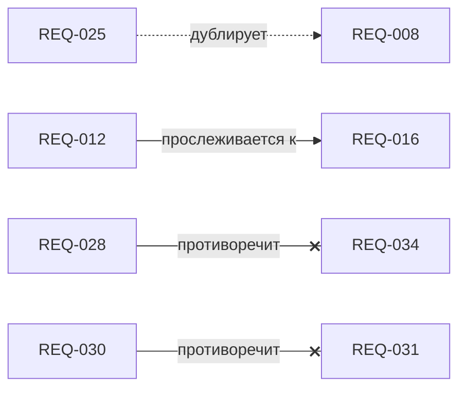

# Отчёт о проверке требований: «Уведомление о расходах по карте»

> **Итог:** ⚪ INSUFFICIENT DATA — недостаточно данных для надёжной оценки. Семантическая проверка моделью не выполнялась (офлайн-режим): правила нашли 23 дефекта, но противоречия и полнота смысла не оценены. Запустите с LLM-ключом.  
> Выделено требований: **42**, подтверждённых замечаний: **23** (🔴 0 · 🟠 3 · 🟡 13 · 🔵 7), «требует проверки»: 0, вопросов владельцу: 4. Индекс качества LÜMEN: **73.3/100**.

Отчёт сформирован автоматически агентом **LÜMEN Requirements Intelligence** (LÜMEN Core 1.0.0). Каждое замечание привязано к месту документа; цитаты программно сверены с исходным текстом, номера строк и страниц вычислены по файлу, а не взяты из ответа модели.

**Содержание:** [1. Паспорт прогона](#1-паспорт-прогона) · [2. Методика](#2-методика-проверки) · [3. Нарезка требований](#3-как-агент-нарезал-требования) · [4. Проверка каждого требования](#4-проверка-каждого-требования) · [5. Проверка набора](#5-проверка-всего-набора-требований) · [6. Вопросы владельцу](#6-вопросы-к-владельцу-требований) · [7. Сводка](#7-сводка) · [8. Итог](#8-итог-можно-ли-начинать-разработку-и-тестирование) · [Приложения](#приложения)

## 1. Паспорт прогона

| Параметр | Значение |
| :--- | :--- |
| Название документа | «Уведомление о расходах по карте» |
| Файл | `requirements.md` (MARKDOWN) |
| SHA-256 файла | `e7dae55e5453a250d93e335f5ff9c7f775f4457ccddd333f4a67e47b20d74381` |
| Дата и время анализа | 26.11.2026 14:12:42 (UTC+05:00) |
| Длительность | 0.0 с |
| Модель LLM | `rules-only` — Без LLM (только детерминированные правила) |
| Режим анализа | Только детерминированные правила (без LLM) |
| Версия агента | LÜMEN 1.0.0, коммит `223a733` |
| Обращений к модели | 0 (ошибок/повторов: 0); токены: вход 0 · выход 0 |
| Стандарты | ISO/IEC/IEEE 29148:2018 (п. 5.2.5, 5.2.6); IEEE Std 830-1998 (п. 4.3) |
| Идентификатор прогона | `8c2f01c81425` |

**Предупреждения прогона:**

* ⚠️ Семантическая проверка моделью не выполнялась (офлайн-режим): отчёт построен только детерминированными правилами LÜMEN Core. Для полного анализа задайте ключ LLM в .env.

## 2. Методика проверки

Проверка статическая — ревью текста требований до разработки (программа не запускается). Конвейер LÜMEN Core:

1. ✅ **Загрузка документа** — 13 507 байт
2. ✅ **Проверка формата и целостности** — Формат: MARKDOWN, SHA-256 e7dae55e5453…
3. ✅ **Извлечение текста, структуры, страниц и таблиц** — 199 строк, — стр., 7 таблиц
4. ✅ **Сегментация документа** — 128 блоков, 34 разделов
5. ✅ **Выделение и идентификация требований** — 42 требований, с исходным ID: 11
6. ✅ **Классификация требований** — API-контракт: 27, Функциональное: 4, Архитектура/процесс: 3, Критерий приёмки: 3, Бизнес-цель: 1, UI/UX: 1, Нефункциональное: 1, Данные: 1, Интеграция: 1
7. ✅ **Индивидуальная проверка требований** — Правила: 25 замечаний
8. ✅ **Межтребовательная проверка (противоречия, дубли)** — Правила: 9 замечаний набора, 2 связей
9. ⏭️ **Анализ полноты документа** — Требуется LLM — смысловая полнота не оценивалась
10. ✅ **FinTech-аудит (LÜMEN Risk Engine)** — Документ относится к финансовой предметной области (без LLM — только упоминания)
11. ✅ **Уточняющие вопросы (Clarification Engine)** — 4 вопросов к владельцу требований
12. ✅ **Перепроверка результатов и защита от галлюцинаций** — Цитаты сверены с документом; «требует проверки»: 0; отклонено перепроверкой: 0; отброшено несуществующих ID: 0
13. ✅ **Подсчёт статистики и готовности** — Индекс качества 73.3, готовность: INSUFFICIENT DATA

**Защита от галлюцинаций.** Детерминированные правила (лексика, структура, API-контракт, единицы, заглушки) работают без модели. Ответы LLM принимаются только по строгой JSON-схеме (при невалидном ответе — повтор с описанием ошибки). Каждая цитата модели ищется в документе (точное и нечёткое совпадение ≥ 82%) и заменяется дословным фрагментом; при отсутствии совпадения замечание получает статус «требует проверки». Несуществующие ID требований отбрасываются. CRITICAL/HIGH-замечания модели проходят независимую перепроверку (роль скептичного ревьюера), которая может снизить критичность или отклонить дефект.

**Критерии отдельного требования** (✅ выполнено · ❌ дефект · N/A неприменимо · «·» не оценено):

| Сокр. | Критерий | Основание |
| :--- | :--- | :--- |
| Одн | Однозначность | ISO 29148 §5.2.5 Unambiguous; IEEE 830 §4.3.2 |
| Пол | Полнота | ISO 29148 §5.2.5 Complete; IEEE 830 §4.3.3 |
| Пров | Проверяемость | ISO 29148 §5.2.5 Verifiable; IEEE 830 §4.3.6 |
| Согл | Непротиворечивость | ISO 29148 §5.2.6 Consistent; IEEE 830 §4.3.4 |
| Необх | Необходимость | ISO 29148 §5.2.5 Necessary |
| Атом | Атомарность | ISO 29148 §5.2.5 Singular |
| Реал | Реализуемость | ISO 29148 §5.2.5 Feasible |
| Трас | Прослеживаемость | IEEE 830 §4.3.8; ISO 29148 §5.2.8 |
| Корр | Корректность | ISO 29148 §5.2.5 Correct; IEEE 830 §4.3.1 |
| БезПР | Без лишних проектных решений | ISO 29148 §5.2.5 Appropriate (implementation-free) |
| Вход | Определённость входных данных | LÜMEN practice (экспертная практика) |
| Выход | Определённость выходных данных | LÜMEN practice (экспертная практика) |
| Ошиб | Ошибки и исключения | LÜMEN practice (экспертная практика) |
| Приём | Критерии приёмки | LÜMEN practice (экспертная практика) |
| Гран | Граничные условия | LÜMEN practice (экспертная практика) |

**Шкала критичности:** 🔴 CRITICAL — блокирует корректную реализацию или создаёт серьёзный риск; 🟠 HIGH — исправить до разработки; 🟡 MEDIUM — риск разной интерпретации/проблем тестирования; 🔵 LOW — улучшение; ⚪ INFO — наблюдение. Нормативные замечания (по стандартам) отделены от экспертных FinTech-рекомендаций.

## 3. Как агент нарезал требования

Выделено **42** требований; собственный идентификатор в документе есть у **11**. Требованиям без номера агент присвоил свои ID (REQ-NNN), для них указано место (раздел/пункт таблицы или списка) и сохранена цитата. Метаданные (общие сведения, чек-лист ревью, согласующие) не считаются требованиями, но проверяются на уровне набора.

| ID в отчёте | ID в документе | Тип | Раздел | Место | Краткая формулировка | Цитата |
| :--- | :--- | :--- | :--- | :--- | :--- | :--- |
| REQ-001 | нет | Бизнес-цель | Часть A. Новый функционал / Цели | строка 23 | Дать клиенту возможность узнать о достижении личного бюджета в момент покупки. | «Дать клиенту возможность узнать о достижении личного бюджета в момент покупки.» |
| REQ-002 | нет | Архитектура/процесс | Часть A. Новый функционал / Архитектура решения | строка 26 | Мобильное приложение → сервис настроек. | «Мобильное приложение → сервис настроек. Карточный процессинг → учёт расходов → сервис push.» |
| REQ-003 | нет | UI/UX | Часть A. Новый функционал / Дизайн процесса UI | строка 29 | Карты → Расходы → Уведомления. | «Карты → Расходы → Уведомления. На экране видны переключатель, поле «Порог, ₸», сумма за месяц и кнопка «Сохранить». При ошибке ввода сообщение появляется под полем.» |
| REQ-004 | нет | Архитектура/процесс | Часть A. Новый функционал / Требования к изменениям / BPMN схема процесса | строка 34 | Проведение покупки → пересчёт расходов → проверка порога → при достижении отправка push → завершение. | «Проведение покупки → пересчёт расходов → проверка порога → при достижении отправка push → завершение.» |
| REQ-005 | Ф-1 | Функциональное | Часть A. Новый функционал / Требования к изменениям / Функциональные требования | строка 37 | Держатель активной карты KZT задаёт целый порог от 1 000 до 1 000 000 ₸ включительно. | «Ф-1. Держатель активной карты KZT задаёт целый порог от 1 000 до 1 000 000 ₸ включительно. По умолчанию уведомление выключено.» |
| REQ-006 | Ф-2 | Функциональное | Часть A. Новый функционал / Требования к изменениям / Функциональные требования | строка 38 | Месяц определяется по дате совершения покупки в Алматы. | «Ф-2. Месяц определяется по дате совершения покупки в Алматы. В расходы входят проведённые покупки. Возврат уменьшает расходы месяца исходной покупки. Переводы и снятие наличных исключаются.» |
| REQ-007 | Ф-3 | Функциональное | Часть A. Новый функционал / Требования к изменениям / Функциональные требования | строка 39 | Когда расходы переходят от суммы ниже порога к сумме, равной порогу или выше, клиент получает push. | «Ф-3. Когда расходы переходят от суммы ниже порога к сумме, равной порогу или выше, клиент получает push. На карту приходится максимум один такой push за календарный месяц.» |
| REQ-008 | Ф-4 | Функциональное | Часть A. Новый функционал / Требования к изменениям / Функциональные требования | строка 40 | При изменении порога накопленная сумма сохраняется. | «Ф-4. При изменении порога накопленная сумма сохраняется. Если она ниже нового порога, следующее достижение вызывает push независимо от истории предыдущей настройки.» |
| REQ-009 | нет | Архитектура/процесс | Часть A. Новый функционал / Sequence Diagram | строка 43 | Процессинг → сервис расходов: проведена покупка. | «Процессинг → сервис расходов: проведена покупка. Сервис расходов → настройки: получить порог карты. Сервис расходов → push: передать последние четыре цифры карты и сумму при достижении порога.» |
| REQ-010 | нет | Нефункциональное | Часть A. Новый функционал / Нефункциональные требования | строка 46 | Сервис передаёт push на отправку в течение минуты после получения события. | «Сервис передаёт push на отправку в течение минуты после получения события.» |
| REQ-011 | нет | Данные | Часть A. Новый функционал / Требования к данным | строка 49 | Хранить идентификатор карты, месяц, идентификатор операции, сумму покупки в тиынах, признак отправки и порог в тенге. | «Хранить идентификатор карты, месяц, идентификатор операции, сумму покупки в тиынах, признак отправки и порог в тенге.» |
| REQ-012 | нет | Интеграция | Часть A. Новый функционал / Требования к интеграции | строка 52 | Приложение читает и сохраняет настройки через дочерний документ «Уведомление о расходах по карте — REST API». | «Приложение читает и сохраняет настройки через дочерний документ «Уведомление о расходах по карте — REST API». Повторная доставка одного события процессинга сохраняет исходный итог.» |
| REQ-013 | нет (Критерии приемки, стр. табл. 1) | Критерий приёмки | Часть A. Новый функционал / Критерии приемки | строка 63 | Исходные условия: Расходы 48 500 ₸, порог 50 000 ₸; Действие: Провести покупку на 1 500 ₸; Ожидаемый результат: Итог 50… | «Исходные условия: Расходы 48 500 ₸, порог 50 000 ₸; Действие: Провести покупку на 1 500 ₸; Ожидаемый результат: Итог 50 000 ₸ и один push» |
| REQ-014 | нет (Критерии приемки, стр. табл. 2) | Критерий приёмки | Часть A. Новый функционал / Критерии приемки | строка 64 | Исходные условия: Покупка 31 января в 23:58 на 4 000 ₸; Действие: Провести 1 февраля в 00:03 по Алматы; Ожидаемый резул… | «Исходные условия: Покупка 31 января в 23:58 на 4 000 ₸; Действие: Провести 1 февраля в 00:03 по Алматы; Ожидаемый результат: Февральский счётчик вырос на 4 000 ₸» |
| REQ-015 | нет (Критерии приемки, стр. табл. 3) | Критерий приёмки | Часть A. Новый функционал / Критерии приемки | строка 65 | Исходные условия: Расходы 19 900 ₸, порог 20 000 ₸; Действие: Перевести 500 ₸; Ожидаемый результат: Счётчик показывает… | «Исходные условия: Расходы 19 900 ₸, порог 20 000 ₸; Действие: Перевести 500 ₸; Ожидаемый результат: Счётчик показывает 19 900 ₸» |
| REQ-016 | нет | API-контракт | Часть B. REST API | строка 97 | Дочерний документ части A: «Уведомление о расходах по карте — REST API». | «Дочерний документ части A: «Уведомление о расходах по карте — REST API».» |
| REQ-017 | нет | API-контракт | Часть B. REST API / Общие параметры | строки 103–114 | Таблица «Общие параметры»: Description, REST type, Authorization, Controller, URL type, Request URL | «Description: Сохранение порога. Функциональные требования: чтение порога REST type: GET Authorization: Bearer, сессия владельца карты Controller: AlertsController URL type: Dev / Prod Request URL: Dev: /alerts/saveLimit…» |
| REQ-018 | нет (Логика работы метода, п. 1) | API-контракт | Часть B. REST API / Логика работы метода | строка 117 | Проверить пользовательскую сессию. | «Проверить пользовательскую сессию.» |
| REQ-019 | нет (Логика работы метода, п. 2) | API-контракт | Часть B. REST API / Логика работы метода | строка 118 | Проверить принадлежность карты клиенту. | «Проверить принадлежность карты клиенту.» |
| REQ-020 | нет (Логика работы метода, п. 3) | API-контракт | Часть B. REST API / Логика работы метода | строка 119 | Проверить сумму и переключатель. | «Проверить сумму и переключатель.» |
| REQ-021 | нет (Логика работы метода, п. 4) | API-контракт | Часть B. REST API / Логика работы метода | строка 120 | Заменить настройку и вернуть результат сохранения. | «Заменить настройку и вернуть результат сохранения.» |
| REQ-022 | нет (Логика работы метода, п. 5) | API-контракт | Часть B. REST API / Логика работы метода | строка 121 | При отклонении суммы вернуть прежнее состояние и результат ERROR. | «При отклонении суммы вернуть прежнее состояние и результат ERROR.» |
| REQ-023 | нет (Особые правила, п. 1) | API-контракт | Часть B. REST API / Особые правила | строка 124 | Целое число тенге, обе границы включены. | «Целое число тенге, обе границы включены.» |
| REQ-024 | нет (Особые правила, п. 2) | API-контракт | Часть B. REST API / Особые правила | строка 125 | Повторное сохранение заменяет действующую настройку. | «Повторное сохранение заменяет действующую настройку.» |
| REQ-025 | нет (Особые правила, п. 3) | API-контракт | Часть B. REST API / Особые правила | строка 126 | Изменение порога сохраняет накопленные расходы. | «Изменение порога сохраняет накопленные расходы.» |
| REQ-026 | нет | API-контракт | Часть B. REST API / Схема | строки 129–131 | Приложение → AlertsController → хранилище настроек → AlertsController → приложение. | «Приложение → AlertsController → хранилище настроек → AlertsController → приложение.» |
| REQ-027 | cardId | API-контракт | Часть B. REST API / Параметры запроса / Query-параметры | строка 142 | Parameter: cardId; Format: string; Size: 1–64; Mandatory: Да; Logic: Карта клиента; Description: Идентификатор карты; D… | «Parameter: cardId; Format: string; Size: 1–64; Mandatory: Да; Logic: Карта клиента; Description: Идентификатор карты; DB field: card_id» |
| REQ-028 | amount | API-контракт | Часть B. REST API / Параметры запроса / Query-параметры | строка 143 | Parameter: amount; Format: integer; Size: 32 bit; Mandatory: Да; Logic: 1 000–1 000 000; Description: Порог в тенге; DB… | «Parameter: amount; Format: integer; Size: 32 bit; Mandatory: Да; Logic: 1 000–1 000 000; Description: Порог в тенге; DB field: limit_kzt» |
| REQ-029 | enabled | API-контракт | Часть B. REST API / Параметры запроса / Query-параметры | строка 144 | Parameter: enabled; Format: integer; Size: 1 знак; Mandatory: Да; Logic: 0 или 1; Description: Признак включения; DB fi… | «Parameter: enabled; Format: integer; Size: 1 знак; Mandatory: Да; Logic: 0 или 1; Description: Признак включения; DB field: enabled» |
| REQ-030 | нет | API-контракт | Часть B. REST API / Параметры запроса / Request body | строка 147 | Content-Type: application/json . | «Content-Type: application/json .» |
| REQ-031 | нет | API-контракт | Часть B. REST API / Параметры запроса / Request body | строка 148 | Тело не используется. | «Тело не используется.» |
| REQ-032 | нет | API-контракт | Часть B. REST API / Ответ | строка 151 | Если результат 200 или 201 — успешный. | «Если результат 200 или 201 — успешный. Если результат 400, 401 и далее — неуспешный.» |
| REQ-033 | result | API-контракт | Часть B. REST API / Ответ | строка 155 | Parameter: result; Format: string; Logic: OK / ERROR; Description: Исход сохранения; DB field: — | «Parameter: result; Format: string; Logic: OK / ERROR; Description: Исход сохранения; DB field: —» |
| REQ-034 | amount | API-контракт | Часть B. REST API / Ответ | строка 156 | Parameter: amount; Format: string; Logic: При успехе; Description: Порог в тенге; DB field: limit_kzt | «Parameter: amount; Format: string; Logic: При успехе; Description: Порог в тенге; DB field: limit_kzt» |
| REQ-035 | enabled | API-контракт | Часть B. REST API / Ответ | строка 157 | Parameter: enabled; Format: string; Logic: «0» или «1»; Description: Признак включения; DB field: enabled | «Parameter: enabled; Format: string; Logic: «0» или «1»; Description: Признак включения; DB field: enabled» |
| REQ-036 | message | API-контракт | Часть B. REST API / Ответ | строка 158 | Parameter: message; Format: string; Logic: При ошибке; Description: Описание ошибки; DB field: — | «Parameter: message; Format: string; Logic: При ошибке; Description: Описание ошибки; DB field: —» |
| REQ-037 | нет (HTTP 200) | API-контракт | Часть B. REST API / Статусы | строка 162 | 200. Ответ в случае успешного выполнения метода. | «200. Ответ в случае успешного выполнения метода.» |
| REQ-038 | нет (HTTP 400) | API-контракт | Часть B. REST API / Статусы | строка 163 | 400. Ответ в случае, если параметры запроса заполнены неверно. | «400. Ответ в случае, если параметры запроса заполнены неверно.» |
| REQ-039 | нет (HTTP 401) | API-контракт | Часть B. REST API / Статусы / 200. Successful — Created | строка 174 | 401. Ответ в случае, если запрос выполнен без необходимой авторизации. | «401. Ответ в случае, если запрос выполнен без необходимой авторизации.» |
| REQ-040 | нет (HTTP 403) | API-контракт | Часть B. REST API / Статусы / 200. Successful — Created | строка 175 | 403. Ответ в случае, если на указанный ресурс доступ запрещен. | «403. Ответ в случае, если на указанный ресурс доступ запрещен.» |
| REQ-041 | нет (HTTP 500) | API-контракт | Часть B. REST API / Статусы / 200. Successful — Created | строка 176 | 500. Ответ в случае, если произошла внутренняя ошибка сервера. | «500. Ответ в случае, если произошла внутренняя ошибка сервера.» |
| REQ-042 | нет | API-контракт | Часть B. REST API / Статусы / 403. Unsuccessful — Forbidden | строка 189 | Для чужой карты возвращается 404, как и для отсутствующей карты. | «Для чужой карты возвращается 404, как и для отсутствующей карты.» |

## 4. Проверка каждого требования

### 4.1. Матрица критериев

| ID | Балл | Одн | Пол | Пров | Согл | Необх | Атом | Реал | Трас | Корр | БезПР | Вход | Выход | Ошиб | Приём | Гран |
| :--- | ---: | :---: | :---: | :---: | :---: | :---: | :---: | :---: | :---: | :---: | :---: | :---: | :---: | :---: | :---: | :---: |
| REQ-001 | 100 | · | · | · | · | · | · | · | ❌ | · | · | · | · | · | · | · |
| REQ-002 | 100 | · | · | · | · | · | · | · | ❌ | · | · | · | · | · | · | · |
| REQ-003 | 97 | · | · | · | · | · | ❌ | · | ❌ | · | · | · | · | · | · | · |
| REQ-004 | 100 | · | · | · | · | · | · | · | ❌ | · | · | · | · | · | · | · |
| REQ-005 | 100 | · | · | · | · | · | · | · | ✅ | · | · | · | · | · | · | · |
| REQ-006 | 94 | ❌ | · | · | · | · | ❌ | · | ✅ | · | · | · | · | · | · | · |
| REQ-007 | 100 | · | · | · | · | · | · | · | ✅ | · | · | · | · | · | · | · |
| REQ-008 | 98 | · | · | · | · | · | · | · | ✅ | · | · | · | · | · | · | · |
| REQ-009 | 97 | · | · | · | · | · | ❌ | · | ❌ | · | · | · | · | · | · | · |
| REQ-010 | 92 | · | · | ❌ | · | · | · | · | ❌ | · | · | · | · | · | · | · |
| REQ-011 | 92 | · | · | · | ❌ | · | · | · | ❌ | · | · | · | · | · | · | · |
| REQ-012 | 100 | · | · | · | · | · | · | · | ❌ | · | · | · | · | · | · | · |
| REQ-013 | 100 | · | · | · | · | · | · | · | ❌ | · | · | · | · | · | · | · |
| REQ-014 | 100 | · | · | · | · | · | · | · | ❌ | · | · | · | · | · | · | · |
| REQ-015 | 100 | · | · | · | · | · | · | · | ❌ | · | · | · | · | · | · | · |
| REQ-016 | 100 | · | · | · | · | · | · | · | ❌ | · | · | · | · | · | · | · |
| REQ-017 | 64 | · | ❌ | · | · | · | · | · | ❌ | ❌ | · | · | · | · | · | · |
| REQ-018 | 100 | · | · | · | · | · | · | · | ❌ | · | · | · | · | · | · | · |
| REQ-019 | 100 | · | · | · | · | · | · | · | ❌ | · | · | · | · | · | · | · |
| REQ-020 | 100 | · | · | · | · | · | · | · | ❌ | · | · | · | · | · | · | · |
| REQ-021 | 100 | · | · | · | · | · | · | · | ❌ | · | · | · | · | · | · | · |
| REQ-022 | 100 | · | · | · | · | · | · | · | ❌ | · | · | · | · | · | · | · |
| REQ-023 | 100 | · | · | · | · | · | · | · | ❌ | · | · | · | · | · | · | · |
| REQ-024 | 100 | · | · | · | · | · | · | · | ❌ | · | · | · | · | · | · | · |
| REQ-025 | 98 | · | · | · | · | · | · | · | ❌ | · | · | · | · | · | · | · |
| REQ-026 | 100 | · | · | · | · | · | · | · | ❌ | · | · | · | · | · | · | · |
| REQ-027 | 100 | · | · | · | · | · | · | · | ✅ | · | · | · | · | · | · | · |
| REQ-028 | 96 | · | · | · | ❌ | · | · | · | ✅ | · | · | · | · | · | · | · |
| REQ-029 | 100 | · | · | · | · | · | · | · | ✅ | · | · | · | · | · | · | · |
| REQ-030 | 98 | · | · | · | ❌ | · | · | · | ❌ | · | · | · | · | · | · | · |
| REQ-031 | 98 | · | · | · | ❌ | · | · | · | ❌ | · | · | · | · | · | · | · |
| REQ-032 | 92 | · | · | · | · | · | · | · | ❌ | · | · | · | · | · | · | · |
| REQ-033 | 100 | · | · | · | · | · | · | · | ✅ | · | · | · | · | · | · | · |
| REQ-034 | 96 | · | · | · | ❌ | · | · | · | ✅ | · | · | · | · | · | · | · |
| REQ-035 | 100 | · | · | · | · | · | · | · | ✅ | · | · | · | · | · | · | · |
| REQ-036 | 100 | · | · | · | · | · | · | · | ✅ | · | · | · | · | · | · | · |
| REQ-037 | 100 | · | · | · | · | · | · | · | ❌ | · | · | · | · | · | · | · |
| REQ-038 | 100 | · | · | · | · | · | · | · | ❌ | · | · | · | · | · | · | · |
| REQ-039 | 100 | · | · | · | · | · | · | · | ❌ | · | · | · | · | · | · | · |
| REQ-040 | 100 | · | · | · | · | · | · | · | ❌ | · | · | · | · | · | · | · |
| REQ-041 | 100 | · | · | · | · | · | · | · | ❌ | · | · | · | · | · | · | · |
| REQ-042 | 84 | · | · | · | ❌ | · | · | · | ❌ | · | · | · | · | · | · | · |

### 4.2. Замечания по требованиям

### REQ-003 — Карты → Расходы → Уведомления.

*UI/UX · строка 29, раздел «Дизайн процесса UI» · балл 97/100 · вердикт: принято*

> Карты → Расходы → Уведомления. На экране видны переключатель, поле «Порог, ₸», сумма за месяц и кнопка «Сохранить». При ошибке ввода сообщение появляется под полем.

#### 🔵 F-017 · LOW · Неатомарное требование (3 утверждения)

* **Критерий:** Атомарность (ISO 29148 §5.2.5 Singular; нормативное); источник: правило (R-ATOMIC)
* **Где:** строка 29, раздел «Дизайн процесса UI»; требования: REQ-003
* **Цитата:**

  > Карты → Расходы → Уведомления. На экране видны переключатель, поле «Порог, ₸», сумма за месяц и кнопка «Сохранить». При ошибке ввода сообщение появляется под полем.

* **Что не так:** В одном пункте объединены 3 самостоятельных утверждения.
* **Риск:** Сложно трассировать к тестам и частично принимать; изменения затрагивают всё сразу.
* **Как исправить:** Разбить на отдельные пронумерованные требования, по одному проверяемому утверждению.

### REQ-006 (Ф-2) — Месяц определяется по дате совершения покупки в Алматы.

*Функциональное · строка 38, раздел «Функциональные требования» · балл 94/100 · вердикт: принято*

> Ф-2. Месяц определяется по дате совершения покупки в Алматы. В расходы входят проведённые покупки. Возврат уменьшает расходы месяца исходной покупки. Переводы и снятие наличных исключаются.

#### 🔵 F-018 · LOW · Неатомарное требование (4 утверждения)

* **Критерий:** Атомарность (ISO 29148 §5.2.5 Singular; нормативное); источник: правило (R-ATOMIC)
* **Где:** строка 38, раздел «Функциональные требования»; требования: REQ-006
* **Цитата:**

  > Ф-2. Месяц определяется по дате совершения покупки в Алматы. В расходы входят проведённые покупки. Возврат уменьшает расходы месяца исходной покупки. Переводы и снятие наличных исключаются.

* **Что не так:** В одном пункте объединены 4 самостоятельных утверждения.
* **Риск:** Сложно трассировать к тестам и частично принимать; изменения затрагивают всё сразу.
* **Как исправить:** Разбить на отдельные пронумерованные требования, по одному проверяемому утверждению.

#### 🔵 F-019 · LOW · Часовой пояс задан городом, без смещения UTC

* **Критерий:** Однозначность (ISO 29148 §5.2.5 Unambiguous; IEEE 830 §4.3.2; экспертная рекомендация); источник: правило (R-TZ)
* **Где:** строка 38, раздел «Функциональные требования»; требования: REQ-006
* **Цитата:**

  > Месяц определяется по дате совершения покупки в Алматы.

* **Что не так:** Граница суток/месяца привязана к городу, но не указано смещение UTC и источник времени.
* **Риск:** Покупки около полуночи попадут не в тот месяц при расхождении часовых поясов серверов.
* **Как исправить:** Указать часовой пояс явно (например, UTC+5, IANA Asia/Almaty) и источник метки времени события.

### REQ-009 — Процессинг → сервис расходов: проведена покупка.

*Архитектура/процесс · строка 43, раздел «Sequence Diagram» · балл 97/100 · вердикт: принято*

> Процессинг → сервис расходов: проведена покупка. Сервис расходов → настройки: получить порог карты. Сервис расходов → push: передать последние четыре цифры карты и сумму при достижении порога.

#### 🔵 F-020 · LOW · Неатомарное требование (3 утверждения)

* **Критерий:** Атомарность (ISO 29148 §5.2.5 Singular; нормативное); источник: правило (R-ATOMIC)
* **Где:** строка 43, раздел «Sequence Diagram»; требования: REQ-009
* **Цитата:**

  > Процессинг → сервис расходов: проведена покупка. Сервис расходов → настройки: получить порог карты. Сервис расходов → push: передать последние четыре цифры карты и сумму при достижении порога.

* **Что не так:** В одном пункте объединены 3 самостоятельных утверждения.
* **Риск:** Сложно трассировать к тестам и частично принимать; изменения затрагивают всё сразу.
* **Как исправить:** Разбить на отдельные пронумерованные требования, по одному проверяемому утверждению.

### REQ-010 — Сервис передаёт push на отправку в течение минуты после получения события.

*Нефункциональное · строка 46, раздел «Нефункциональные требования» · балл 92/100 · вердикт: с замечаниями*

> Сервис передаёт push на отправку в течение минуты после получения события.

#### 🟡 F-004 · MEDIUM · Временное ограничение без профиля нагрузки и доли запросов

* **Критерий:** Проверяемость (ISO 29148 §5.2.5 Verifiable; IEEE 830 §4.3.6; нормативное); источник: правило (R-NFR-PROFILE)
* **Где:** строка 46, раздел «Нефункциональные требования»; требования: REQ-010
* **Цитата:**

  > Сервис передаёт push на отправку в течение минуты после получения события.

* **Что не так:** Не указаны нагрузка, перцентиль и точки начала/окончания измерения.
* **Риск:** Требование «выполнено» на одном событии и нарушено под пиковой нагрузкой.
* **Как исправить:** Добавить: при нагрузке N событий/с, для 95–99% событий, время от T1 (получение) до T2 (передача).

### REQ-011 — Хранить идентификатор карты, месяц, идентификатор операции, сумму покупки в тиынах, признак отправки и порог в тенге.

*Данные · строка 49, раздел «Требования к данным» · балл 92/100 · вердикт: с замечаниями*

> Хранить идентификатор карты, месяц, идентификатор операции, сумму покупки в тиынах, признак отправки и порог в тенге.

#### 🟡 F-005 · MEDIUM · Смешение денежных единиц (тиын и тенге)

* **Критерий:** Непротиворечивость (ISO 29148 §5.2.6 Consistent; IEEE 830 §4.3.4; нормативное); источник: правило (R-UNITS)
* **Где:** строка 49, раздел «Требования к данным»; требования: REQ-011
* **Цитата:**

  > Хранить идентификатор карты, месяц, идентификатор операции, сумму покупки в тиынах, признак отправки и порог в тенге.

* **Что не так:** В одном требовании величины заданы в разных единицах: тиын и тенге.
* **Риск:** Ошибка масштаба ×100 при сравнении суммы с порогом — ложные или пропущенные уведомления.
* **Как исправить:** Хранить и сравнивать все суммы в одной минимальной единице (тиын), явно описать преобразование для отображения.

### REQ-017 — Таблица «Общие параметры»: Description, REST type, Authorization, Controller, URL type, Request URL

*API-контракт · строки 103–114, раздел «Общие параметры» · балл 64/100 · вердикт: не принято*

> Description: Сохранение порога. Функциональные требования: чтение порога
> REST type: GET
> Authorization: Bearer, сессия владельца карты
> Controller: AlertsController
> URL type: Dev / Prod
> Request URL: Dev: /alerts/saveLimit . Prod: —
> CURL: curl -G "$BASE/alerts/saveLimit" -H "Authorization: Bearer $TOKEN" --data 'cardId=demo-42&amount=50000&enabled=1'
> Swagger: —
> Gitlab project: Учебный контур
> Framework: Учебный контур
> Author: Школа тестирования
> Developer: Команда практикума

#### 🟠 F-002 · HIGH · Изменяющая операция объявлена через GET

* **Критерий:** Корректность (ISO 29148 §5.2.5 Correct; IEEE 830 §4.3.1; нормативное); источник: правило (API-GET-MUTATION)
* **Где:** строка 104, раздел «Общие параметры»; требования: REQ-017
* **Цитата:**

  > REST type | GET

* **Что не так:** Метод сохраняет состояние, но объявлен как GET (безопасный и идемпотентный по RFC 9110).
* **Риск:** Кэширование/предзагрузка прокси и браузеров может повторно изменить настройку; параметры попадают в URL и логи; повышается риск CSRF.
* **Как исправить:** Использовать PUT (замена настройки) или POST, параметры передавать в теле JSON.
* **Улучшенная формулировка:** _REST type: PUT; Request URL: /alerts/limit; тело: {"cardId", "amount", "enabled"}._

#### 🟡 F-009 · MEDIUM · Не заполнено значение «Prod»

* **Критерий:** Полнота (ISO 29148 §5.2.5 Complete; IEEE 830 §4.3.3; нормативное); источник: правило (R-EMPTY-VALUE)
* **Где:** строка 108, раздел «Общие параметры»; требования: REQ-017
* **Цитата:**

  > Prod: —

* **Что не так:** Поле «Prod» оставлено пустым (прочерк).
* **Риск:** Исполнитель не получит необходимые данные; интеграция/выпуск будут заблокированы.
* **Как исправить:** Заполнить «Prod» или явно указать «не применимо» с обоснованием.

#### 🟡 F-010 · MEDIUM · Пустое поле контракта «swagger»

* **Критерий:** Полнота (ISO 29148 §5.2.5 Complete; IEEE 830 §4.3.3; нормативное); источник: правило (API-EMPTY-FIELD)
* **Где:** строка 110, раздел «Общие параметры»; требования: REQ-017
* **Цитата:**

  > Swagger | —

* **Что не так:** Поле «swagger» не заполнено.
* **Риск:** Неполный контракт: потребители API не смогут интегрироваться или сверить реализацию.
* **Как исправить:** Заполнить «swagger» или указать «не применимо» с причиной.

### REQ-028 (amount) — Parameter: amount; Format: integer; Size: 32 bit; Mandatory: Да; Logic: 1 000–1 000 000; Description: Порог в тенге; DB…

*API-контракт · строка 143, раздел «Query-параметры» · балл 96/100 · вердикт: с замечаниями*

> Parameter: amount; Format: integer; Size: 32 bit; Mandatory: Да; Logic: 1 000–1 000 000; Description: Порог в тенге; DB field: limit_kzt

#### 🟡 F-011 · MEDIUM · Параметр «amount» имеет разные типы: integer, string

* **Критерий:** Непротиворечивость (ISO 29148 §5.2.6 Consistent; IEEE 830 §4.3.4; нормативное); источник: правило (API-TYPE-MISMATCH)
* **Где:** строка 143, раздел «Query-параметры»; требования: REQ-028, REQ-034
* **Цитата:**

  > amount | integer | 32 bit | Да | 1 000–1 000 000 | Порог в тенге | limit_kzt

* **Что не так:** «amount» описан как integer (REQ-028) и string (REQ-034).
* **Риск:** Ошибки сериализации/парсинга, потеря точности сумм, разная валидация на клиенте и сервере.
* **Как исправить:** Определить единый тип «amount» в запросе и ответе (для денег — integer в минимальных единицах).

### REQ-030 — Content-Type: application/json .

*API-контракт · строка 147, раздел «Request body» · балл 98/100 · вердикт: принято*

> Content-Type: application/json .

#### 🔵 F-022 · LOW · Content-Type: application/json при отсутствии тела запроса

* **Критерий:** Непротиворечивость (ISO 29148 §5.2.6 Consistent; IEEE 830 §4.3.4; нормативное); источник: правило (API-CT-NOBODY)
* **Где:** строка 147, раздел «Request body»; требования: REQ-030, REQ-031
* **Цитата:**

  > Content-Type: application/json .

* **Что не так:** Объявлен JSON-формат тела, но тело не используется.
* **Риск:** Неоднозначность для клиентов и шлюзов; признак незавершённого контракта.
* **Как исправить:** Либо перенести параметры в тело JSON, либо убрать Content-Type.

### REQ-032 — Если результат 200 или 201 — успешный.

*API-контракт · строка 151, раздел «Ответ» · балл 92/100 · вердикт: с замечаниями*

> Если результат 200 или 201 — успешный. Если результат 400, 401 и далее — неуспешный.

#### 🟡 F-012 · MEDIUM · Статус 201 упоминается, но не описан в перечне статусов

* **Критерий:** Полнота интеграционных контрактов (LÜMEN practice; экспертная рекомендация); источник: правило (API-UNDEFINED-STATUS)
* **Где:** строка 151, раздел «Ответ»; требования: REQ-032
* **Цитата:**

  > Если результат 200 или 201 — успешный.

* **Что не так:** Текст ссылается на код 201, однако в разделе статусов нет его условия и тела ответа.
* **Риск:** Клиент и тестировщики не знают, когда возникает этот код и что в нём приходит.
* **Как исправить:** Описать 201 в перечне статусов (условие, пример тела) или убрать упоминание.

### REQ-042 — Для чужой карты возвращается 404, как и для отсутствующей карты.

*API-контракт · строка 189, раздел «403. Unsuccessful — Forbidden» · балл 84/100 · вердикт: с замечаниями*

> Для чужой карты возвращается 404, как и для отсутствующей карты.

#### 🟡 F-013 · MEDIUM · Статус 404 используется, но не описан в перечне статусов

* **Критерий:** Полнота интеграционных контрактов (LÜMEN practice; экспертная рекомендация); источник: правило (API-UNDEFINED-STATUS)
* **Где:** строка 189, раздел «403. Unsuccessful — Forbidden»; требования: REQ-042
* **Цитата:**

  > Для чужой карты возвращается 404, как и для отсутствующей карты.

* **Что не так:** Текст ссылается на код 404, которого нет в разделе статусов.
* **Риск:** Клиент не обработает код; тестировщики не знают ожидаемого тела ответа.
* **Как исправить:** Добавить 404 в перечень статусов с условием и примером тела.

#### 🟡 F-014 · MEDIUM · Раздел статуса 403 описывает возврат 404

* **Критерий:** Непротиворечивость (ISO 29148 §5.2.6 Consistent; IEEE 830 §4.3.4; нормативное); источник: правило (API-STATUS-SECTION)
* **Где:** строка 189, раздел «403. Unsuccessful — Forbidden»; требования: REQ-042
* **Цитата:**

  > Для чужой карты возвращается 404, как и для отсутствующей карты.

* **Что не так:** В разделе «403. Unsuccessful — Forbidden» указано, что возвращается 404.
* **Риск:** Неясно, когда возникает статус из заголовка; противоречивый контракт.
* **Как исправить:** Определить условия для 403 и 404 раздельно или удалить неиспользуемый.

**Без замечаний (32):** REQ-001, REQ-002, REQ-004, REQ-005, REQ-007, REQ-008, REQ-012, REQ-013, REQ-014, REQ-015, REQ-016, REQ-018, REQ-019, REQ-020, REQ-021, REQ-022, REQ-023, REQ-024, REQ-025, REQ-026, REQ-027, REQ-029, REQ-031, REQ-033, REQ-034, REQ-035, REQ-036, REQ-037, REQ-038, REQ-039, REQ-040, REQ-041 — дефекты по проверенным критериям не обнаружены.

## 5. Проверка всего набора требований

### 5.1. Свойства набора (ISO/IEC/IEEE 29148 п. 5.2.6, IEEE 830 п. 4.3)

| Свойство | Основание | Статус | Замечания |
| :--- | :--- | :---: | :--- |
| Полнота набора | ISO 29148 §5.2.6 Complete; IEEE 830 §4.3.3 | · | — |
| Согласованность набора | ISO 29148 §5.2.6 Consistent; IEEE 830 §4.3.4 | ✅ | — |
| Реализуемость набора | ISO 29148 §5.2.6 Feasible | · | — |
| Понятность набора | ISO 29148 §5.2.6 Comprehensible | · | — |
| Возможность валидации | ISO 29148 §5.2.6 Able to be validated | ❌ | F-001, F-007 |
| Ранжирование по важности/стабильности | IEEE 830 §4.3.5 | ❌ | F-015 |
| Модифицируемость | IEEE 830 §4.3.7 | ❌ | F-006, F-021 |
| Прослеживаемость набора | IEEE 830 §4.3.8 | ❌ | F-008, F-016 |
| Согласованность терминологии | ISO 29148 §5.2.6 Consistent | · | — |
| Полнота интеграционных контрактов | LÜMEN practice | ❌ | F-012, F-013, F-023 |

### 5.2. Противоречия и согласованность

#### 🟠 F-003 · HIGH · Ошибка бизнес-валидации возвращается со статусом 200

* **Критерий:** Непротиворечивость (ISO 29148 §5.2.6 Consistent; IEEE 830 §4.3.4; нормативное); источник: правило (API-SUCCESS-WITH-ERROR)
* **Где:** строки 170–172, раздел «200. Successful — Created»
* **Цитата:**

  > {"result":"ERROR","message":"Проверьте сумму"}

* **Что не так:** В примерах успешного ответа 200 приведено тело с результатом ERROR.
* **Риск:** Клиенты, проверяющие только HTTP-код, сочтут отклонённое сохранение успешным; мониторинг ошибок не увидит отказов.
* **Как исправить:** Возвращать ошибку валидации с 400/422 и телом {"message": …}; 200 — только при успехе.

### 5.3. Полнота, пропущенные сценарии и проверяемость набора

#### 🟠 F-001 · HIGH · Раздел «Тестирование требований» не заполнен

* **Критерий:** Возможность валидации (ISO 29148 §5.2.6 Able to be validated; нормативное); источник: правило (SET-PLACEHOLDER)
* **Где:** строка 57, раздел «Тестирование требований»
* **Цитата:**

  > заполняются тестировщиками

* **Что не так:** Вместо содержимого раздела — заглушка «заполняются тестировщиками».
* **Риск:** Отсутствуют данные, необходимые для разработки или приёмки; набор нельзя валидировать.
* **Как исправить:** Заполнить раздел «Тестирование требований» до передачи в разработку.

#### 🟡 F-007 · MEDIUM · Чек-лист ревью не заполнен (14 пунктов с шаблонными «Да / Нет»)

* **Критерий:** Возможность валидации (ISO 29148 §5.2.6 Able to be validated; нормативное); источник: правило (SET-CHECKLIST)
* **Где:** строки 72–85, раздел «Ревью требований»
* **Цитата:**

  > Техническое требование зафиксировано и покрывает бизнес-требование | Да / Нет | Да / Нет

* **Что не так:** Пункты чек-листа ревью оставлены в шаблонном виде, решения по ним не приняты.
* **Риск:** Нет подтверждения тестируемости, отката, согласования ИБ и архитектуры.
* **Как исправить:** Проставить отметки по каждому пункту и приложить подтверждения (ссылки, ФИО, даты).

### 5.4. Интеграционные контракты

#### 🔵 F-023 · LOW · Код 200 подписан как «Created» (201)

* **Критерий:** Полнота интеграционных контрактов (LÜMEN practice; экспертная рекомендация); источник: правило (API-STATUS-LABEL)
* **Где:** строка 165, раздел «200. Successful — Created»
* **Цитата:**

  > 200. Successful — Created

* **Что не так:** Заголовок объединяет код 200 и фразу статуса 201.
* **Риск:** Неоднозначно, какой код вернёт сервис при успешном создании/сохранении.
* **Как исправить:** Оставить один код: 200 или 201, и привести примеры к нему.

### 5.5. Структура, ранжирование, модифицируемость и прослеживаемость

#### 🟡 F-006 · MEDIUM · Версия и дата документа не зафиксированы

* **Критерий:** Модифицируемость (IEEE 830 §4.3.7; нормативное); источник: правило (SET-VERSION)
* **Где:** строка 68, раздел «Ревью требований»
* **Цитата:**

  > Документ (версия/дата) в источнике не заполнен. Пункты чек-листа приведены как в шаблоне, отметки не проставлены.

* **Что не так:** Документ не имеет версии/даты.
* **Риск:** Невозможно сослаться на согласованную редакцию; отчёт проверки нельзя привязать к версии.
* **Как исправить:** Добавить лист изменений: версия, дата, автор, описание изменений.

#### 🟡 F-008 · MEDIUM · Блок согласующих пуст

* **Критерий:** Прослеживаемость набора (IEEE 830 §4.3.8; нормативное); источник: правило (SET-APPROVERS)
* **Где:** строка 91, раздел «Блок согласующих»
* **Цитата:**

  > | | | |

* **Что не так:** Не указаны подразделения и ответственные за согласование.
* **Риск:** Невозможно подтвердить, что изменения согласованы с владельцами систем и ИБ.
* **Как исправить:** Указать подразделения, ФИО и дату согласования.

#### 🟡 F-015 · MEDIUM · Требования не ранжированы по важности/стабильности

* **Критерий:** Ранжирование по важности/стабильности (IEEE 830 §4.3.5; нормативное); источник: правило (SET-RANK)
* **Где:** документ в целом (конкретного места нет — пробел)
* **Что не так:** Ни для одного из 42 требований не указан приоритет или стабильность.
* **Риск:** При ограничении сроков невозможно согласованно решить, что реализовать первым.
* **Как исправить:** Добавить атрибут приоритета (например, MoSCoW) и стабильности к каждому требованию.

#### 🟡 F-016 · MEDIUM · 31 из 42 требований без собственных идентификаторов

* **Критерий:** Прослеживаемость набора (IEEE 830 §4.3.8; нормативное); источник: правило (SET-IDS)
* **Где:** документ в целом (конкретного места нет — пробел)
* **Что не так:** Идентификаторы есть только у части требований; остальные описаны прозой/таблицами (разделы: 200. Successful — Created, 403. Unsuccessful — Forbidden, BPMN схема процесса, Request body, Sequence Diagram, Архитектура решения, Дизайн процесса UI, Критерии приемки).
* **Риск:** Невозможно однозначно ссылаться на требования в задачах, тестах и согласованиях.
* **Как исправить:** Присвоить уникальные идентификаторы всем требованиям (НФ-, Д-, И-, API-…).

#### 🔵 F-021 · LOW · Возможное дублирование REQ-008 и REQ-025

* **Критерий:** Модифицируемость (IEEE 830 §4.3.7; нормативное); источник: правило (SET-DUP); уверенность 67%
* **Где:** строка 126, раздел «Особые правила»; требования: REQ-008, REQ-025
* **Цитата:**

  > Изменение порога сохраняет накопленные расходы.

* **Что не так:** Правило в REQ-025 повторяет REQ-008 (сходство формулировок 67%).
* **Риск:** При изменении одного места второе останется прежним — рассинхронизация документов.
* **Как исправить:** Оставить правило в одном месте, во втором — ссылку на REQ-008.

### 5.6. Граф связей требований

| Откуда | Связь | Куда | Статус | Основание |
| :--- | :--- | :--- | :--- | :--- |
| REQ-025 | дублирует | REQ-008 | требует подтверждения | Сходство формулировок 67% |
| REQ-012 | прослеживается к | REQ-016 | подтверждена | Ссылка на документ «Уведомление о расходах по карте — REST API» |
| REQ-028 | противоречит | REQ-034 | подтверждена | F-011: Параметр «amount» имеет разные типы: integer, string |
| REQ-030 | противоречит | REQ-031 | подтверждена | F-022: Content-Type: application/json при отсутствии тела запроса |

Функциональные/нефункциональные требования без установленных связей: REQ-005, REQ-006, REQ-007, REQ-010.

### 5.7. FinTech-анализ (LÜMEN Risk Engine — экспертные рекомендации)

Сначала оценивается применимость аспекта к документу; неприменимые аспекты не считаются дефектами.

| Аспект | Применимость | Статус | Требования | Комментарий / рекомендация |
| :--- | :---: | :--- | :--- | :--- |
| Платёжные операции | да | 🟡 частично | REQ-001, REQ-004, REQ-006, REQ-009, REQ-011 | Аспект упомянут; полноту описания оценивает семантический анализ (LLM). |
| Денежные суммы и валюты | да | 🟡 частично | REQ-003, REQ-005, REQ-007, REQ-008, REQ-009 | Аспект упомянут; полноту описания оценивает семантический анализ (LLM). |
| Точность денежных вычислений и минимальные единицы | да | 🟡 частично | REQ-011 | Аспект упомянут; полноту описания оценивает семантический анализ (LLM). |
| Округление | ? | · не оценено | — | В документе не упоминается. Применимость требует экспертной оценки — не считается дефектом автоматически. |
| Повторная доставка событий | да | 🟡 частично | REQ-012 | Аспект упомянут; полноту описания оценивает семантический анализ (LLM). |
| Идемпотентность операций | да | 🟡 частично | REQ-012, REQ-024 | Аспект упомянут; полноту описания оценивает семантический анализ (LLM). |
| Дублирование платежей/уведомлений | да | 🟡 частично | REQ-007 | Аспект упомянут; полноту описания оценивает семантический анализ (LLM). |
| Тайм-ауты | да | 🟡 частично | REQ-010 | Аспект упомянут; полноту описания оценивает семантический анализ (LLM). |
| Повторные попытки | ? | · не оценено | — | В документе не упоминается. Применимость требует экспертной оценки — не считается дефектом автоматически. |
| Ошибки внешних провайдеров | да | 🟡 частично | REQ-013, REQ-015, REQ-041 | Аспект упомянут; полноту описания оценивает семантический анализ (LLM). |
| Отмены и возвраты | да | 🟡 частично | REQ-006 | Аспект упомянут; полноту описания оценивает семантический анализ (LLM). |
| Статусы операций | да | 🟡 частично | REQ-004, REQ-006, REQ-009 | Аспект упомянут; полноту описания оценивает семантический анализ (LLM). |
| Конкурентные транзакции | ? | · не оценено | — | В документе не упоминается. Применимость требует экспертной оценки — не считается дефектом автоматически. |
| Аутентификация и авторизация | да | 🟡 частично | REQ-017, REQ-018, REQ-039 | Аспект упомянут; полноту описания оценивает семантический анализ (LLM). |
| Разграничение доступа | да | 🟡 частично | REQ-019, REQ-040, REQ-042 | Аспект упомянут; полноту описания оценивает семантический анализ (LLM). |
| Журналирование и аудит | ? | · не оценено | — | В документе не упоминается. Применимость требует экспертной оценки — не считается дефектом автоматически. |
| Защита персональных и платёжных данных | да | 🟡 частично | REQ-009 | Аспект упомянут; полноту описания оценивает семантический анализ (LLM). |
| Недоступность внешних сервисов | ? | · не оценено | — | В документе не упоминается. Применимость требует экспертной оценки — не считается дефектом автоматически. |
| Согласованность данных | да | 🟡 частично | REQ-012, REQ-013 | Аспект упомянут; полноту описания оценивает семантический анализ (LLM). |
| Восстановление после сбоев и откат | ? | · не оценено | — | В документе не упоминается. Применимость требует экспертной оценки — не считается дефектом автоматически. |

## 6. Вопросы к владельцу требований

Сформированы LÜMEN Clarification Engine. Варианты ответа — предложения для обсуждения, а не подтверждённые факты.

**Q-001** [открыт] · REQ-006 — **Какой часовой пояс (смещение UTC) и какая метка времени события используются в REQ-006?**  
*Зачем:* Определяет, в какой месяц попадёт операция у границы суток. *Риск без ответа:* Расхождение счётчиков с выпиской клиента.  
*Варианты:* ☐ UTC+5 (Asia/Almaty), время авторизации · ☐ UTC+5, время проведения (клиринга) · ☐ Другое  
*Связанные замечания:* F-018, F-019

**Q-002** [открыт] · REQ-011 — **Подтвердите единицу хранения и сравнения сумм в REQ-011: тиын или тенге?**  
*Зачем:* Сравнение величин в разных единицах — классический источник ошибки ×100. *Риск без ответа:* Порог сработает на неверной сумме.  
*Варианты:* ☐ Всё хранить в тиын · ☐ Всё хранить в тенге (целые) · ☐ Хранить в разных, описав конвертацию  
*Связанные замечания:* F-005

**Q-003** [открыт] · REQ-017 — **Допустимо ли заменить GET на PUT/POST для операции сохранения в REQ-017?**  
*Зачем:* GET не должен менять состояние сервера. *Риск без ответа:* Непредсказуемые повторные изменения и утечки в логи.  
*Варианты:* ☐ PUT /alerts/limit (идемпотентная замена) · ☐ POST /alerts/limit · ☐ Оставить GET (обосновать)  
*Связанные замечания:* F-002, F-009, F-010

**Q-004** [открыт] · набор — **Каким HTTP-кодом должен завершаться отказ валидации суммы: 200 с result=ERROR или 400/422?**  
*Зачем:* Документ одновременно относит ERROR к успешному ответу и описывает 400 для неверных параметров. *Риск без ответа:* Разная обработка ошибок в приложении и сервисе.  
*Варианты:* ☐ 400 Bad Request · ☐ 422 Unprocessable Entity · ☐ 200 + result=ERROR (обосновать)  

## 7. Сводка

| Показатель | Значение |
| :--- | ---: |
| Выделено требований | 42 |
| Проверено требований | 42 |
| Подтверждённых замечаний (нарушений) | 23 |
| 🔴 CRITICAL | 0 |
| 🟠 HIGH | 3 |
| 🟡 MEDIUM | 13 |
| 🔵 LOW | 7 |
| ⚪ INFO | 0 |
| Замечаний «требует проверки» | 0 |
| Противоречий | 2 |
| Непроверяемых формулировок | 3 |
| Неоднозначных формулировок | 1 |
| Неполных формулировок | 2 |
| Открытых вопросов | 4 |
| Индекс качества требований | 97.6/100 |
| Индекс качества набора | 36.8/100 |
| **Общий индекс качества LÜMEN** | **73.3/100** |
| Покрытие критериев оценками | 9% |

**Критичные дефекты (непроверяемые, противоречивые, неполные формулировки):**

| # | Замечание | Критичность | Требования | Место | Суть |
| :--- | :--- | :--- | :--- | :--- | :--- |
| F-001 | Раздел «Тестирование требований» не заполнен | 🟠 HIGH | набор | строка 57, раздел «Тестирование требований» | Вместо содержимого раздела — заглушка «заполняются тестировщиками». |
| F-002 | Изменяющая операция объявлена через GET | 🟠 HIGH | REQ-017 | строка 104, раздел «Общие параметры» | Метод сохраняет состояние, но объявлен как GET (безопасный и идемпотентный по RFC 9110). |
| F-003 | Ошибка бизнес-валидации возвращается со статусом 200 | 🟠 HIGH | набор | строки 170–172, раздел «200. Successful — Created» | В примерах успешного ответа 200 приведено тело с результатом ERROR. |

**Распределение замечаний по критериям:** Непротиворечивость — 5, Полнота интеграционных контрактов — 3, Атомарность — 3, Возможность валидации — 2, Модифицируемость — 2, Прослеживаемость набора — 2, Полнота — 2, Корректность — 1, Проверяемость — 1, Ранжирование по важности/стабильности — 1, Однозначность — 1

## 8. Итог: можно ли начинать разработку и тестирование

### ⚪ INSUFFICIENT DATA — недостаточно данных для надёжной оценки

Семантическая проверка моделью не выполнялась (офлайн-режим): правила нашли 23 дефекта, но противоречия и полнота смысла не оценены. Запустите с LLM-ключом.

* **Разработка:** начинать нельзя.
* **Тестирование:** начинать нельзя — нет полного набора проверяемых критериев приёмки.

**Что исправить в первую очередь:**

1. [HIGH] Раздел «Тестирование требований» не заполнен (набор; строка 57, раздел «Тестирование требований») — Заполнить раздел «Тестирование требований» до передачи в разработку.
2. [HIGH] Изменяющая операция объявлена через GET (REQ-017; строка 104, раздел «Общие параметры») — Использовать PUT (замена настройки) или POST, параметры передавать в теле JSON.
3. [HIGH] Ошибка бизнес-валидации возвращается со статусом 200 (набор; строки 170–172, раздел «200. Successful — Created») — Возвращать ошибку валидации с 400/422 и телом {"message": …}; 200 — только при успехе.

Параллельно получить ответы владельца требований на 4 вопросов раздела 6 (в первую очередь: Q-001, Q-002, Q-003, Q-004).

## Приложения

### А. Методика расчёта индексов (не является официальной оценкой по ISO)

Штраф дефекта: CRITICAL 40, HIGH 20, MEDIUM 8, LOW 3, INFO 0; замечания «требует проверки» — ×0.5. Балл требования = max(0, 100 − Σ штрафов его дефектов − ½ Σ штрафов межтребовательных дефектов с его участием). Индекс требований = среднее баллов. Индекс набора = 100 / (1 + P/50), P — Σ штрафов дефектов уровня набора (индекс вдвое ниже при P = 50). Общий индекс качества = 0.6 × индекс требований + 0.4 × индекс набора. Покрытие критериев = доля пар «требование × критерий», получивших вердикт ok/issue/na. Готовность: NOT READY — есть CRITICAL или ≥ 5 HIGH; READY WITH CONDITIONS — есть HIGH/MEDIUM; READY — только LOW/INFO; INSUFFICIENT DATA — < 3 требований, покрытие критериев < 50% или семантическая проверка (LLM) не выполнялась при отсутствии CRITICAL.

### Б. Каталог детерминированных правил, сработавших в прогоне

`API-CT-NOBODY` × 1, `API-EMPTY-FIELD` × 1, `API-GET-MUTATION` × 1, `API-STATUS-LABEL` × 1, `API-STATUS-SECTION` × 1, `API-SUCCESS-WITH-ERROR` × 1, `API-TYPE-MISMATCH` × 1, `API-UNDEFINED-STATUS` × 2, `R-ATOMIC` × 3, `R-EMPTY-VALUE` × 1, `R-NFR-PROFILE` × 1, `R-TZ` × 1, `R-UNITS` × 1, `SET-APPROVERS` × 1, `SET-CHECKLIST` × 1, `SET-DUP` × 1, `SET-IDS` × 1, `SET-PLACEHOLDER` × 1, `SET-RANK` × 1, `SET-VERSION` × 1

---
*LÜMEN Requirements Intelligence · LÜMEN Core 1.0.0 · отчёт сформирован агентом автоматически.*
